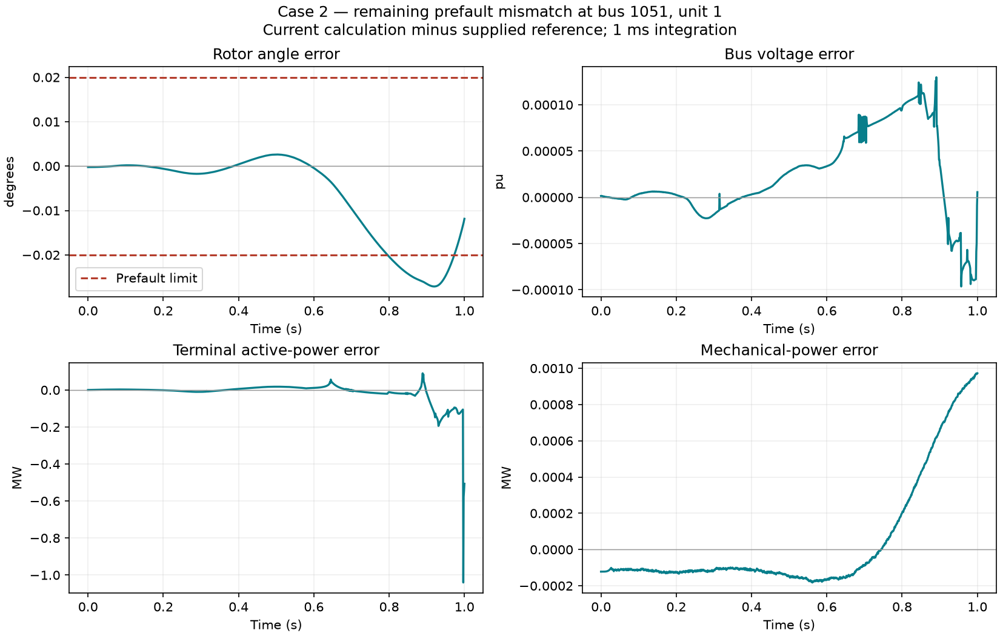

# Case 2 accuracy regression and measurement-stage recovery

The recent synchronous-machine current refresh changed the numerical boundary
used by controller inputs and electrical derivatives. It was not a harmless
cache optimization. Restoring the preceding network-injection boundary recovers
the much closer Case 2 trajectory when the earlier initialization and integration
protocol are also restored.

The ten-second recovery calculation passes all 2,000 voltage channels in both
periods and all 103 full-window rotor-angle channels. One prefault rotor channel
still fails. This is one event at a 1 ms step, with a separately computed startup
conversion; it does not establish ordinary-runner, quarter-cycle or six-case
acceptance.

## What changed

Commit `7ab448293` added a machine-current refresh after every accepted network
solve. Calling `getIxy()` also replaces cached d/q currents and air-gap power.
The next controller and electrical-state evaluations consequently consume a
different measurement boundary. Finite network convergence makes the two
boundaries numerically distinct.

The earlier [machine torque and stage audit](texas2k-native-reference-comparison-2026-10-17.md#machine-torque-and-evaluation-stage-audit-2026-10-19)
had already rejected this change for Case 2. It was subsequently introduced for
the [Case 3 endpoint-consistency diagnostic](case3-machine-endpoint-refresh-2026-10-20.md).
That diagnostic improved local replay consistency but did not pass the supplied
reference gates. Promoting it without rerunning the earlier Case 2 control
introduced a cross-case regression.

The staggered solver now exposes `MachineMeasurementStage`:

- `LAST_NETWORK_INJECTION` restores the earlier default. Machine measurements
  remain at the voltage used to assemble the final network right-hand side.
- `ACCEPTED_VOLTAGE` explicitly selects recomputation after the final linear
  solve. It remains available for the endpoint-consistency diagnostic.

The selection must be made before initialization, so it cannot silently change
the meaning of retained derivative history. The default predictor/corrector
solver is unaffected. Controller expression bindings and the recording
optimizations remain enabled.

The reference runner now reads and reports network tolerance, convergence norm,
minimum iteration count, endpoint reuse, load-Z matrix placement, converter
voltage memory and machine measurement stage from its plan. These settings no
longer require Java source substitutions for a numerical comparison. Existing
defaults are retained except for restoring the staggered machine boundary.
The requested default power-flow tolerance remains 1e-3 pu.

## Controlled evidence

With the same independently computed startup point, 1 ms step, 1e-4
complex-magnitude network tolerance, one minimum iteration, endpoint reuse,
reactive-Z matrix placement and converter voltage memory:

| Through 0.99 s | Accepted-voltage refresh | Last network injection |
|---|---:|---:|
| Maximum bus-voltage error, pu | 0.112058 | 0.000744281 |
| Maximum rotor-angle error, degrees | 10.9641 | 0.0265213 |
| Worst rotor-angle RMSE, degrees | 3.77317 | 0.0115567 |

This is the isolated refresh comparison. It does not attribute the entire
previously reported 107.90-degree error to that one edit: the performance run
also used different integration and network settings.

Disabling controller runtime optimizations reproduces the early quarter-cycle
trajectory exactly. The experimental performance overlay also reproduces it to
roundoff. Merely reducing the ordinary run to 1 ms leaves a worst full-window
rotor RMSE of 37.8787 degrees. Merely removing the current refresh at a
quarter-cycle step leaves a prefault maximum angle error of 14.2903 degrees.
Both controls fail; neither is an accuracy-qualified performance baseline.

The completed recovered ten-second run was also repeated with controller
runtime optimizations disabled. The complete binary traces have the same
SHA-256: all 10,005 rows and 4,810 channels are byte-for-byte identical. This
supports retaining those optimizations while correcting the numerical policy.

## Recomputed startup and full-window comparison

The recovery was repeated with a startup point newly calculated from today's
original-input power flow. A declared binary32 constant-source conversion uses
all 2,000 calculated bus phasors, all 199 active generator powers and the
current-P/impedance-Q load coefficients. No supplied trajectory value, selected
Q sign, fitted angle offset or internal model state is an initialization input.
The tight 1e-10 load-flow tolerance is an explicit diagnostic override; it is
not a change to the requested production default.

The dynamic solve uses the Java sparse backend in double precision. It retains
all 10,005 samples and both sides of each event. Scoring verifies the supplied
binary32 clock and matches exact 1 ms ordinals and event sides, without
interpolation. Normalization uses the full ten-second reference range and the
current [acceptance contract](texas2k-current-acceptance.json).

| Required comparison | Worst error | Limit | Passing channels |
|---|---:|---:|---:|
| Prefault voltage NRMAE | 0.000475624 | 0.001 | 2,000 / 2,000 |
| Fault/postfault voltage NRMAE | 0.00103194 | 0.015 | 2,000 / 2,000 |
| Prefault rotor maximum, degrees | 0.0271092 | 0.02 | 102 / 103 |
| Full-window rotor RMSE, degrees | 0.0731918 | 0.2 | 103 / 103 |

Direct bus-frequency measurements are absent from this supplied Parquet file.
Generator speed remains diagnostic and does not substitute for that gate.
P/Q errors are retained in the per-channel report.

The remaining prefault rotor failure is bus 1051, unit 1. Its cold angle error
is only -0.000226 degrees; the largest difference develops during the coupled
trajectory. Its prefault mechanical-power difference stays below 0.000973 MW.
A torque-only diagnostic reduces its maximum angle error to 0.024374 degrees,
still above the limit. That additional numerical change was not promoted.

## Limits and next acceptance gate

The ordinary startup path with 1e-3 power-flow tolerance still fails even at
1 ms with the restored machine boundary. Converted startup remains a separate
diagnostic calculation. Its integration into the normal runner, the remaining
bus-1051 prefault error, quarter-cycle accuracy and all other original events
remain open. The recovery run took 90.28 seconds including recording; it is
not a warm timing measurement and does not meet the runtime objective.

Future performance comparisons must retain the numerical protocol and pass
the supplied-reference gates. Agreement with another inaccurate local run is
only an implementation-equivalence check.

## Regression testing

### Confirmed reference settings and shunt-control correction

The user subsequently confirmed three distinct convergence settings for the
latest supplied Case 2 run: 0.1 MVA maximum bus mismatch for power flow,
1e-5 pu voltage correction for converted-network startup, and 1e-4 pu voltage
correction during dynamics. On the input's 100 MVA base, the power-flow setting
is 1e-3 pu. The [settings record](texas2k-case2-reference-numerics-2026-10-20.json)
separates these confirmed values from local numerical choices. The image does
not establish the exact correction norm, iteration limits or arithmetic precision.
The earlier 1e-5 dynamic controls therefore use a different stopping tolerance
from this reference; they do not qualify as matched-protocol accuracy tests.

Repeating startup at the requested 1e-3 power-flow tolerance exposed another
regression in the inner-NR continuous-shunt path. It used the power mismatch
tolerance to decide whether a voltage target was violated and whether a
temporary susceptance limit should release. It could report settled controls
while bus 8107 remained at 1.0293158 pu instead of its attainable 1.03 pu target.
The auxiliary voltage equation could also terminate using the looser power
threshold after a shunt was admitted.

Continuous-shunt admission and limit release now use the configured voltage
control tolerance. Before final convergence, an owned continuous-shunt voltage
equation outside that tolerance receives another Newton correction. Power-flow
mismatch tolerance remains 1e-3 pu; physical susceptance limits remain enforced.
Discrete control policies are unchanged. Case 2 reaches the 1.03 pu target and
finishes preparation in 16 iterations, with maximum electrical mismatch
2.39091e-5 pu.

The complete ten-second diagnostic retains the calculated startup conversion,
1 ms integration and every reference sample, including event-side duplicates.
With the confirmed stage tolerances, the isolated shunt correction changes
worst full-window rotor RMSE from 2.960 degrees to 0.072737 degrees:

| Required comparison after correction | Worst error | Limit | Passing channels |
|---|---:|---:|---:|
| Prefault voltage NRMAE | 0.000467410 | 0.001 | 2,000 / 2,000 |
| Fault/postfault voltage NRMAE | 0.00102110 | 0.015 | 2,000 / 2,000 |
| Prefault rotor maximum, degrees | 0.0267988 | 0.02 | 102 / 103 |
| Full-window rotor RMSE, degrees | 0.0727366 | 0.2 | 103 / 103 |

The remaining prefault rotor failure is still bus 1051 unit 1. Ordinary startup
integration, quarter-cycle accuracy, direct bus-frequency coverage and the other
events remain open. This result is a partial recovery, not complete acceptance.

The specialized controller and network candidate was separately compared with
the recovered 1 ms production implementation: all 10,005 rows and 4,810 channels
agree within 2.12e-10 in their recorded units. Its supplied-reference scores also
retain the same remaining prefault failure. The corrected shunt run uses this
candidate and takes 31.39 seconds including recording, excluding the separate
startup-conversion calculation. This cold diagnostic is not an end-to-end,
warmed single-core performance acceptance result.

All 134 focused tests pass after compiling the final production sources.
The new small-network regression fails before the fix: a 0.0005 pu voltage error
is ignored at 1e-3 power tolerance. Tests cover local and remote targets, both
error signs, physical bounds, and release from upper and lower temporary limits.
The wider registered-suite results below describe the preceding measurement-stage
change; that entire suite was not repeated for this isolated control fix.

Additional compact evidence is retained privately in
`verification-artifacts/2026-10-20-case2-confirmed-tolerances`.

### Measurement-stage regression tests

All 56 focused checks pass, including round-rotor and salient-pole measurement
boundaries, unchanged differential states during network evaluation, rejection
of stage changes after initialization, explicit numerical-plan reporting,
cache-neutral recording and coordinated power-flow preparation.

The registered core suite finds 2,613 tests: 2,595 pass, nine are skipped, four
abort and five fail. It is not a passing system gate. The first bounded attempt
stopped at the console-capture limit; the completed run uses warning-level
logging and a two-GiB heap.

All five failing methods reproduce with identical failure types and messages
using the pre-change solver: the Case 1 flat-run voltage-drift check and four
static exchange/large-network checks. They remain existing gate failures; no
new failure was found by this comparison.

Compact scripts, calculated startup points, numerical plans, validation results
and comparison metrics are retained under the private evidence directory
`verification-artifacts/2026-10-20-case2-accuracy-recovery`. Supplied references
and large raw traces remain hash-identified dependencies.
