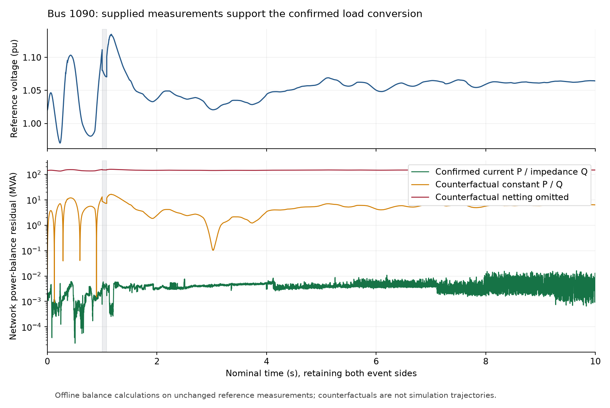

# Case 2 complete network-balance audit

The supplied full-system measurements support the confirmed current-P,
impedance-Q conversion of netted generation at bus 1090. They do not support
replacing that conversion with constant P/Q. This audit also identifies two
incorrect boundary labels in the supplied `event_active` metadata. The existing
acceptance comparison already uses event sides, so its scores are unchanged.

## Scope and independent verification

The audit covers all **10,005 rows, 2,000 bus phasors and 199 generator P/Q
channels** in the full-system bus-6307 event. It uses the completed run retained
by the [current acceptance report](fleet-boundary-localization-2026-10-19.md),
whose compressed physical trace has SHA-256
`e161775b5c2c1b38ae70896ce6a717025c5a58dd6af698a9629141d7544220df`.
The supplied Parquet hash remains
`732f330408480d8e97f4d677f487221e575749778401da1e72043919ed26f1b8`.
An earlier similarly named failed attempt is not used.

At each row, the diagnostic evaluates
`S_generation - S_converted_load - V * conjugate(Y_passive * V)`.
The matrix contains the original passive network and solved switched shunts
once. It contains no generator Norton terms or converted-load admittance.
The load term uses the unchanged computed conversion coefficients, including
netting before load conversion. The faulted bus is excluded from ranked
balances while the fault is active.

A separate implementation reads the original network records and accumulates
individual branch currents. It covers 2,359 branches, 861 transformers, two
fixed shunts and 153 controlled shunts. Reassembled matrix entries agree within
**9.10e-13 pu**. Across 59 ranked peak balances at 43 distinct clock positions,
the two balance calculations agree within **8.79e-11 MVA**. Every local row
also matches the independently reconstructed reference step/event-side key.

Reporting envelopes include binary32 magnitude, angle and generator-power
rounding, with the corresponding load sensitivity. They do not bound unknown
internal arithmetic, finite network convergence or conversion-input differences.
A residual above that envelope therefore does not by itself prove a missing
network term.

## Netted-generation check

Bus 1090 has two netted units with solved total power **141.37 MW and
16.4587169 Mvar**. Its supplied voltage ranges from 0.970342 to 1.134884 pu,
providing a substantial change over which to distinguish conversion profiles.
The following are offline balance calculations on the same measured voltages;
they are not alternative simulated trajectories.

| Load accounting at bus 1090 | Prefault maximum residual, MVA | Ten-second maximum, MVA | Ten-second RMS, MVA |
| --- | ---: | ---: | ---: |
| Confirmed current P / impedance Q | 0.006086 | 0.016246 | 0.004392 |
| Constant P/Q counterfactual | 13.070405 | 16.396932 | 5.670775 |
| Netted generation omitted | 155.305422 | 158.606617 | 147.026723 |

The coefficients and solved unit powers are not fitted to the measurements.
This check supports retaining the confirmed Case 2 preparation path; it does
not establish the other cases' behavior.

## Boundary labels and remaining residuals

The original metadata marks both of these zero-based rows as fault-inactive:

| Row | Nominal step | Event side | Supplied fault-bus voltage, pu | Physical fault state |
| --- | ---: | --- | ---: | --- |
| 1003 | 1000 | After application | 2.69593e-8 | Active |
| 1087 | 1084 | Before clearing | 2.56003e-8 | Active |

The preceding application row is 1.014869 pu and the following clearing row is
0.964037 pu. The audit uses the declared event sequence and duplicate sides,
independently checking the fault state against the fault-bus voltage. It keeps
the original metadata unchanged. The current acceptance scorer already uses
these step/event-side keys and does not use `event_active` to split periods.

The largest prefault non-generator residual beyond the reporting envelope is
0.032405 MVA at bus 4147. Its change from the cold residual stays inside the
combined reporting envelopes, as does the corresponding residual at bus 4175.
These reproduce the earlier persistent reactive-balance observations.
Among generator buses, bus 3122 has a larger changing residual: its maximum
increment beyond the combined reporting envelopes is 0.032678 MVA at 0.388 s.
Terminal-power evaluation stages and network convergence remain possible
contributors; this accounting does not identify a controller equation defect.

## Evidence and acceptance

Private evidence set `2026-10-19-case2-complete-network-balance` retains the
programs, input hashes, all-bus metrics, selected full-time traces, original
network cross-check, conversion controls and figures. Existing immutable
inputs are referenced by verified archive objects instead of copied again.
The new diagnostic files occupy about 20 MB before their evidence archive.
The initial missing-package attempt, boundary-label assertion, and verifier
precision correction remain recorded separately.

No production equation, trajectory, initial state, tolerance or supplied
measurement changed. Current Case 2 prefault rotor maximum remains
**0.0285314 degrees at 1051/1**, and full-window rotor RMSE remains
**0.203219 degrees at 1050/1**. Both exceed the current contract. The six-case,
36-event scope, direct bus-frequency evidence and runtime target remain open.
