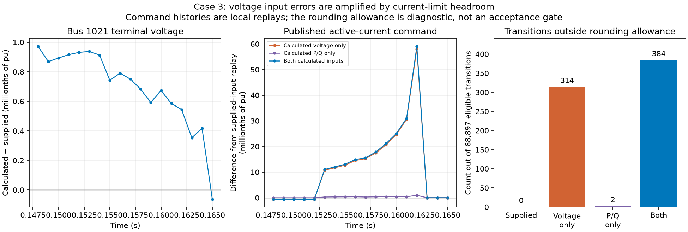

# Case 3 active-current commands and physical-input controls

The early active-current discrepancy follows terminal-voltage error. The
same controllers driven by supplied voltage and P/Q remain consistent with
the supplied active-power trajectory under an explicit rounding allowance.
Using calculated voltage reproduces almost all of the command discrepancy;
using calculated P/Q with supplied voltage produces only two outliers.

This extends the
[converter-history and recovery checks](case3-feedback-history-controls-2026-10-20.md).
It does not justify changing a current-limit equation, threshold or model
parameter. No production source changes in this slice. Full-system accuracy
and the runtime goal remain unresolved.

## Four physical-input controls

All 290 converter bundles are replayed through 0.238 seconds, before the
first previously identified recovery disagreement at bus 3051. Each replay
has 241 rows, including the two negative-time history rows. Original model
parameters, integration method and step are identical; all internal states
are derived from the same physical cold point.

| Control | Voltage and phase history | Terminal P/Q history |
|---|---|---|
| Supplied | Supplied | Supplied |
| Voltage only | Calculated | Supplied |
| P/Q only | Supplied | Calculated |
| Both | Calculated | Calculated |

The calculated histories come from the existing machine-current-refresh
diagnostic. The mixed controls prescribe physical inputs and are not
autonomous simulations. The two unmixed runs reproduce their retained
physical-output prefixes byte-for-byte after decompression despite adding
observations for every converter.

An independent scalar calculation reproduces all 278,400 active-current
rates and all 278,400 advanced active-current states exactly, including
rate limiting, low-voltage state ceilings and binary32 STORE/STATE
arithmetic. This establishes consistency of the local command-to-state
boundary. It does not establish the reference simulator's internal
arithmetic or complete model accuracy.

## Command consistency with exported active power

When low-voltage current scaling and state/rate ceilings are inactive,
the supplied terminal measurements give a current estimate:

```text
x[k] = P[k] / (V[k] * MBASE)
```

For a lag with time constant `Tg`, the two-step update driven by the
published commands has the real-arithmetic identity:

```text
x[k+1] = x[k] + h/Tg * (1.5*(u[k] - x[k]) - 0.5*(u[k-1] - x[k-1]))
```

The audit compares this predicted next current with the exported P/V
estimate. It permits the half-ULP export cells, two binary32 relative
rounding terms for terminal-power formation, both entered and binary32
machine bases, and five unit-roundoff storage/product terms. Time step and
lag time constant use their binary32 representations.

This is a declared conservative uncertainty model for diagnosis. It is
neither a proven description of every reference arithmetic operation nor
a replacement acceptance tolerance. An in-range residual is consistency
evidence, not proof of exact command equality.

Each control has 68,897 eligible transitions. Another 123 are excluded
because current scaling or a state/rate ceiling can invalidate the linear
identity. Negative-time transitions are not scored.

| Input control | Outside declared allowance | Largest absolute next-current residual, pu |
|---|---:|---:|
| Supplied | 0 | 1.95063e-7 |
| Calculated voltage only | 314 | 3.73710e-6 |
| Calculated P/Q only | 2 | 1.17752e-6 |
| Both calculated | 384 | 3.79855e-6 |

The first out-of-allowance transition with both calculated inputs occurs
at 0.153 s at bus 1021, unit 1. Its largest residual occurs at the same
unit at 0.162 s. The two P/Q-only outliers are at bus 2109, unit 1,
at 0.195 and 0.196 s. These counts do not establish that P/Q feedback is
irrelevant later in the trajectory.



## Current headroom amplifies the voltage discrepancy

For the selected Q-priority controllers, the active-current command is
limited by the preceding published reactive-current command:

```text
headroom = sqrt(max(0, Imax² - preceding_Iq_command²))
Ip_command = max(0, min(Porder / filtered_voltage, headroom))
```

The relevant current tables are inactive. An independent calculation
reproduces 392 selected command publications with this equation, without
altering the inputs or fitting a gain.

At bus 1021, unit 1, at 0.162 s:

| Quantity | Supplied-input replay | Calculated-input replay |
|---|---:|---:|
| Terminal voltage, pu | 0.824346125126 | 0.824346669565 |
| Preceding reactive-current command, pu | -1.291836639519 | -1.291829990662 |
| Active-current headroom and published command, pu | 0.145458230416 | 0.145517267791 |
| Unlimited active-current command, pu | 0.719047154068 | 0.719046513090 |

The terminal-voltage difference is 0.544439 millionths of a pu. The
reactive-command difference is 6.648857 millionths, and the active-command
difference is 59.037375 millionths. The square-root headroom equation
explains the latter amplification; these values do not identify a bad
limiter equation. All command quantities in this table are locally
replayed observations, not exported internal reference channels.

## Verification and next boundary

The independent verifier checks all four command histories, their input
substitutions, derived initialization, and 1,102,352 residual/allowance
fields. Its largest scalar disagreement is 5.58e-16. The unchanged
physical-output checks and source hashes protect against observation
instrumentation changing the trajectory.

These controls narrow the next investigation to the preceding network
voltage and machine-source/startup boundary. They do not support changing
the controller's recovery threshold or adding an artificial deadband to
suppress the error.

No new one-second coupled improvement is established. The retained
refreshed diagnostic still reaches 0.111939 pu voltage error and
3.10847 degrees rotor-angle error. The inferred maximum-25 network
continuation policy remains unconfirmed, with 471 unconverged stops in that
run. The supplied metadata archive does not contain solver iteration
settings. All six cases, the original 36 events, full ten-second accuracy,
direct bus-frequency coverage and the 20-second runtime target remain open.

Compact evidence is retained under
`ipss.test.plugin.core/testData/private/verification-artifacts/2026-10-20-case3-active-command-inputs-v2`.
Large state traces and original supplied results remain compressed,
hash-identified dependencies rather than duplicate archive contents.
The first archive attempt included its still-changing console log and failed
the independent hash check. The corrected archive excludes active archive
logs; the numerical run and comparison artifacts are unchanged.
