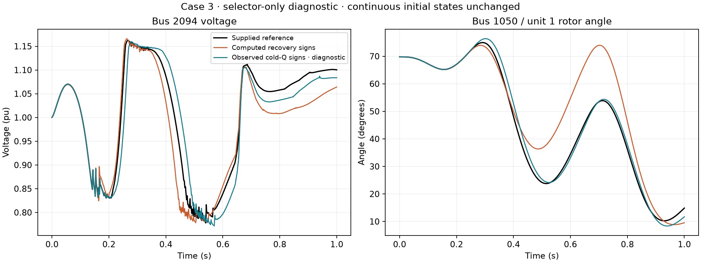

# Case 3 conversion rounding and recovery direction

The full-system reference localizes a substantial part of the Case 3 prefault
discrepancy to the recovery direction selected from nearly zero initial
reactive power. Changing only those discrete directions in a diagnostic
reduces the worst prefault rotor-angle error from 26.6981 to 4.81898 degrees.
The result still fails the acceptance target. It does not establish an
initialization rule or justify adopting reference-derived selectors in
production.

This continues the
[full-reference boundary investigation](case3-full-reference-boundary-localization-2026-10-20.md).
No production model, numerical tolerance or acceptance limit changes in this
slice.

## Selector-only diagnostic

The original case defines 117 converters with Q, Qmin and Qmax all exactly
zero. After ordinary local conversion, 55 have a different reactive-power
sign from the supplied cold physical observation. REGCA1 uses the sign of
initialized Q to select its recovery-rate bound. The applicable rate bounds
are zero for this cohort, so a small sign difference has a finite dynamic
effect.

The diagnostic examines the entire predeclared 117-unit cohort. It changes
only the sign used by this selector, retaining its magnitude for nonzero
signs and using exactly zero when the observed cold Q is zero. All 623
device snapshots have identical continuous initial states and other
metadata; only the two selector-related metadata fields differ. The first
physical sample and all operating-point inputs are identical.

Both runs use the corrected participation-based operating point, 1 ms
integration, two cold-history steps, the confirmed current-P/impedance-Q
load profile, a network stopping threshold of 1e-4 and single-precision
factorization. The comparison covers all 6,578 matched physical channels.
Voltage NRMAE is mean absolute error divided by the channel's supplied
full-ten-second range. Rotor errors below are maximum absolute errors,
not RMSE.

| Window and measure | Computed recovery directions | Observed cold-Q directions, diagnostic |
|---|---:|---:|
| Through 0.1 s: worst voltage error, pu | 0.0138382 | 0.0000706185 |
| Through 0.1 s: worst voltage NRMAE | 0.0262039 | 0.0000572746 |
| Through 0.1 s: voltage channels below 0.001 NRMAE | 761 / 2,000 | 2,000 / 2,000 |
| Through 0.1 s: worst rotor error, degrees | 0.0163123 | 0.0173255 |
| Full prefault second: worst voltage error, pu | 0.237116 | 0.115477 |
| Full prefault second: worst voltage NRMAE | 0.236324 | 0.0657062 |
| Full prefault second: worst rotor error, degrees | 26.6981 | 4.81898 |

All 333 rotor channels meet the 0.02-degree limit through 0.1 seconds in
both runs. Over the complete prefault second, no voltage or rotor channel
passes its respective limit in either run. The worst rotor channel changes
from 1051/1 to 1050/1; these are fleet maxima, not two errors at one machine.
The diagnostic's largest voltage error is at bus 2094, and its largest
voltage NRMAE is at bus 2029.

The 0.1-second run and the prefix of the full-second run are byte-identical
across all 103 physical samples, including both negative-history samples.
Scoring uses 101 and 1,001 nonnegative prefault samples, respectively.
The supplied clock and event-side duplicates remain in the retained files;
the plot uses nominal 1 ms sample time. No fitted time shift or angle offset
is applied.

These signs come from supplied physical measurements, rather than directly
recorded internal selectors in the full-system run. The diagnostic
establishes sensitivity and narrows the cause; it is not independent
trajectory acceptance.

## Conversion-stage evidence

A separate finite two-bus reference experiment uses the original 1083/2
REGCA1/REECA1/REPCA1 constants, P = 718.043 MW, Q = 0 and machine base
1,994.563 MVA. Only the common angle orientation changes between controls.
No controller parameter, initial state or selector is overridden.

The observed Q remains exactly zero after power flow, generator conversion
and load conversion. The small nonzero quantity first appears after the
converted-network solution. The initialized internal Q variable then
agrees with that converted Q, expressed on system base.

| Common angle orientation, degrees | Converted Q, Mvar |
|---|---:|
| 0 | +0.00003282123 |
| 16 | -0.00002384186 |
| 32.116741 | -0.00002384186 |
| 48 | -0.00009536743 |
| 64 | 0 |

Independent cold repetitions at 0 and 32.116741 degrees reproduce every
exported sample exactly. All accepted probes report successful initial
conditions and retain plausible active current, terminal voltage and
active power. A preliminary probe with an incorrect generator bus type
is explicitly rejected and excluded from the evidence above. Two sandbox
runtime-import stalls are also retained as failed attempts, without
measurements.

The experiment demonstrates sensitivity to conversion arithmetic and
angle orientation in this reference implementation. It does not identify
the exact arithmetic order for the full-system converted solution.
A partial arithmetic reconstruction does not reproduce all phase controls,
so no reconstruction, small-Q deadband or uniform sign replacement is
adopted.

## Remaining network discrepancy

An independent audit reconstructs physical power balance at all 2,000
buses from the original passive network, solved switched shunts included
once, the declared voltage-dependent loads and all 625 generator P/Q
pairs. The two confirmed model-less units contribute negative
current-P/impedance-Q loads. No computed residual is injected into a
simulation.

| Maximum reconstructed power-balance residual | Supplied trajectory | Selector diagnostic |
|---|---:|---:|
| Through 0.1 s, MVA | 0.249264 | 0.249517 |
| Full prefault second, MVA | 3.166427 | 0.254264 |

The supplied full-second maximum occurs at bus 2029 around 0.766 seconds.
A conservative bound for rounding of the exported voltage magnitudes,
angles and generator powers at that sample is 0.001004 MVA. Export
rounding alone therefore does not explain the reconstructed residual.
This bound does not include differences in source parameters, matrix
arithmetic, load preparation or the stage at which channels are sampled.
The audit does not establish that the reference solver failed to converge.
Its convergence threshold and maximum iteration count are still needed
to interpret this finding.

## Reproducibility and open gates

The private evidence set `2026-10-20-case3-conversion-recovery-signs` retains
the exact producers, inputs, runtime/source hashes, successful and failed
probe records, per-channel metrics, comparison plot and independent
verification. Large original traces and supplied Parquet parts remain
protected by dependency hashes without duplicate expanded exports.

The independent verifier rechecks runtime and source hashes, the 117-unit
cohort and 55 changes, unchanged cold states, exact prefix repeatability,
extreme-channel metrics, reference stage observations and both cold
repetitions. It separately reconstructs the bus-2029 residual and its
export-rounding bound using scalar arithmetic.

The initialization protocol for final benchmarking remains unresolved:
independently solving the original case and starting both tools from the
supplied cold operating point answer different questions. No supplied
operating point has been adopted as a new acceptance convention.

Production integration, full-ten-second and postfault agreement, all six
cases and the original 36 events, direct bus-frequency validation, and the
20-second runtime target remain open. The supplied full-system exports
contain machine speed but no direct bus-frequency channels.
