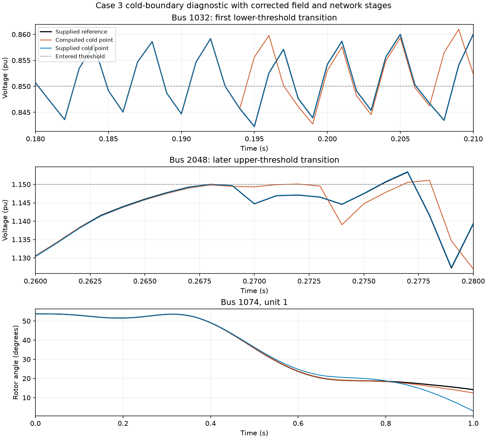
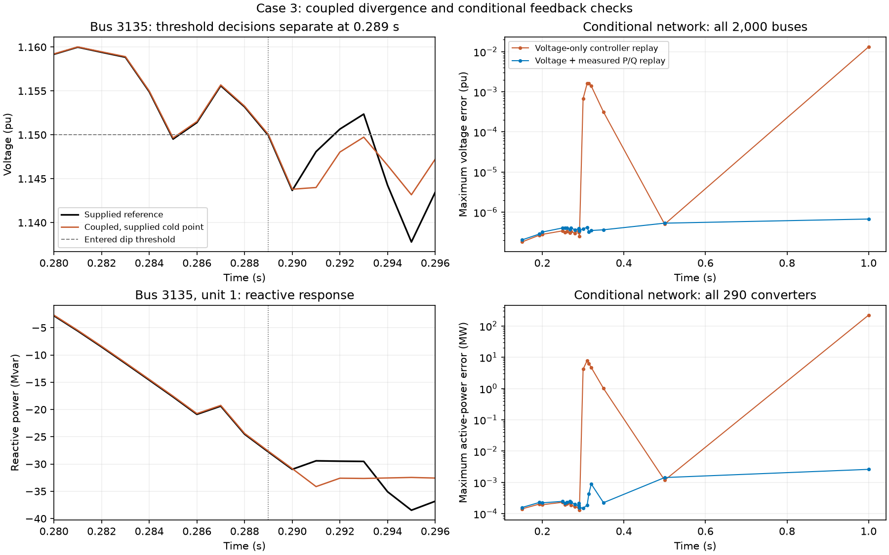

# Case 3 cold operating point and converter feedback checks

Using the supplied cold operating point resolves the earlier control-threshold
disagreements at buses 1032 and 2048, but the coupled simulation still fails
the prefault limits. Its next substantial voltage disagreement begins at
0.291 s, following opposite threshold decisions at bus 3135.

The converter replay also needs terminal P/Q feedback after network-dependent
current limiting starts. Adding those measured inputs makes the conditional
network agree closely with the supplied measurements. A separate check using
the coupled run's own inputs reproduces its outputs, so these results do not
establish a missing feedback update in the coupled solver.

This diagnostic follows the
[machine-source and network-precision controls](case3-prethreshold-source-controls-2026-10-20.md).
It changes no production source, entered model parameter, threshold or
acceptance limit.

## Supplied reference inventory

All six full-system bus-6307 datasets are present and their retained parts
have been checked again against their recorded SHA-256 hashes. There are
11 Parquet files totaling 683,087,481 bytes, including the previously
downloaded Case 2 file, which is reused without a duplicate copy. The other
five cases each have two parts. The metadata archive is retained separately.

Each case has 10,005 rows, including two negative-time history rows and
duplicate fault-application and clearing timestamps. Every case contains
2,000 bus-voltage and 2,000 bus-angle channels, generator P/Q and synchronous
machine channels. Direct bus-frequency channels are absent.

The immutable import manifest is under
`ipss.test.plugin.core/testData/private/reference-imports/texas2k-full-system-bus6307-1ms-20261020/local_reference_manifest.json`.
The supplied reference remains the accuracy authority.

## Cold operating point control

The new run initializes all 2,000 bus voltages and phases and all 623 active
dynamic-device P/Q values from the supplied first row. Every model derives
its internal states from those physical inputs. It makes no recovery-selector
overrides; all 117 examined recovery directions agree with the supplied cold-Q
sign. The earlier computed-point control retains its 55 diagnostic overrides.

The current-P/impedance-Q load coefficients remain unchanged. The two netted
units, 5045/1 and 7099/2, retain their original negative current/impedance
coefficients. Original input records, switched-shunt settings and model
parameters are preserved.

Both controls use the same field-stage candidate, double-precision dynamic
LU, 1 ms step and inferred maximum-25 iteration continuation policy.
The reference iteration setting remains unconfirmed. The supplied cold point
is a diagnostic boundary, not an accepted autonomous preparation procedure.

The first physical row agrees with the reference to 6.22e-15 pu in voltage,
2.06e-13 degrees in bus angle, 8.36e-12 MW in generator P and 1.05e-11 Mvar
in generator Q. Derived rotor angles differ by at most 8.99e-5 degrees.

| Prefault comparison through 1.0 s | Computed cold point | Supplied cold point |
|---|---:|---:|
| Largest voltage error, pu | 0.122767 | 0.148419 |
| Worst voltage NRMAE | 0.0710040 | 0.0858539 |
| Voltage channels passing NRMAE < 0.001 | 32 / 2,000 | 0 / 2,000 |
| Largest rotor-angle error, degrees | 3.05261 | 24.2224 |
| Rotor channels passing maximum error < 0.02 degrees | 0 / 333 | 0 / 333 |
| First voltage error above 0.001 pu | 0.195 s | 0.291 s |
| Unconverged iteration-limit stops | 473 | 469 |
| Diagnostic runtime, seconds | 225.85 | 223.36 |

All 6,578 matched channels and 1,003 retained samples are compared; the two
negative-time rows are excluded from scores. Voltage NRMAE uses each
channel's full ten-second supplied range. The new matrix differs from the
previous matrix by at most 7.11e-15 and is factored once for 19,000 solves.
All 469 limit stops remain explicitly marked unconverged. These recording-heavy
runtimes do not measure the quarter-cycle performance target.

The first two panels show the corrected threshold responses. The third shows
one rotor-angle example; the largest rotor error in both controls is at
bus 1051, unit 1, as reflected in the table.

## Next threshold disagreement

At 0.289 s, bus 3135 has a supplied voltage of 1.149922967 pu and a coupled
voltage of 1.150032484 pu. They lie on opposite sides of the entered
1.15 pu upper dip threshold. By 0.291 s the voltage difference is
0.00408807 pu, with a corresponding reactive-response separation.

The discrepancy is already accumulating before that decision. At 0.280 s,
unit 1's Q is -2.694495 Mvar locally versus -2.805692 Mvar in the reference.
The threshold is unchanged; moving it would conceal the preceding difference.

## Converter feedback discriminator

All 290 converter/controller bundles are replayed through the same 1,003
samples, starting from the supplied physical cold point. The maximum initial
state difference from the coupled startup record is 4.45e-16. Two controls
prescribe either terminal voltage alone or voltage plus terminal P/Q at the
controller measurement boundary. Their internal states evolve locally.

The second control uses the preceding P/Q sample during advancement and the
current P/Q sample during endpoint algebraic refresh. Predicted converter
currents remain computed from model states. This is an input-boundary
diagnostic, not a free-running simulation.

Nineteen independent network endpoints from 0.150 through 1.000 s then use
these replayed regulator states, supplied preceding network voltage and
synchronous Norton sources inferred from supplied P/Q/V. Each endpoint
recalculates the iterative high-voltage correction and the final output
evaluation. Converter P/Q is computed from solved voltage, regulator states
and that correction; it is not copied from the measurement input.

| Largest error across the 19 endpoints | Voltage-only replay | Voltage plus P/Q replay |
|---|---:|---:|
| Voltage, all 2,000 buses, pu | 0.0131489 | 6.74547e-7 |
| Active power, all 290 converters, MW | 221.701 | 0.00261018 |
| Reactive power, all 290 converters, Mvar | 8.79301 | 0.000364030 |

Both controls stop without convergence at 15 of the 19 endpoints under the
inferred maximum-25 policy. The remaining endpoints meet the fixed complex
voltage-change tolerance. Linear residuals stay below 1.84e-12.

The earlier voltage-only replay applied only the endpoint high-voltage
correction. It therefore did not supply complete network-dependent power
feedback to the controllers. Its later regulator states must not be used as
fully reference-conditioned boundaries. The new control corrects that
diagnostic limitation; its agreement does not establish coupled acceptance.

Only the 19 marked times are solved in the conditional panels. Connecting
lines guide the eye and do not represent additional evaluated samples.

## Local runtime consistency

A third replay supplies the coupled run's own recorded voltage and terminal
P/Q to the same 290 bundles. The subsequent conditional reconstruction uses
that run's preceding voltages and synchronous source measurements.

Through 0.310 s, all tested network endpoints reproduce the local voltages
within 1.12e-15 pu and converter P/Q within 5.69e-13 MW/Mvar. Across all
19 endpoints through 1.0 s, the largest differences are 1.10e-9 pu,
3.00e-7 MW and 4.27e-6 Mvar. This checks stage consistency against the local
run; it is not independent reference accuracy.

The result supports the existing converter/controller coupling at these
boundaries. The next investigation should locate the small accumulated input
and state differences before 0.289 s, with the complete feedback boundary,
rather than infer a missing update from the voltage-only replay.

## Verification and retained evidence

Independent scalar checks recalculate all 13,156 channel-metric records and
105,248 associated fields. They verify the physical cold boundary, unchanged
load coefficients, selector directions, explicit nonconvergence, matrix
identity and factorization reuse. Both reference-boundary converter replays
retain all 581,740 device samples. Their 581,740 prescribed P/Q values match
the supplied measurements exactly.

A separately expressed inverse-based network calculation checks all 38
reference-boundary endpoints and 11,020 converter output records. It agrees
with the LU calculation within 1.78e-15 pu in maximum voltage error and
1.81e-12 across recorded converter outputs. Its matrix inverse residual is
1.05e-14. The passive-network assembly is shared, so this cross-check verifies
the diagnostic arithmetic rather than independently proving the input model.
The same independent calculation checks the 19 local-boundary endpoints and
5,510 associated converter records, with maximum voltage-result disagreement
of 2.67e-15 pu. Every replayed local voltage and P/Q input is also checked
against its originating coupled sample.

The initial converter-replay compilation attempt stopped before execution
because it selected a trace helper with an incompatible constructor. The
successful retry explicitly compiled the matching helper. Both attempts are
retained. Full traces remain compressed dependencies rather than duplicate
archive contents; the 2 GiB free-space guard remains enabled.

Private evidence is under
`ipss.test.plugin.core/testData/private/verification-artifacts/2026-10-20-case3-corrected-cold-boundary/`.
The coupled prefault limits still fail. Autonomous initialization, confirmed
reference iteration settings, production integration, all six cases and
36 original events, full ten-second acceptance, direct bus-frequency
validation and the 20-second runtime target remain open.
