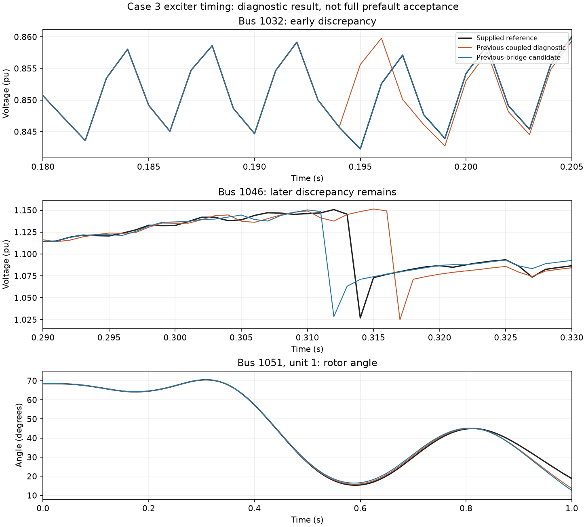

# Case 3 field-application timing diagnostic

An ESST4B field-application timing candidate removes the large early voltage
disagreement at 0.195 seconds, but does not pass the complete prefault
comparison. The one-second run still reaches 0.122293 pu voltage error and
6.23747 degrees rotor-angle error. No production implementation or model
support classification changes in this slice.

This follows the
[machine storage and controller-boundary controls](case3-machine-boundary-controls-2026-10-20.md).
The supplied full-system reference collection is available for all six cases:
10,005 samples per case, two negative-time history rows, and original
event-side duplicate timestamps. All 11 local Parquet files were rechecked
against their retained hashes. The existing Case 2 file is reused.

## Evidence for the stage discrepancy

An independent electrical-state replay matches the local implementation for
all 313 round-rotor machines: maximum state disagreement is 4.44e-16 pu and
maximum terminal-power disagreement is 6.78e-12 MVA. This uses exactly the
terminal-voltage values serialized to the replay, rather than silently
substituting higher-precision values from the Parquet measurements.

The original supplied 0.5 ms recordings contain more internal states than
the full-system export. Their state increments separate the field voltage
reported as an output from the field voltage applied to machine derivatives.
For 17 ESST4B machines, using the current regulator command with the preceding
endpoint's physical bridge inputs reduces the largest one-step Eq' residual
from 2.41812e-6 to 1.46563e-7 pu. This check covers 1,982 samples per machine,
ending near 0.9895 seconds.

The candidate is defined by integration stages, without a fitted time shift:

- Capture bridge voltage before advancing the states.
- Use the newly advanced regulator command with that captured bridge voltage
  when evaluating the machine's electrical derivatives.
- Keep the reported field-voltage output evaluated with current inputs.

The recorded-state discriminator has zero bridge feedback, integral gain,
current compensation, reactance compensation and phase shift in the
relevant ESST4B parameters. The runtime candidate explicitly rejects nonzero
bridge-feedback gain. Events, inactive machines, reconnect, reinitialization
and other parameter profiles remain unverified.

## Replay with locally evolved machines and controllers

All 333 synchronous machines retain their original calculated cold states.
Only supplied terminal-voltage magnitude and phase are prescribed. Machine
states, controller states and controller outputs evolve locally. The fresh
unchanged replay reproduces the retained baseline prefix byte for byte.

| Maximum absolute error through 0.193 s | Previous stage | Candidate |
|---|---:|---:|
| P, MW | 0.0329849 | 0.00428813 |
| Q, Mvar | 0.0410337 | 0.00928598 |
| Rotor angle, degrees | 0.00121820 | 0.00107042 |
| Speed deviation, pu | 1.58755e-6 | 3.36910e-7 |
| Field voltage, pu | 0.00122797 | 0.000594978 |

P RMSE improves for all 208 machines with the affected exciter; the other
125 are unchanged. Q RMSE improves for 177, worsens for 31 and is unchanged
for 125. This is evidence about the declared replay boundary, not complete
network acceptance.

## Coupled-network result

Both coupled runs use the same original computed operating point, model
parameters, current-P/impedance-Q load profile, 1 ms step, numerical solver
and entered hydro gate limits. Both retain 55 earlier diagnostic
recovery-selector changes derived from supplied cold measurements.
Those changes are not an accepted autonomous initialization rule.

All 6,578 matched channels are scored. Four reference-only P/Q channels
belong to the two netted units and remain zero. Negative-time history is
retained and excluded from scoring. Voltage NRMAE uses each channel's
complete ten-second reference range.

| Through 0.2 s | Previous stage | Candidate |
|---|---:|---:|
| Largest voltage error, pu | 0.0133437 | 0.000487338 |
| Worst voltage NRMAE | 0.000528827 | 0.0000663280 |
| Largest rotor-angle error, degrees | 0.00111257 | 0.00125785 |
| Bus 1032 voltage error at 0.195 s, pu | 0.0133437 | 0.0000223412 |

Extending the candidate through one second does not preserve that agreement.

| Complete prefault prefix through 1.0 s | Previous stage | Candidate |
|---|---:|---:|
| Largest voltage error, pu; bus 1046 | 0.121544 | 0.122293 |
| Worst voltage NRMAE | 0.0688455 | 0.0436165 |
| Voltage channels passing NRMAE < 0.001 | 27 / 2,000 | 13 / 2,000 |
| Largest rotor-angle error, degrees; 1051/1 | 5.17472 | 6.23747 |
| Rotor channels passing maximum error < 0.02 degrees | 0 / 333 | 0 / 333 |

The candidate first exceeds 0.001 pu voltage error at 0.257 s, at bus 2059:
reference 1.2037331 pu, calculated 1.2007508 pu. Its first error above
0.01 pu occurs at bus 2029 at 0.278 s. These provide the next boundaries
for localization; they do not by themselves identify the faulty device.

## Verification and retained evidence

Independent scalar calculations verify 104,080 metric records, including
624,480 scalar values, and 102 recorded-state timing records. The check
recomputes reference ranges from both original Parquet parts and verifies
543 source, runtime and result hashes.

The first coupled attempt was stopped by the 2 GiB free-space guard.
Its partial outputs and failure status are retained. Replacing identical
generated inputs and matrices with verified immutable hard links recovered
about 382 MB while preserving every file path and hash. The separate retry
completed. Logs and trajectories stay compressed.

The first independent metric-check attempt stopped on a capitalization
error in its reactive-power column mapping. The corrected verifier passed;
both attempts are retained. A later plot corrects the inherited scorer's
misleading "autonomous" title and scales the displayed intervals explicitly.
No numerical result was changed by those presentation corrections.

Private evidence is under
`ipss.test.plugin.core/testData/private/verification-artifacts/2026-10-20-case3-esst4b-field-stage-v2/`.
This slice changes diagnostic evidence and documentation only. Production
integration, lifecycle and nonzero-feedback verification, full prefault
and ten-second acceptance, all six cases and 36 original events, direct
bus-frequency validation and the 20-second runtime target remain open.
