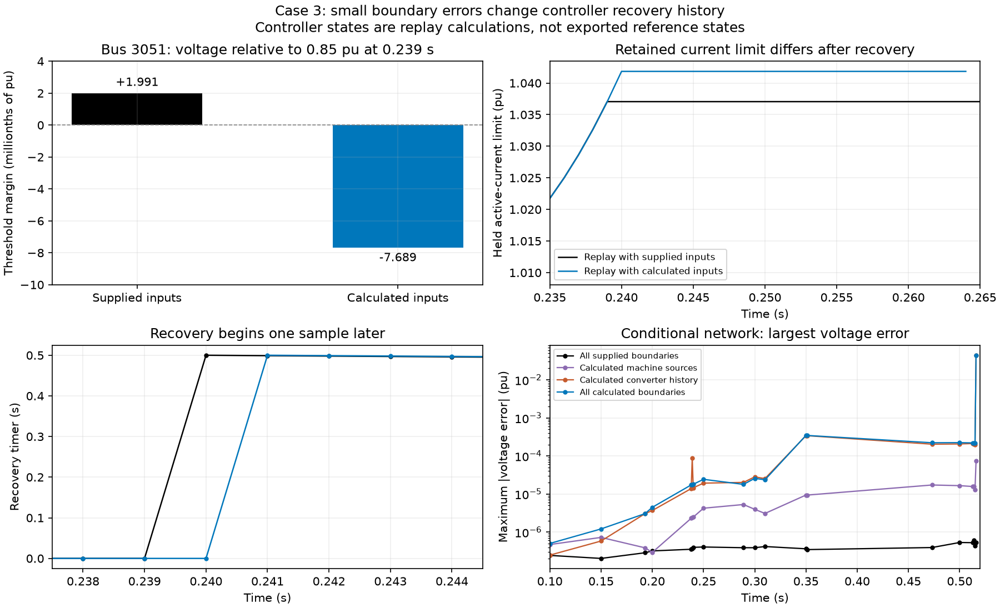

# Case 3 converter history and recovery controls

The remaining early voltage error is dominated by accumulated converter
active-current history. At bus 3051, this small error changes the recovery
decision by one millisecond and retains a different active-current limit.
Individual-device checks show that the preceding error is distributed
across converters. They do not establish a single defective device.

These are diagnostic calculations following the
[accepted-voltage machine-current refresh](case3-machine-endpoint-refresh-2026-10-20.md).
No production equations or acceptance limits change in this slice.
The six-case trajectory and runtime goals remain open.

## Supplied data and replay boundaries

All six full-system bus-6307 exports are retained locally as original
compressed Parquet files. The previously downloaded Case 2 file is reused
by its verified hash. Each case has 10,005 rows, including two negative-time
history rows and duplicate fault-event timestamps. Supplied metadata is
retained alongside the files. There are no direct bus-frequency channels.

Two converter replays use the same original input records and derive
internal states from the same physical cold point. One receives supplied
voltage, phase and terminal P/Q; the other receives the refreshed coupled
run's corresponding quantities. Both cover 290 converters and 1,003 samples
through 1 s. An exact-field check verifies 2,202,588 physical input values.
The supplied-input replay reproduces the preceding supplied-input replay
byte-for-byte after decompression.

The term **supplied-input history** below refers to locally calculated
controller states driven by supplied physical measurements. Controller
internal states are not present in the supplied full-system exports.

## Recovery at bus 3051

At 0.239 s, the supplied voltage is 0.850001990795 pu and the calculated
voltage is 0.849992311108 pu. These lie on opposite sides of the entered
0.85 pu recovery threshold. The supplied-input replay starts recovery at
0.240 s; the calculated-input replay starts at 0.241 s. Their retained
active-current limits are respectively 1.03706101314 and 1.04184822568 pu.

These comparisons preserve the threshold, sample times and internal
recurrence. No offset, time shift, gain or internal-state correction is
fitted to the measurements.

## Conditional network attribution

At each selected endpoint, the network is recalculated using combinations
of supplied-input or calculated-input converter histories, synchronous
machine sources, and preceding bus voltages. None of these substituted
endpoints is integrated forward or used for trajectory acceptance.

Across 20 selected endpoints and eight combinations:

- The fully calculated inputs reproduce the coupled voltage magnitudes
  within 2.84e-9 pu.
- The fully supplied inputs produce a largest voltage error of 6.75e-7 pu.
- An independent inverse-based network calculation agrees with the
  factorized calculation within 2.89e-15 pu and reproduces every iteration
  count and convergence status.

At 0.238 s, the largest voltage errors against the supplied measurements
are:

| Conditional calculation | Largest voltage error, pu |
|---|---:|
| All supplied inputs | 3.53e-7 |
| Calculated machine sources only | 2.30e-6 |
| Calculated converter histories only | 1.39e-5 |
| All calculated inputs | 1.73e-5 |

At 0.516 s, calculated converter histories alone produce a 0.04416 pu
error. This is consistent with the later coupled divergence following the
bus-2029 threshold disagreement. Conditional effects are nonlinear and
must not be assumed additive.

## Individual converters and history coordinates

Replacing one converter's history at a time gives 580 conditional
calculations: 290 devices at 0.200 s and again at 0.238 s. All preserve the
baseline iteration count at their respective endpoint.

At 0.238 s, the largest individual contribution to bus-3051 voltage comes
from bus 2029, unit 2: -4.23e-7 pu, approximately 6.2% of the combined
-6.83e-6 pu converter-history effect. Bus 3122, unit 1 is next at
-3.05e-7 pu. This is evidence of a distributed discrepancy.

Separate substitutions of each history coordinate across all converters
give:

| Coordinates replaced at 0.238 s | Change in bus-3051 voltage, pu |
|---|---:|
| Active-current states | -7.88762e-6 |
| Reactive-current states | +1.05714e-6 |
| Saved network voltage | 0 |
| All three coordinates | -6.83048e-6 |

The zero saved-voltage effect applies to this endpoint and does not imply
that voltage memory is generally inactive. The independent inverse
calculation verifies all 580 device records and 4,060 scalar fields within
3.11e-15 in their respective coordinates.

Bus 3122 illustrates an earlier retained difference without a switching-time
disagreement. At 0.168 s, its held active-current limits are 0.408630349854
and 0.408646164469 pu. Both replays start recovery at 0.169 s. Their
previous-dip flags agree throughout the interval through 0.238 s.

The next equation-level investigation should therefore follow active-current
commands, limiter headroom and their integration-stage inputs before the
bus-3051 crossing. Changing a single converter or adjusting its threshold
is not justified by these checks.

## Fixed controls that did not resolve the mismatch

Three separate one-second coupled controls test specific representation
choices. All retain the accepted-voltage machine-current refresh, field-stage
candidate, 1 ms step, original model equations, and inferred maximum-25
network continuation policy.

| Control | Largest voltage error, pu | Worst voltage NRMAE | Largest rotor error, degrees |
|---|---:|---:|---:|
| Existing refreshed diagnostic | 0.1119389 | 0.0329048 | 3.10847 |
| Real dynamic-input literals stored as binary32 | 0.1119378 | 0.0329047 | 3.10838 |
| Physical initial point from supplied metadata | 0.1119269 | 0.0328941 | 3.10663 |
| Controller P/Q and voltage/frequency measurements stored as binary32 | 0.1119201 | 0.0328931 | 3.10628 |

Each still first exceeds 0.001 pu voltage error at 0.516 s. Each has
47 of 2,000 voltage channels below the prefault NRMAE limit and none of
333 rotor channels below the prefault maximum-error limit. These controls
do not justify adopting a precision change or metadata-boundary substitution
as a production fix.

The dynamic-input control changes 29,160 of 30,672 real fields by the fixed
binary32 rule. The metadata control verifies 5,246 physical fields against
the supplied metadata, preserves total current-P/impedance-Q coefficients,
and changes no derived selector signs. The measurement control contains
exactly four declared source edits in an isolated overlay. Each comparison
has an independent recomputation of all 105,248 scalar metric fields.

Scores exclude the two negative-time history rows. Voltage NRMAE uses the
full ten-second reference range. All coupled controls retain 471 explicitly
unconverged iteration-limit stops; the reference iteration setting remains
unconfirmed. These one-second diagnostics do not establish full ten-second
acceptance or validate the complete production checkout.

## Retained evidence

The supplied-file manifest is
`ipss.test.plugin.core/testData/private/reference-imports/texas2k-full-system-bus6307-1ms-20261020/local_reference_manifest.json`.

Compact diagnostic evidence is retained under
`ipss.test.plugin.core/testData/private/verification-artifacts/2026-10-20-case3-feedback-history-controls`.
Scripts, summaries, small state tables and plots are archived. Large
compressed traces and supplied files remain hash-identified dependencies,
without duplicate archive copies.
