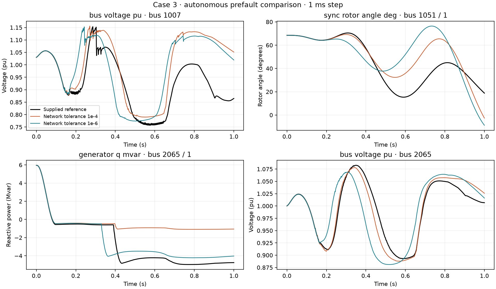
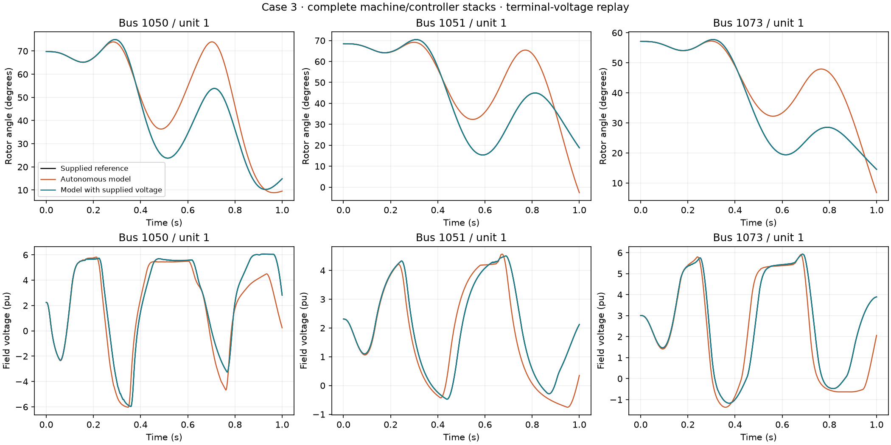
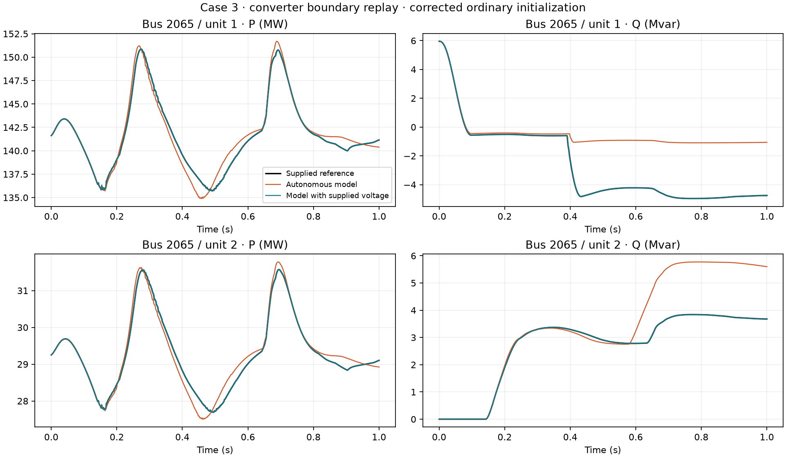

# Case 3 localization using the full-system reference

The new full-system measurements distinguish a remaining initialization
sensitivity from the large downstream rotor-angle errors. After the
[reactive-sharing correction](texas2k-reactive-sharing-2026-10-20.md), tightening
network convergence does not improve agreement. Three leading synchronous
machines and both converters at bus 2065 closely reproduce the supplied
trajectories when driven by the supplied terminal voltage. A wider converter
replay exposes substantial early errors associated with different signs of
nearly zero initialized reactive power.

These are diagnostic results. The autonomous dynamic acceptance gates remain
unmet, and this investigation changes no production equation, initial state,
selector or acceptance limit.

## Convergence control

Both autonomous runs use the corrected participation-based operating point,
the same original case inputs, 1 ms integration, two cold-history steps and
single-precision network factorization. Only the dynamic network stopping
threshold changes; cold initialization remains at 1e-8. All 6,578 matched
physical channels are compared over the prefault second. Voltage NRMAE uses
each channel's supplied full-ten-second range.

| Measure | Network tolerance 1e-4 | Network tolerance 1e-6 |
|---|---:|---:|
| Worst absolute bus-voltage error, pu | 0.237116 | 0.303334 |
| Worst voltage NRMAE | 0.236324 | 0.312932 |
| Worst rotor-angle absolute error, degrees | 26.6981 | 45.2755 |
| Linear solves | 26,857 | 50,097 |
| Matrix factorizations | 1 | 1 |
| Recorded elapsed time, seconds | 267.303 | 420.055 |

Factorization is reused. These elapsed times include full diagnostic recording
and concurrent workstation activity; they are not controlled performance
measurements. The tighter threshold increases solve work and worsens agreement,
so this experiment supplies no reason to adopt it as an accuracy fix.

## Prescribed-voltage localization

The replay initializes each complete device/controller stack from the ordinary
corrected local operating point. It then prescribes only terminal-voltage
magnitude and phase. Rotor angle, speed, field voltage, mechanical power and
electrical power remain computed outputs. No reference state or output is
injected, and no offset, time shift or parameter is fitted.

Every replay is also driven by the autonomous local voltage to check that the
standalone calculation reproduces the original coupled calculation.

| Device and quantity | Autonomous error | Supplied-voltage replay error |
|---|---:|---:|
| 1050/1 rotor angle, maximum degrees | 21.3592 | 0.0141083 |
| 1051/1 rotor angle, maximum degrees | 26.6981 | 0.000131589 |
| 1073/1 rotor angle, maximum degrees | 20.3043 | 0.0145326 |
| 2065/1 reactive power, RMSE Mvar | 2.79697 | 0.000185213 |
| 2065/2 reactive power, RMSE Mvar | 1.17270 | 0.0000285763 |

The bus-2065 replays reproduce autonomous P/Q within 5.69e-14 MW/Mvar.
The complete machine replays reproduce local rotor angles within 1.78e-13
degrees at 1050/1 and exactly at 1073/1. At 1051/1, a remaining local replay
closure discrepancy reaches 0.001363 degrees and 0.008483 MW. That limitation
is retained; the very small supplied-voltage error is conditional evidence,
not a complete validation of that machine's solver coupling.

The results locate most of these devices' large autonomous errors upstream
in their terminal-voltage trajectories. They do not establish autonomous
network acceptance.

## Initial reactive-power signs

The expanded replay covers all 290 active converter bundles and 580 P/Q
channels. The original RAW defines 117 of those units with Q, Qmin and Qmax
all exactly zero. Their computed converted Q is generally a small nonzero
quantity.

The established REGCA1 rate equation selects an upper rate bound when its
initialized Q is positive, a lower bound when Q is negative, and neither
bound for exactly zero. Both bounds are zero for this cohort, making the
sign consequential. The
[existing selector investigation](case3-converter-replay-selector-controls-2026-10-19.md)
already rejected uniform sign replacement. The new full reference now
provides the previously unavailable cold P/Q observations.

| Cold Q sign in the 117-unit cohort | Local initialization | Supplied physical observation |
|---|---:|---:|
| Negative | 21 | 49 |
| Zero | 0 | 7 |
| Positive | 96 | 61 |

There are 55 sign disagreements, all within this cohort. A supplied cold
physical Q channel is not a directly recorded internal recovery selector:
output arithmetic can itself introduce rounding. The observations therefore
identify a concrete initialization discriminator, rather than authorizing
per-device selector overrides.

For bus 1083/unit 2:

- The original and solved preconversion Q are exactly zero.
- Local converted initial Q is +0.001374740852 Mvar.
- Supplied cold physical Q is -0.000047683716 Mvar.
- The local-voltage replay reproduces autonomous Q within 7.11e-15 Mvar
  through 0.1 seconds.
- With the supplied voltage, Q still differs by up to 52.85154 Mvar in that
  prefix. Supplied voltage remains between 0.995643 and 1.042599 pu, below
  the converter's high-voltage threshold.

This discrepancy appears before high-voltage network correction becomes
relevant at this device. Initial conversion arithmetic and the recovery
selection boundary are the next implementation targets. No small-Q deadband,
round-to-zero rule or reference-derived selector is adopted.

The full-second fleet replay has additional closure gaps at some devices.
Its simple prescribed-voltage boundary omits the iterative high-voltage
network correction required by some later excursions. Those late fleet
errors must not be interpreted as isolated controller-equation failures.
The complete per-channel results are retained, with the short-prefix
qualification explicit.

## Evidence and outstanding gates

The private evidence set `2026-10-20-case3-full-reference-boundary-localization`
retains producers, source and runtime hashes, commands, plans, summaries,
per-channel comparisons and plots. Original compressed traces, supplied
Parquet files and factorization records remain protected by dependency
hashes without duplicate expanded exports. Output guards cap logs and traces
and retain the workstation free-space reserve.

An independent reader rechecks source/runtime hashes, confirms the isolated
convergence change, recomputes the reported extreme-channel metrics and two
selected replay metrics, and checks the 117-unit cohort and 55 observed sign
disagreements.

The prefault dynamic error remains unresolved. Full-ten-second and postfault
acceptance, all six cases and the original 36 events, direct bus-frequency
validation, production integration and the 20-second runtime target remain
open. The supplied exports contain generator speed but no direct bus
frequency.
