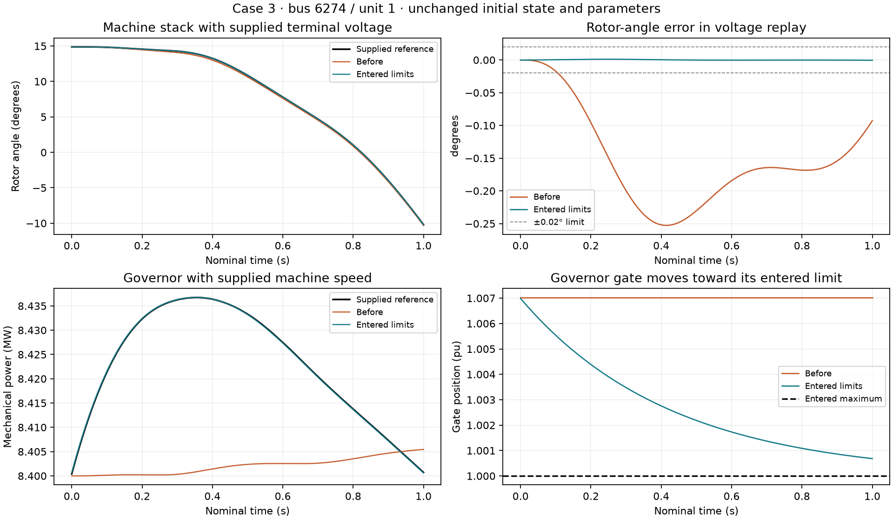
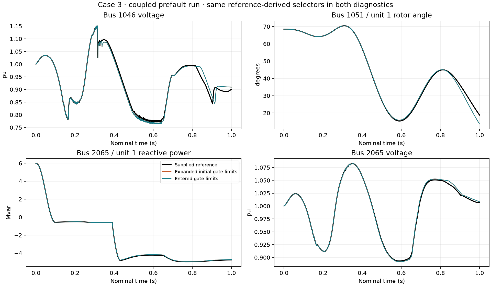

# Case 3 hydro gate limits

The supplied full-system results reveal an initialization-limit defect at
bus 6274, unit 1. The hydro governor expanded its operating gate limit to
accommodate the initial gate position, suppressing a transient present in
the reference. Retaining the entered limit reduces this machine's maximum
prefault rotor error from 0.252706° to 0.001065° when driven by the supplied
terminal voltage. The coupled full-system comparison still fails.

## Reference coverage and comparison conditions

All six supplied cases are downloaded and validated, each with 10,005 rows.
Their compressed parts, negative-time history and duplicate event timestamps
are preserved. Case 2 reuses the existing file after hash verification.
The collection includes voltage magnitude and angle at all 2,000 buses,
generator P/Q and available synchronous-machine channels. It does not
include direct bus-frequency channels. The import manifest is under
`ipss.test.plugin.core/testData/private/reference-imports/texas2k-full-system-bus6307-1ms-20261020/`.

This investigation follows the
[recovery-current memory correction](case3-recovery-hold-2026-10-20.md).
The coupled diagnostics retain the same 55 reference-derived selector
changes in the 117-unit cohort. These are diagnostic inputs; an accepted
rule for deriving those selectors from the original case is still missing.

Replay covers all 333 synchronous machines with their complete exciter,
governor and stabilizer stacks: 313 round-rotor and 20 salient-pole machines.
Only terminal voltage magnitude and angle are prescribed. Each stack retains
1,003 rows, including two negative-history rows. Scores use the 1,001 samples
from nominal zero through one second, before fault application. The comparison
uses the recorded sample order on the declared nominal grid; no fitted
time shift, rotor offset or model parameter is applied.

## Localized mechanism

The solved mechanical power initializes bus 6274's gate to 1.00702809856 pu,
above its entered GMAX of 1.0 pu. The old initialization expanded the
effective maximum to the initial gate, making its initial derivative zero.
The model-library diagram places the entered position limit before the gate
servo. Keeping that limit gives the initial gate derivative:

```text
dg/dt = (1.0 - 1.00702809856) / 0.43 = -0.0163444153 pu/s
```

The correction retains both entered position bounds. Initial power, gate,
water flow, controller states and model parameters are unchanged. A gate
outside its operating range now moves toward the entered limit.
The installed model-library section 7.15, PDF pages 404–405, provides the
equation source; its document hash is retained in private evidence.

Independent prescribed-speed replay covers all 20 hydro governors. Before
changing the model, replay of local speed reproduces local mechanical power
within 1.14e-13 MW. The correction changes only bus 6274; all other 19 hydro
outputs remain identical.

| Bus 6274/1, prefault second | Expanded limits | Entered limits |
|---|---:|---:|
| Mechanical-power maximum error with supplied speed, MW | 0.03606657 | 0.000255134 |
| Mechanical-power RMSE with supplied speed, MW | 0.02450728 | 0.000107586 |
| Rotor maximum error with supplied terminal voltage, degrees | 0.2527061 | 0.001064804 |
| Rotor RMSE with supplied terminal voltage, degrees | 0.1686235 | 0.000499813 |

The two replay conditions in the table are separate experiments. With supplied
terminal voltage, 332 of 333 machine stacks met the 0.02° prefault maximum-error
limit before the correction; all 333 meet it afterward. The other 332 stacks
have identical physical outputs before and after. The remaining largest
rotor error is 0.0194583° at bus 1052/1.

Unchanged-model replay using local terminal voltages has a maximum rotor
closure error of 0.001072° across the fleet, and 0.0000427° at bus 6274.
These finite replay errors qualify localization; replay is not an exact
replacement for the coupled numerical solve.



A small mechanical-power residual remains around startup publication.
The cold and first positive samples are retained without shifting or
discarding them. This slice does not establish the reference's internal
output-publication timing.

## Coupled network result

Both paired runs use the same converted operating point, diagnostic selectors,
corrected electrical recovery schedule, 1 ms step and solver settings.
Only the hydro gate-limit implementation changes. All 6,578 matched channels
are scored. Voltage NRMAE uses each channel's full ten-second reference range.

| Prefault measure | Expanded limits | Entered limits |
|---|---:|---:|
| Bus 6274/1 rotor maximum error, degrees | 0.603571 | 0.517570 |
| Bus 6274/1 rotor RMSE, degrees | 0.299208 | 0.178476 |
| Fleet rotor maximum error, degrees | 5.174727 | 5.174718 |
| Rotor channels below 0.02° maximum error | 0 / 333 | 0 / 333 |
| Fleet bus-voltage maximum error, pu | 0.1215436 | 0.1215440 |
| Worst voltage NRMAE | 0.0688420 | 0.0688455 |
| Voltage channels below 0.001 NRMAE | 27 / 2,000 | 27 / 2,000 |

The largest rotor error remains at bus 1051/1. Passing prescribed-voltage
replay while failing the coupled run points to the remaining voltage/network
feedback mismatch; it does not prove every controller or network equation.
The run takes 299.8 seconds for one simulated second, including diagnostics.
It is not a measurement of the quarter-cycle production runtime target.



## Verification and retained evidence

Three of the four new limit guards fail against the preceding implementation.
All four pass with the correction, and all 38 focused hydro, solver and
initialization tests pass. These include existing HYGOV and HYGOVD conformance
checks for the shared engine. An initial focused invocation failed discovery
because its frozen classpath omitted an audit helper; the corrected invocation
and failed attempt are retained separately.

Independent verification checks 479 source/evidence hashes, confirms compiled
production classes match the tested candidate, and verifies all 623 initial
device state records. Only the expected gate derivative changes. It
independently recomputes machine-replay, hydro-power and selected coupled
metrics. An initial verifier rejected selector JSON member ordering; parsed
values were equal, and the revised verifier checks that equality while
retaining both original hashes.

The frozen registered suite discovers 2,365 tests: 2,345 pass, nine are skipped,
six are aborted and five fail. All five failure methods match the preceding
suite: the six-case initialization smoke, the large PEGASE power-flow test,
two fixed-shunt import checks and the CGMES voltage-match check. This is not
a passing system gate. All 2,362 staged input files retain their hashes.

Compact evidence is retained under
`ipss.test.plugin.core/testData/private/verification-artifacts/2026-10-20-case3-hydro-gate-limits/`.
Large compressed traces and original references are protected as hashed
dependencies without duplicate copies. The paired network matrices are
verified identical and the existing saved matrix is reused.

No model support status is promoted. The initialization-selector rule,
strict six-case flat/fault gates, current-reactor complete suite, ten-second
accuracy target and 20-second runtime target remain open.
