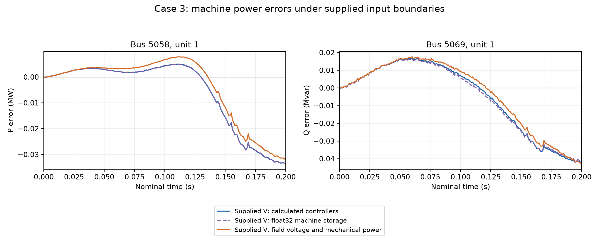

# Case 3 machine storage and controller-boundary controls

Uniform single-precision machine storage does not materially reduce the
leading machine power discrepancies in the corrected supplied-voltage replay.
Prescribing the supplied field voltage and mechanical power also leaves most
of those discrepancies. Neither experiment justifies a production change.

These controls follow the
[observed cold-point and source-localization audit](case3-observed-cold-point-2026-10-20.md).
They examine machine response before the large coupled-network voltage
disagreement at 0.195 seconds. They do not reproduce or resolve that network
disagreement themselves.

## Fixed experiment boundary

Every control contains all 333 synchronous machines and their attached
controllers. It retains 203 samples from -0.002 through 0.2 seconds at a
nominal 1 ms step, including both negative-time history rows. Terminal
voltage magnitude and phase come from the supplied Case 3 measurements.
All original model parameters and calculated continuous cold states remain
unchanged. No state, parameter, time shift or angle offset is fitted.

The frozen corrected runtime includes the hydro gate-limit correction.
Two fresh unchanged controls reproduce the retained corrected replay prefix
byte for byte, across every output row and column. Initialization JSON
records are numerically identical for every control.

The comparison covers 1,998 measured channels: P, Q, rotor angle, speed
deviation, field voltage and mechanical power for each machine. Metrics are
retained for prefixes ending at 0.1, 0.193 and 0.2 seconds. Negative-time
history is retained but excluded from error scores.

## Uniform storage controls

The original shared double-precision recurrence is compared with two
machine-only STATE/STORE controls:

- Electrical states only: 1,312 states use binary32 storage and arithmetic.
- All physical machine states: 1,978 states use binary32 storage and
  arithmetic, with speed stored as deviation from synchronous speed.

Controller arithmetic remains unchanged. Both controls use the same
published machine coordinates and integration stages. This is a numerical
representation diagnostic, not a claim about the required production
arithmetic. It is limited to this active-machine prefix without event,
trip or machine-state limiter transitions.

| Maximum absolute error through 0.193 s | Double baseline | Electrical storage | All machine storage |
|---|---:|---:|---:|
| P, MW; 5058/1 | 0.0329849 | 0.0329278 | 0.0329014 |
| Q, Mvar; 5069/1 | 0.0410337 | 0.0401409 | 0.0401706 |
| Rotor angle, degrees; 1050/1 | 0.00121820 | 0.00121870 | 0.00119070 |
| Speed deviation, pu; 1050/1 | 1.58755e-6 | 1.59106e-6 | 1.60397e-6 |
| Field voltage, pu; 5303/1 | 0.00122797 | 0.00130898 | 0.00112551 |
| Mechanical power, MW; 6216/1 | 0.00301236 | 0.00301261 | 0.00301295 |

The changes have mixed effects across the fleet. With all machine states
in binary32, P RMSE improves for 169 machines and worsens for 164; Q RMSE
improves for 163 and worsens for 170. This does not establish that storage
precision explains the residual device errors or should be changed globally.
It also does not rule out sensitivity of a coupled network near a threshold.

## Supplied controller-output boundaries

A second independent control set retains double-precision machine
integration and prescribes field voltage, mechanical power, or both.
Each value is taken from the same supplied sample as the prescribed
terminal-voltage boundary. The machine receives these values after
controller publication and before its derivative evaluation. Mechanical
power is converted from MW to the machine base.

Controllers remain attached and their states continue to evolve. Prescribed
outputs replace their influence on machine derivatives for this diagnostic.
Machine electrical states, speed and rotor angle still evolve locally;
the original calculated machine cold states are retained.

| Maximum absolute error through 0.193 s | Calculated controllers | Supplied field voltage | Supplied mechanical power | Both supplied |
|---|---:|---:|---:|---:|
| P, MW; 5058/1 | 0.0329849 | 0.0305110 | 0.0331848 | 0.0307708 |
| Q, Mvar; 5069/1 | 0.0410337 | 0.0403091 | 0.0404170 | 0.0405151 |
| Rotor angle, degrees; 1050/1 | 0.00121820 | 0.00124755 | 0.00113995 | 0.00118069 |

With both supplied outputs, mean P MAE across machines decreases from
0.00114760 to 0.000937568 MW. Mean Q MAE increases from 0.00133244 to
0.00136860 Mvar. The leading P and Q errors remain at the same machines.
Reported field-voltage equality and near-roundoff mechanical-power equality
are input-boundary checks, not independent prediction successes.

The residual persists under the declared sampled-input convention.
Further localization should examine machine electrical-state equations,
mechanical coupling and measurement-publication timing. The result does not
identify a defective equation by itself, or establish that these machine
errors cause the much larger coupled converter/network divergence.

## Verification and retained evidence

Independent scalar calculations verify all 41,958 metric records, with
six values per record. Additional checks verify 538,128 binary32 electrical
state values, 405,594 prescribed input/output values, identical initialization
records and 512 runtime/input/result file hashes. The two unchanged
replays exactly reproduce the retained baseline prefix.

The first comparison attempt rejected byte differences in initialization
JSON caused solely by object-key ordering. Parsed values were identical.
That attempt and its log are retained; the corrected comparison checks
semantic initialization equality and still requires exact trajectory
serialization equality for the unchanged controls.

Private evidence is under
`ipss.test.plugin.core/testData/private/verification-artifacts/2026-10-20-case3-machine-boundary-controls/`.
Full trajectories and logs remain compressed and are retained by hash,
without duplicating the complete evidence tree. No production source changes
or production regression claims are part of this slice.

These short, prescribed-voltage diagnostics are not acceptance runs.
Complete prefault and ten-second agreement, all six cases and 36 original
events, direct bus-frequency validation and the 20-second runtime target
remain open.
