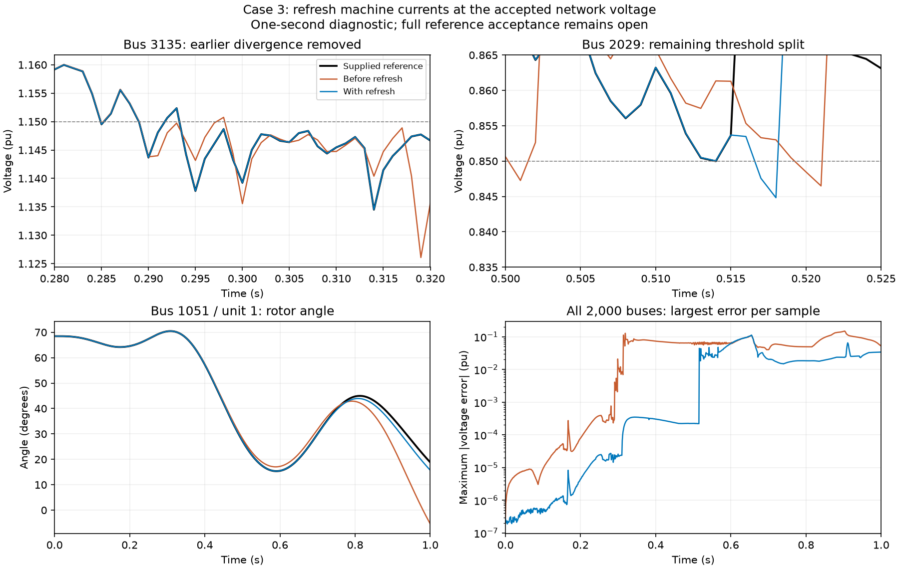

# Case 3 machine-current consistency at accepted network voltage

Subsequent cross-case checking found that the accepted-voltage refresh regresses
Case 2. The [accuracy recovery](case2-accuracy-recovery-2026-10-20.md) restores the
earlier injection boundary as the staggered solver's default and retains this
accepted-voltage behavior as an explicit option. The measurements below remain
the historical evidence for that option, not a justification for making it the
universal default.

The staggered solver left synchronous-machine stator currents and air-gap
power cached at the voltage preceding the final linear network solve.
Electrical derivatives could therefore consume currents inconsistent with
the accepted bus voltage. Refreshing those algebraic quantities after the
network solve removes this inconsistency without advancing machine states.

The production change adds this refresh for active machines, including when
the accepted network endpoint is subsequently reused. Two regression tests
cover round-rotor and salient-pole machines. No model parameters, thresholds,
time steps, convergence tolerances or acceptance limits change.

The Case 3 diagnostic improves substantially, but still fails reference
accuracy. The six-case benchmark and performance objectives remain open.
This work follows the
[cold operating point and converter feedback checks](case3-corrected-cold-boundary-2026-10-20.md).

## Evidence for the defect

A small one-machine network deliberately accepts a visible voltage change in
one normally converged iteration. Before the change, the stored current and
power values differ from their recomputed values by up to 1.549646 in their
respective per-unit coordinates. After the refresh, both machine types give
exactly equal cached and recomputed values. All differential states remain
bit-for-bit unchanged. The loose 0.5 tolerance belongs only to this contract
test; it is not a benchmark setting.

A separate machine replay provides the stronger full-network consistency
check. It drives all 333 synchronous machines with the coupled run's own
recorded bus voltages and phases, while deriving their internal states from
the same physical cold point. The replay does not prescribe internal states.

| Largest replay versus coupled-run difference, through 1 s | Before refresh | With refresh |
|---|---:|---:|
| Active power, MW | 0.167807 | 2.55e-11 |
| Reactive power, Mvar | 0.449907 | 2.79e-11 |
| Rotor angle, degrees | 0.0122870 | 8.35e-13 |

The comparison covers all 333,999 device samples, including the two
negative-time history rows. Agreement here establishes local implementation
consistency; the supplied measurements remain the accuracy reference.

## Coupled comparison against supplied measurements

Both one-second runs use the same supplied physical cold point, original
input records, current-P/impedance-Q load coefficients, field-stage candidate,
double-precision dynamic LU, 1 ms time step and inferred maximum-25 iteration
continuation policy. Only the final machine-current refresh changes.
The reference iteration setting remains unconfirmed.

| Prefault comparison through 1.0 s | Before refresh | With refresh |
|---|---:|---:|
| Largest voltage error, pu | 0.148419 | 0.111939 |
| Worst voltage NRMAE | 0.0858539 | 0.0329048 |
| Voltage channels passing NRMAE < 0.001 | 0 / 2,000 | 47 / 2,000 |
| Largest rotor-angle error, degrees | 24.2224 | 3.10847 |
| Rotor channels passing maximum error < 0.02 degrees | 0 / 333 | 0 / 333 |
| First voltage error above 0.001 pu | 0.291 s | 0.516 s |
| Unconverged iteration-limit stops | 469 | 471 |
| Diagnostic runtime, seconds | 223.36 | 223.56 |

All 6,578 matched channels and 1,003 rows are retained. The two negative-time
rows are excluded from scores, and voltage NRMAE uses each channel's full
ten-second reference range. All 471 iteration-limit stops remain explicitly
unconverged. The unchanged matrix is factored once and used for 19,019
triangular solves.

The candidate run also contains earlier isolated diagnostic corrections,
including the field-stage candidate. Its complete trajectory is not a
validation of the current production checkout. The focused production tests
validate the machine-current change itself.

The largest remaining voltage error occurs at bus 2029; the largest rotor
error occurs at bus 1051, unit 1. At 0.514 s, the calculated bus-2029 voltage
is 0.850025625 pu and the supplied value is 0.849989653 pu, on opposite sides
of the entered 0.85 pu dip threshold for its three converter units.
The first voltage error above 0.001 pu follows at 0.516 s.

Earlier instantaneous threshold disagreements occur at buses 3051
(0.239 s), 2099 (0.351 s) and 3081 (0.473 s). These are retained too:
an instantaneous predicate disagreement alone does not establish a changed
controller output. The next diagnosis must explain the accumulated boundary
error and controller history, without shifting any threshold.

## Additional machine-source controls

Reference-voltage machine replays were also repeated using the exact stored
floating-point boundary values. With the supplied physical cold point,
the largest one-second differences are 0.0138250 MW in active power,
0.00655139 Mvar in reactive power and 0.00159913 degrees in rotor angle.
All 333 rotor channels pass the prefault angle bound in this conditional
replay.

Combining those replayed machine sources with the earlier converter replay
using reference voltage and terminal P/Q produces a largest bus-voltage
error of 2.00060e-6 pu at the selected 1 s endpoint. This is conditional
network evidence, not autonomous trajectory acceptance.

## Validation and retained evidence

- All 30 focused tests pass, including the two new machine-cache tests,
  network lifecycle, converter iteration and staggered stabilizer checks.
- The registered core suite runs 2,604 tests: three failures, two errors and
  13 skips. All five failing checks reproduce with identical messages when
  the pre-change solver is compiled into an isolated overlay.
- Those five checks are the existing static exchange/large-network checks
  and the Case 1 flat-run voltage-drift check. The two six-case disturbance
  smoke methods pass. The core gate remains failed.
- An independent scalar verifier reproduces 105,248 coupled metric fields,
  191,808 machine-replay metric fields and all 667,998 exact reference
  boundary values. It also verifies the unchanged cold point and matrix,
  all iteration-limit records and the local machine replay.

The strict six-case flat gate, topology fault matrix and complete repository
acceptance are not newly established by this slice. Full ten-second
comparisons, direct bus-frequency coverage and the 20-second quarter-cycle
runtime target remain open.

Compact private evidence is retained under
`ipss.test.plugin.core/testData/private/verification-artifacts/2026-10-20-case3-machine-endpoint-refresh`.
The archive contains scripts, summaries, regression evidence and small
artifacts. Large traces and supplied references remain compressed,
hash-identified dependencies rather than duplicate archive copies.
