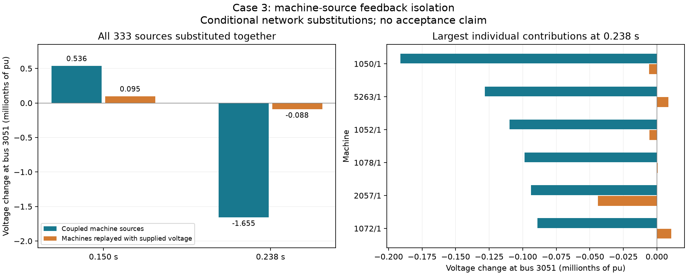

# Case 3 machine feedback and converter network-memory checks

The early machine-source discrepancy is distributed across multiple units.
Most of its effect at bus 3051 disappears when the machines evolve under
the supplied terminal voltage. A separate test of converter network-memory
precision does not resolve the subsequent large divergence.

These findings extend the [validated source replay](case3-machine-source-isolation-2026-10-20.md).
They do not establish a defective machine equation or justify a production
precision change.

## Machine-source ranking

At 0.150 and 0.238 seconds, substitute each of the 333 machine sources into
the same conditional network calculation. Compare two sources for every
machine:

- Its coupled local trajectory, including accumulated voltage feedback.
- Its local machine/controller trajectory driven by supplied terminal
  voltage, starting from the same physical cold point.

Reconstruct source currents from physical terminal P/Q and complex voltage,
using the original machine admittances. All other machine sources, converter
history and the preceding network voltage retain the supplied boundary.
There are 1,332 individual substitutions. This calculation does not integrate
the substituted network endpoint into a new trajectory.

| Conditional voltage change at bus 3051, pu | 0.150 s | 0.238 s |
|---|---:|---:|
| All coupled machine sources | +5.35647e-7 | -1.65521e-6 |
| All sources from machines replayed with supplied voltage | +9.51809e-8 | -8.80298e-8 |

At 0.238 seconds, the largest individual coupled contribution is unit 1050/1:
-1.91133e-7 pu, about 11.5% of the aggregate change's magnitude. Unit 5263/1
contributes -1.28160e-7 pu. No single unit accounts for most of the discrepancy.
Individual effects need not add exactly because the conditional network
calculation is nonlinear.

The rotor-angle-only substitution at 0.238 seconds changes bus 3051 voltage
by +2.28371e-7 pu for coupled sources; the corresponding source change in the
rotating frame produces -1.88358e-6 pu. This supports tracing the upstream
voltage and electrical-state feedback before changing a rotor-angle equation.
These coordinate substitutions are diagnostics, not assignments to model
states or fitted corrections.

An independent real-coordinate current reconstruction and simultaneous
inverse-matrix calculation check all 1,332 individual substitutions and 12
aggregate coordinate controls. All 10,704 checked scalar fields agree within
7.11e-15; the independent inverse residual is 1.04e-14. No individual
substitution changes the iteration count: 22 at 0.150 seconds and 24 at
0.238 seconds.

## Converter network-memory precision control

A fixed binary32 storage policy is applied only when assigning the saved
network voltage, decelerated voltage and accumulated high-voltage correction
in `Regca1Model`. Four assignment sites change. Model parameters, physical
initial conditions, integration, the double-precision network matrix and
other calculations retain the baseline. This tests a numerical hypothesis;
the reference implementation's internal arithmetic is not established.

With the storage option disabled, all 253 output rows through 0.25 seconds
are byte-identical to the baseline after decompression. The enabled
one-second run produces:

| Metric over 0–1 s | Baseline | Binary32 network memory |
|---|---:|---:|
| Worst voltage absolute error, pu, bus 2029 | 0.11193889 | 0.11195106 |
| Worst voltage NRMAE | 0.03290476 | 0.03290478 |
| Voltage channels meeting prefault NRMAE | 47 / 2,000 | 47 / 2,000 |
| Worst rotor absolute error, degrees, unit 1051/1 | 3.108472 | 3.107451 |
| Worst rotor RMSE, degrees, unit 1050/1 | 1.066152 | 1.066011 |
| Rotor channels meeting prefault absolute-error limit | 0 / 333 | 0 / 333 |
| First voltage error above 0.001 pu, s | 0.516 | 0.516 |
| Network iteration-limit stops, unconverged | 471 | 471 |
| Network triangular solves | 19,019 | 19,019 |

Both runs reuse one factorization. Their network matrices are byte-identical.
Every matched channel is scored: 6,578 channels, excluding negative-time
history from the scores and using full ten-second reference ranges for
normalization. An independent scalar calculation verifies 13,156 channel
records and 105,248 metric fields. The precision change is not adopted.

## Scope and retained evidence

All six supplied full-system datasets remain locally retained and
hash-verified. The original history rows and event-side duplicate timestamps
are preserved. The full-system exports lack direct bus-frequency channels.

The current one-second diagnostic still fails the prefault limits. Its
supplied physical cold point, private field-application control and inferred
maximum-25 network continuation rule do not establish autonomous preparation
or full-run acceptance. The reference tolerance and maximum iteration count
remain unconfirmed. No new reference simulation was run.

No production source changes are made by this slice. All six cases, the
original 36 events, ten-second accuracy and the 20-second runtime goal remain
open. The next localization should distinguish startup/network differences
from accumulated electrical-state feedback using the supplied measurements.

Compact scripts, summaries, checks and this report are retained under
`ipss.test.plugin.core/testData/private/verification-artifacts/2026-10-20-case3-machine-feedback-ranking-v2/`.
Large compressed traces and supplied references remain hash-identified
dependencies rather than duplicate archive copies.
