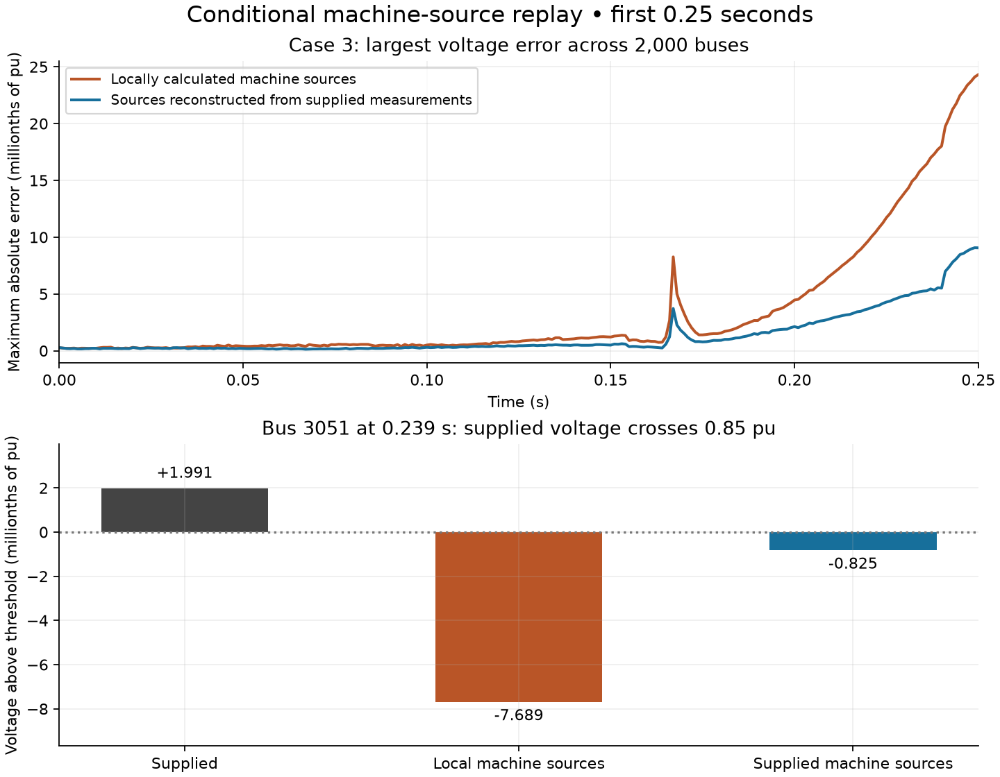

# Case 3 machine-source replay and timing control

Replacing the synchronous-machine network sources with currents reconstructed
from the supplied measurements reduces the worst voltage error in the first
0.25 seconds from 0.0000243144 to 0.00000906917 pu. The first identified recovery
crossing remains one sample late. This localizes part of the early voltage
discrepancy to the machine-source feedback path; it does not prove a particular
machine equation is wrong.

No production model or solver changes are made in this slice. These are
conditional diagnostics, not autonomous acceptance runs.

## Supplied files

All six full-system bus-6307 datasets are retained locally: 11 original
Parquet files, the metadata archive and upload manifest, totaling 684,046,545
bytes. Case 2 reuses its earlier hash-verified download. The current Drive
folder listing matches all 13 retained filenames and sizes; every local
SHA-256 still matches the previously verified manifest.

Each case has 10,005 rows. Two negative-time history rows and duplicate
timestamps at fault application and clearing remain intact. No expanded
reference CSV copies were created. The inventory is
`ipss.test.plugin.core/testData/private/reference-imports/texas2k-full-system-bus6307-1ms-20261020/local_reference_manifest.json`.
Direct bus-frequency measurements are absent from these exports.

## Replay construction and controls

For each of the 333 synchronous machines, reconstruct the system-base Norton
source from recorded terminal voltage, phase and P/Q:

```text
I_source = conjugate((P + jQ) / (100 * V)) + Y_machine * V
```

The entered machine admittance remains unchanged. At every network iteration,
the diagnostic subtracts the local machine source and adds the prescribed
source at its bus. The converter bundles and all machine/controller states
continue to evolve locally. Reported machine P/Q remains the local model's
output, not the substituted network injection.

The three runs share the retained physical cold point, original model
parameters, integration step, network tolerance and iteration policy:

| Control | Additional source evaluation | Source used by the network |
|---|---|---|
| Observation only | Yes | Original local source |
| Local replay | Yes | Reconstructed local terminal measurements |
| Supplied replay | Yes | Reconstructed supplied terminal measurements |

Each run retains 253 rows, including two history rows. Scores cover the 251
nonnegative endpoints through 0.25 s, with full ten-second reference ranges.
There are 6,578 matched channels. This prefix does not include the fault.

The first replay attempt used the simulation clock inside the end-of-step
network solve. That clock still represented the beginning of the step, even
though the machine states had advanced. Its local control failed, reaching
0.0851134 pu voltage difference from the original run. That attempt is retained
as a failed harness control and supplies no model-accuracy conclusion.

The corrected diagnostic explicitly uses `time + dt` for the advanced
network endpoint. It does not shift or fit the supplied measurements.
Production integration behavior and the network callbacks are unchanged.

| Closure check against the original local run | Observation only | Corrected local replay |
|---|---:|---:|
| Maximum bus-voltage difference, pu | 0 | 9.99e-16 |
| Maximum bus-angle difference, degrees | 0 | 4.97e-14 |
| Maximum generator-P difference, MW | 0 | 1.43e-11 |
| Maximum generator-Q difference, Mvar | 0 | 8.58e-12 |
| Maximum rotor-angle difference, degrees | 0 | 5.47e-13 |

The observation-only output is also byte-identical to the original prefix
after decompression. An independent real-coordinate calculation checks all
336,996 source-current components; its largest disagreement is 1.42e-14 pu.
Every run visits all 252 advanced endpoints. Source cancellation is checked
at all 3,902 network iterations per run, with maximum error below 4.50e-14 pu.

## Comparison with supplied measurements

| Metric over 0–0.25 s | Local sources | Supplied machine sources |
|---|---:|---:|
| Worst voltage maximum absolute error, pu | 0.0000243144 | 0.00000906917 |
| Leading voltage bus | 2052 | 2029 |
| Time of worst voltage error, s | 0.250 | 0.249 |
| Worst rotor maximum absolute error, degrees | 0.00124815 | 0.00117952 |
| Leading rotor channel | 6274/1 | 6274/1 |

All 2,000 voltage and 333 rotor channels meet their prefault limits within
this short prefix in both controls. This does not supersede the failing
one-second comparison or establish full-run acceptance.



At bus 3051 and 0.239 s, the supplied voltage is 0.850001990795 pu. The local
run gives 0.849992311108 pu; the supplied-machine-source replay gives
0.849999174801 pu. Both calculated voltages still lie below the entered
0.85 pu recovery threshold. Their first upward voltage crossing occurs at
0.240 s, versus 0.239 s in the supplied data. The source substitution reduces
the discrepancy but does not remove the recovery disagreement.

This complements the
[physical-input command controls](case3-active-command-inputs-2026-10-20.md):
the machine-source path contributes to the voltage error, while converter
feedback and the remaining network/startup discrepancy still require
localization. No recovery threshold, current limit or model gain is changed.

## Evidence and remaining work

Each diagnostic reaches 0.25 s with eight network iteration-limit stops,
explicitly marked unconverged. The inferred maximum-25 continuation policy
remains unconfirmed. No new full-size reference simulation is requested or run.

The unchanged one-second diagnostic still reaches 0.111939 pu voltage error
and 3.10847 degrees rotor-angle error. All six cases, the original 36 events,
ten-second accuracy, direct bus-frequency coverage and the 20-second runtime
goal remain open.

The compact evidence archive is retained under
`ipss.test.plugin.core/testData/private/verification-artifacts/2026-10-20-case3-machine-source-isolation/`.
Large compressed traces and supplied references remain hash-identified
dependencies rather than duplicate archive copies. This diagnostic-only slice
does not require a new production regression run.
