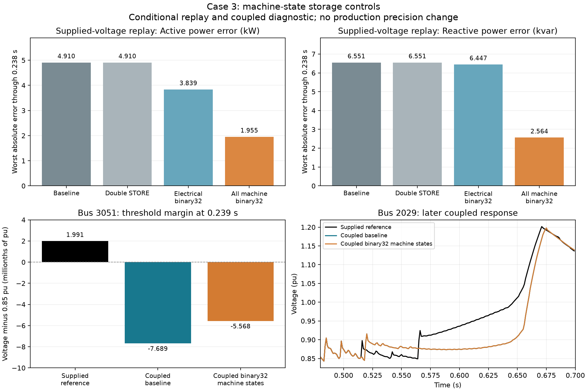

# Case 3 machine-state storage controls

Uniform binary32 machine-state storage reduces the largest P/Q discrepancies
in the supplied-voltage replay. The coupled voltage maximum also decreases, but the run still fails the prefault limits.
No production numerical policy is changed.

## Current-runtime replay

All four controls use the corrected field-application sequence, accepted
terminal-current refresh, original model parameters, supplied physical cold
point and supplied terminal voltage. Machine and controller states evolve
locally; no internal reference states, offsets or gains are fitted.

The baseline retains the existing two-step update. Double STORE uses its
algebraically equivalent constant-step storage recurrence. The other two
controls use binary32 STATE/STORE arithmetic for 1,312 electrical states or
all 1,978 machine states, respectively. The latter stores speed as deviation
from synchronous speed. Controller arithmetic is unchanged. Initial computed
states are unchanged; the storage representation applies during advancement.

The unchanged replay reproduces all 84,249 physical output rows through
0.25 seconds byte for byte. Each run covers 333 machines and 1,998 physical
measurement channels. The table scores nonnegative samples through 0.238 s:

| Storage control | Worst P error, MW | Worst Q error, Mvar | Worst field-voltage error, pu | Worst rotor error, degrees |
|---|---:|---:|---:|---:|
| Baseline | 0.0049103923 | 0.006551385 | 0.00056871916 | 0.0011758151 |
| Double STORE | 0.0049103923 | 0.006551385 | 0.00056871916 | 0.0011752656 |
| Electrical states binary32 | 0.0038388282 | 0.006446948 | 0.00035069884 | 0.0011827863 |
| All machine states binary32 | 0.0019552716 | 0.0025638684 | 0.00010650749 | 0.0011831605 |

Double STORE is close but not byte-identical to the baseline: through 0.25 s,
its largest P difference is 1.51402e-07 MW and rotor difference is
5.96134e-07 degrees. Rearrangement and speed-deviation storage
can change floating-point rounding even with double arithmetic.

An independent scalar calculation verifies 31,968 channel/window records
and 191,808 metric fields, with maximum disagreement below 8.68e-19.
All 21,072 sampled machine storage updates match independent arithmetic
exactly. The four audited endpoints cover the first two advances, 0.150 s
and 0.238 s. This active prefault check does not cover event history,
device reactivation or variable-step behavior.

## Coupled network check

The unchanged coupled control reproduces all 253 physical output rows through
0.25 s exactly. The enabled control then runs through 1.0 s with the original
network, loads, initial point, model parameters and controller arithmetic.
All 6,578 matched physical channels are scored; history rows are retained
but excluded from scoring. Voltage NRMAE uses the full ten-second reference
range for each channel.

| Metric over 0–1 s | Baseline | All machine states binary32 |
|---|---:|---:|
| Worst voltage absolute error, pu | 0.11193889 | 0.11192532 |
| Worst voltage NRMAE | 0.032904755 | 0.032893902 |
| Passing voltage channels | 47 / 2,000 | 47 / 2,000 |
| Worst rotor absolute error, degrees | 3.1084725 | 3.1067098 |
| Worst rotor RMSE, degrees | 1.0661515 | 1.0655264 |
| Passing rotor channels | 0 / 333 | 0 / 333 |
| Network limit stops, explicitly unconverged | 471 | 471 |
| Triangular solves | 19,019 | 19,019 |

Both runs reuse one factorization and have byte-identical network matrices.
An independent calculation verifies all 13,156 metric records and 105,248
scalar fields, the unchanged preparation and the off-control closure.

At bus 3051, the first upward crossing of 0.85 pu after 0.2 seconds occurs
at 0.239 s in the supplied data,
0.240 s in the baseline and
0.240 s in the machine-storage
control. These are measured crossing times, without shifts or threshold changes.

## Qualification and evidence

The reference's internal arithmetic remains unconfirmed. A smaller replay
error alone does not establish its numerical implementation or justify
adopting a precision change. The coupled diagnostic also retains the supplied
physical cold point, private field-application control and inferred maximum-25
network continuation setting. Limit stops remain marked unconverged.

The current solved power-flow voltage magnitudes already agree with the
exported cold magnitudes within 1.57356e-07 pu
across all 2,000 buses. A preparation audit finds a smaller, distinct question:
the two units without machine models retain I/Z coefficients from the generated
converted-output P/Q, which differs slightly from their solved pre-conversion
P/Q. Netting before load conversion was confirmed for the supplied runs.
The effect of this preparation difference still needs a conditional
network check; it has not been identified as the cause of the divergence.

No new reference simulation was run. All six cases, the 36 original events,
full ten-second accuracy, direct bus-frequency coverage and the 20-second
runtime target remain open. The original supplied references and event-side
duplicates are unchanged.

Compact reproducible evidence is retained under
`ipss.test.plugin.core/testData/private/verification-artifacts/2026-10-20-case3-machine-state-storage/`.
Large compressed traces remain hash-identified dependencies rather than
duplicate archive copies.
