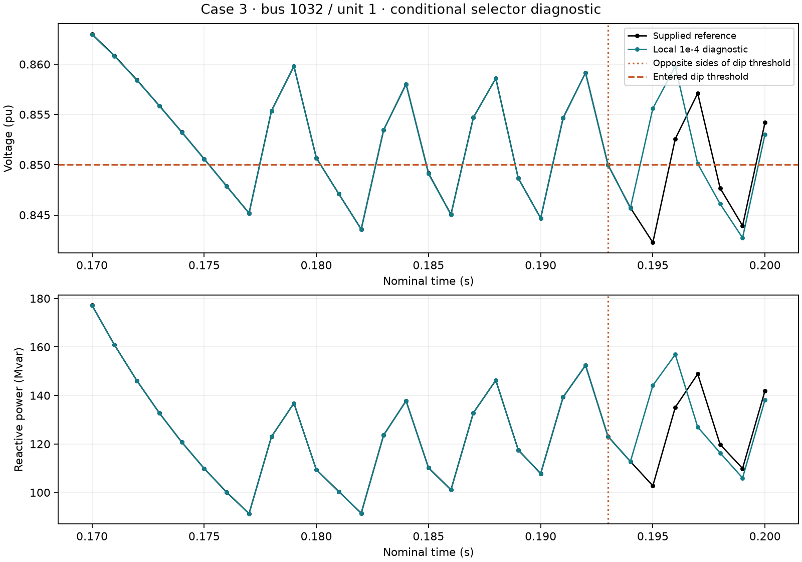

# Case 3 network correction and dip boundaries

The corrected Case 3 diagnostic agrees best with the supplied reference at
the existing 1e-4 network tolerance. Both 1e-5 and 1e-3 worsen the comparison.
The remaining divergence is sensitive to small voltage differences at
converter dip thresholds: a 0.0000194 pu difference at bus 1032 places the
two trajectories on opposite sides of 0.85 pu, followed two milliseconds
later by a 41.38 Mvar reactive-power discrepancy.

This is localization evidence, not a new tolerance recommendation for all
cases. No production equation, threshold, initial state or acceptance limit
changes in this investigation.

## Paired numerical controls

The three runs retain the corrected hydro and electrical recovery models,
1 ms integration, two cold-history steps, original model parameters and the
same converted operating point. They also retain the previously declared
55 reference-derived recovery selectors; an accepted initialization rule
for those selectors remains unresolved.

Each run covers 0.35 seconds, with 353 rows and all 6,578 matched physical
channels. The 351 nonnegative rows are scored against the supplied results.
Voltage NRMAE uses the full ten-second reference range. These prefix scores
do not replace complete prefault or ten-second acceptance.

| Dynamic network tolerance | Worst voltage NRMAE | Maximum rotor error, degrees | Linear solves | Elapsed seconds |
|---|---:|---:|---:|---:|
| 1e-4 | 0.00878863 | 0.0128993 | 7,799 | 101.88 |
| 1e-5 | 0.0427591 | 2.07900 | 13,931 | 140.07 |
| 1e-3 | 0.0712733 | 4.68642 | 2,165 | 67.84 |

Every control uses one factorization. The 1e-4 control passes 1,649 of 2,000
voltage channels and all 333 rotor channels over this prefix. At 1e-5 the
counts are 24 and 35; at 1e-3 both are zero. Elapsed times include initialization,
full diagnostics and concurrent workstation activity. They are not controlled
measurements of the quarter-cycle runtime target.

The read-only observer reproduces the retained corrected baseline exactly
across all 353 rows and 6,578 physical channels. All 623 cold device records
are identical across the controls. The independently recomputed extrema
agree with the primary comparison.

## Correction activity missed by endpoint-only replay

The observer records all 290 converter bundles at each of 352 network calls.
It records evaluation counts, correction before and after final evaluation,
saved/decelerated voltage and regulator states without changing them.

At 1e-4, the first high-voltage correction occurs at bus 2059/1 at 0.255 seconds.
It accumulates over 26 positive-threshold evaluations and reaches 0.0311826 pu.
By 0.258 seconds, both units at bus 2123 retain correction even though their
final decelerated voltage is below the 1.2 pu threshold. For unit 2, the
maximum intermediate decelerated voltage is 1.20176298 pu, final voltage is
1.19720306 pu, and retained correction is 0.00906197 pu.

There are 334 such below-threshold final records in the baseline prefix.
Tighter and looser controls have 450 and 135 respectively. These observations
explain why a replay driven only by saved voltage endpoints cannot reconstruct
all late converter outputs. They do not demonstrate that the correction
equation itself is wrong.

An independent check verifies every recorded final update:

```text
correction_after - correction_before
    = Khv * max(decelerated_voltage - Volim, 0)
```

The maximum identity residual is below 2.23e-17 pu. Evaluation totals agree
exactly with 290 times the sum of linear solves and final-output evaluations.

## Earlier dip-boundary disagreements

The large voltage divergence begins before high-voltage correction is active.
Comparing the recorded voltages against each active converter's entered dip
thresholds finds the first inferred decision disagreement at bus 3044/2:

| Nominal time / unit | Supplied voltage, pu | Local voltage, pu | Entered lower threshold |
|---|---:|---:|---:|
| 0.156 s / 3044/2 | 0.849991024 | 0.850000628 | 0.85 |
| 0.163 s / 1055/1 | 0.850003481 | 0.849999373 | 0.85 |
| 0.193 s / 1032/1 | 0.850002289 | 0.849982931 | 0.85 |

These decisions are inferred from exported physical voltage, not directly
recorded internal reference flags. The inventory covers all 290 active bundles;
16 additional electrical-controller records in the original dynamic data
belong to inactive or netted units and are excluded from the active inventory.

At bus 1032, the voltage difference at 0.193 seconds is only -0.0000193573 pu.
At 0.195 seconds, it becomes 0.0133437 pu and reactive-power error reaches
41.3849 Mvar. The local model's dip classification governs controller freezing
and publication, making this a concrete numerical-boundary discriminator.
The plot retains original sample ordinals without a fitted time shift.



The retained corrected-model replay driven by supplied terminal voltage
reproduces bus 1032's reactive power within 0.000448188 Mvar through 0.25
seconds. No high-voltage correction occurs in that replay prefix. This
supports investigating the small upstream voltage differences and numerical
boundary timing, rather than moving the entered dip threshold or fitting
controller gains. It does not isolate every source of the upstream difference.

## Evidence retention and remaining work

Private evidence is retained under
`ipss.test.plugin.core/testData/private/verification-artifacts/2026-10-20-case3-network-correction/`.
The original supplied references are unchanged. Generated logs and startup
snapshots are losslessly compressed with decompressed-content hash checks.
The baseline's duplicate physical prefix is represented by its verified
identical prefix in the already retained full trajectory. Identical immutable
generated inputs share storage while preserving their paths and hashes.
Per-channel comparison tables are compressed without dropping samples.

The disk guard rejected the first looser-control launch before simulation
started and later stopped an uncompressed comparison writer. Both failures
are recorded. The looser control was resumed after storage was reclaimed,
with complete compressed console capture. The comparator completed using
compressed output. An initial independent verifier rejected an overbroad
controller inventory; the corrected verifier uses the active-device inventory
and retains the rejected check separately.

The next target is the first small voltage discrepancy that changes a dip
decision, including its converted initial point and numerical solve boundary.
Reference solver settings and the common initialization protocol remain
unresolved. Full prefault, ten-second and postfault acceptance, all six cases
and 36 original events, direct bus-frequency validation and the 20-second
runtime target remain open.
