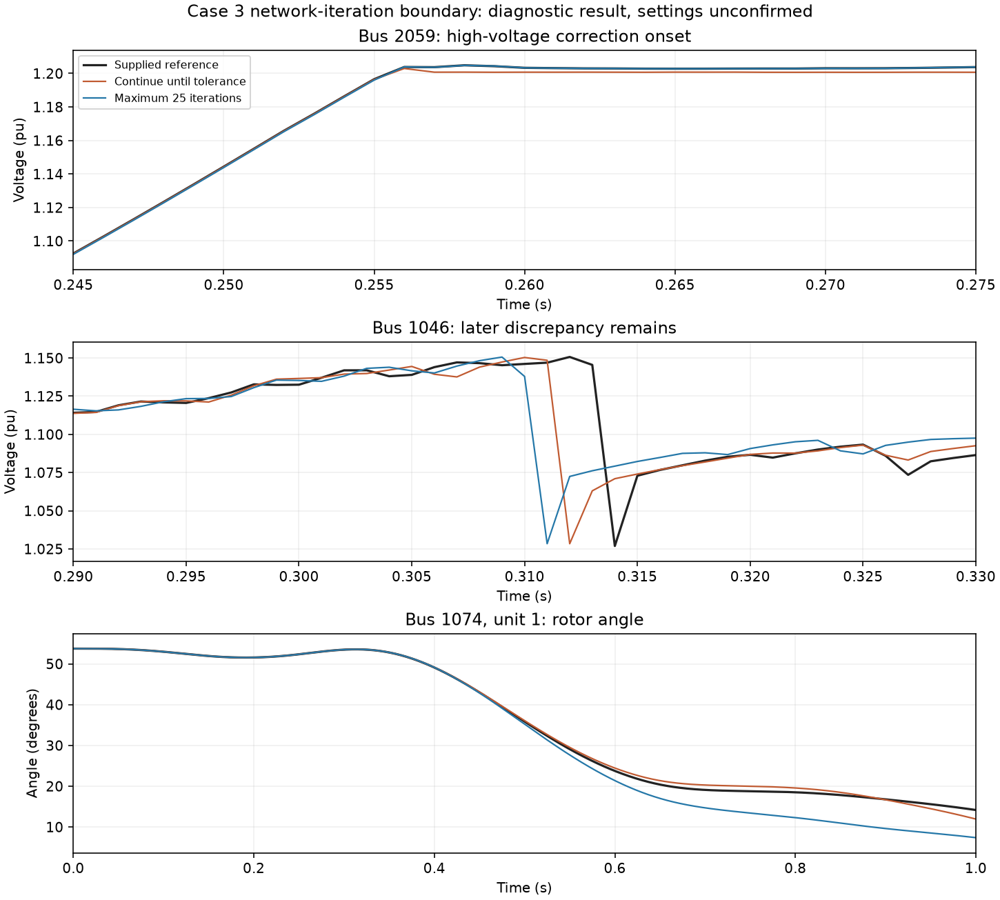

# Case 3 network-iteration boundary diagnostic

The supplied measurements strongly support a 25-iteration stopping boundary
over the examined high-voltage interval. This setting has not been confirmed.
A coupled diagnostic using that boundary improves the early voltage match
but still fails the prefault acceptance limits. No production solver setting
or model classification changes in this slice.

This follows the
[field-application timing diagnostic](case3-esst4b-field-stage-2026-10-20.md).
The complete reference collection has been downloaded for all six cases;
the original samples, event-side duplicate timestamps and hashes are retained.

## Separating network iteration from controller states

A read-only observer records every converter's network evaluations through
0.28 s. Adding the observer leaves all 283 samples of 6,578 matched physical
channels byte-identical to the preceding candidate. It records 81,780
converter-step entries and 1,548,310 current evaluations. There are 5,057
linear solves, with the existing matrix factorization reused.

At bus 2059, high-voltage reactive-current correction accumulates during
network iterations. Consequently, changing how many iterations run changes
the converter current, even when its differential states are held fixed.
The observer verifies the final correction update to within 1.12e-17.

An independent network reconstruction uses the original network and load
records. Its matrix agrees with the retained coupled matrix within 9.10e-13.
Given the observed local states and source currents, it reproduces the
local solution within 4.44e-16 pu voltage magnitude and 5.69e-14 Mvar
converter reactive power.

The reference-conditioned check solves 16 separate endpoints from 0.250
through 0.265 s. Supplied synchronous-machine P/Q and terminal voltages
determine their Norton source currents. Converter states come from the
existing supplied-voltage replay; those internal states were not supplied
as reference measurements. This is a conditional network check, not a
free-running simulation.

| Reference-conditioned result | Iterate to 1e-4 voltage-change tolerance | Stop at 25 iterations or tolerance |
|---|---:|---:|
| Largest voltage-magnitude error across 2,000 buses, pu | 0.00480404 | 0.0000141613 |
| Largest reactive-power error across 290 converters, Mvar | 3.00602 | 0.00674190 |
| Largest active-power error across 290 converters, MW | 0.405227 | 0.00431877 |

The alternative maximum-component convergence norm does not resolve the
disagreement. The 25th iterate is consistently closest to the supplied
bus-2059 voltage across the examined correction interval, although its
voltage change often remains above 1e-4 pu. This is evidence for a
stopping-rule hypothesis; confirmation of the reference configuration
remains pending.

## Coupled test and explicit nonconvergence

The diagnostic changes only the maximum network iteration count and permits
continuation after that specific limit. It preserves `converged=false`,
the `ITERATION_LIMIT` reason and the measured voltage change for each such
step. Invalid voltages, failed linear solves and callback failures remain
fatal. A fresh unchanged control reproduces the previous 283-sample prefix
byte for byte.

Initialization retains its original 1e-8 tolerance and 500-iteration limit.
The subsequent network tolerance remains 1e-4 pu. Both compared trajectories
use the same computed cold operating point, 1 ms step, entered model
parameters, current-P/impedance-Q loads and preceding field-stage candidate.
They also retain 55 earlier diagnostic recovery-selector changes derived
from supplied cold measurements; those are not an accepted autonomous
initialization rule.

The one-second 25-iteration run completes in 170.35 s but records **478
unconverged limit stops**. Completion must not be interpreted as satisfying
the network tolerance.

| Prefault comparison through 1.0 s | Previous candidate | Maximum 25 iterations |
|---|---:|---:|
| Largest voltage error, pu | 0.122293 | 0.118538 |
| Worst voltage NRMAE | 0.0436165 | 0.0319795 |
| Voltage channels passing NRMAE < 0.001 | 13 / 2,000 | 0 / 2,000 |
| Largest rotor-angle error, degrees | 6.23747 | 7.16313 |
| Rotor channels passing maximum error < 0.02 degrees | 0 / 333 | 0 / 333 |

All 6,578 matched channels are scored. Voltage NRMAE uses each channel's
full ten-second reference range. Negative-time history is retained and
excluded from scoring. The previous candidate's largest rotor error is
at 1051/1; the new diagnostic's is at 1074/1. These results do not support
accepting the stopping rule as a complete fix.

## Next discrepancy: bus 2048 threshold crossing

The first voltage error above 0.001 pu moves from bus 2059 at 0.257 s to
bus 2048 at 0.270 s. Two milliseconds earlier, the supplied and calculated
voltages straddle the entered REECA1 upper dip threshold:

| At 0.268 s, bus 2048 | Value, pu |
|---|---:|
| Entered upper threshold | 1.150000000 |
| Supplied voltage | 1.150002122 |
| Calculated voltage | 1.149964675 |
| Absolute voltage difference | 0.0000374470 |

At 0.270 s, the supplied reactive power is -14.756862 Mvar, versus
-7.050751 Mvar in the coupled diagnostic: a 7.706110 Mvar difference.
Replaying the supplied voltage reproduces bus 2048's reactive-power trace
through 0.271 s within 0.000240455 Mvar and active power within 0.000126228 MW.
The converter's separate high-voltage current correction is zero throughout
that replay prefix.

The dip decisions above are inferred from physical voltage and entered
thresholds, rather than supplied internal flags. The evidence directs the
next investigation toward the preceding voltage discrepancy. It does not
justify changing the threshold, fitting a time shift or forcing controller
states.

## Verification and storage

Independent calculations check 13,156 channel-metric records, 105,248 scalar
fields, the unchanged observer/control prefixes, all 478 nonconverged stops
and 553 source/runtime/result hashes. The conditional current-accumulation
identity also passes. Production equations and settings remain unchanged;
this slice contains diagnostic evidence and documentation.

Verified hard-link deduplication of 4,788 identical frozen-library pairs
recovered 5,955,547,136 bytes, approximately 5.96 GB. All paths and byte hashes
are preserved. Some paths resolve through existing aliases into private
verification artifacts; the independent check verifies those resolved
locations as well. Supplied references were outside this operation.
The initial long-path failure and the verifier's initial overly narrow path
check are retained alongside the corrected successful attempts.

Private evidence is under
`ipss.test.plugin.core/testData/private/verification-artifacts/2026-10-20-case3-network-iteration-limit/`.
Full trajectories remain compressed and are retained by hash rather than
copied into the compact evidence archive. The 2 GiB free-space guard remains
enabled.

Reference-setting confirmation, independent initialization of the diagnostic
selectors, production integration, full prefault and ten-second acceptance,
all six cases and 36 original events, direct bus-frequency validation and
the 20-second runtime target remain open.
