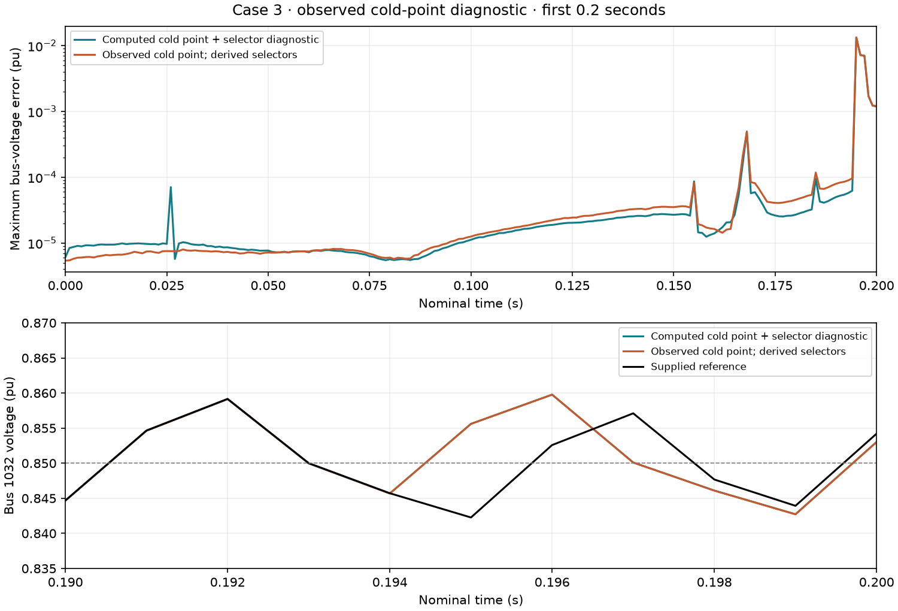

# Case 3 observed cold-point diagnostic

Starting from the supplied physical cold operating point removes the
initial voltage and generator-power discrepancies and derives all 117
examined converter recovery directions without selector overrides. It does
not remove the subsequent coupled-network divergence: the maximum voltage
error at 0.195 seconds remains 0.0133328 pu.

The cold operating-point difference is therefore not the sole cause of the
early discrepancy. This experiment is diagnostic; it does not adopt a new
initialization convention for acceptance or change any production model.

## Physical boundary and independently derived states

The experiment uses the first supplied cold row, at approximately -0.002
seconds, for voltage magnitude and phase at all 2,000 buses and P/Q at all
623 active generators. Each model derives its own internal states and
recovery direction. No internal state, controller parameter, threshold,
time offset or angle offset is fitted.

The original RAW, dynamic-model constants, control settings, 1 ms integration,
two startup-history rows and 1e-4 network tolerance remain unchanged.
Current-P/impedance-Q load coefficients are retained. For the two model-less
units at 5045/1 and 7099/2, their negative-load P/Q is expressed at the new
voltage while preserving the original current and impedance coefficients.
Their reference generator channels are zero and are not substituted for
their nonzero netted loads.

The previous control uses the computed converted point and the declared
55 diagnostic selector changes. The new control makes zero selector changes.
All 117 directions in the examined cohort agree with the supplied cold-Q
sign after ordinary model initialization.

| Largest cold physical error | Computed point | Observed point |
|---|---:|---:|
| Bus voltage, pu | 4.47881e-6 | 6.21725e-15 |
| Bus angle, degrees | 7.75481e-5 | 2.06057e-13 |
| Generator P, MW | 0.00204468 | 8.35598e-12 |
| Generator Q, Mvar | 0.0121346 | 1.04592e-11 |
| Rotor angle, degrees | 0.00106732 | 0.0000898755 |
| Field voltage, pu | 0.0000360733 | 0.00000395273 |
| Mechanical power, MW | 0.00207520 | 0.000549316 |

The last three quantities remain model outputs, rather than imposed initial
states. Their residuals are retained.

## Dynamic comparison

Both controls retain 203 samples and 6,578 matched channels. The scores use
201 nonnegative samples through 0.2 seconds, with full-ten-second reference
ranges for voltage NRMAE. Every voltage channel passes the short-prefix
mean-error gate and all 333 rotor channels pass its maximum-error gate;
these short windows do not establish complete prefault acceptance.

| Quantity through 0.2 seconds | Computed point + selector diagnostic | Observed point, derived selectors |
|---|---:|---:|
| Worst voltage NRMAE | 0.000528827 | 0.000535958 |
| Maximum voltage error, pu | 0.0133437 | 0.0133328 |
| Maximum rotor error, degrees | 0.00111257 | 0.00130662 |

At 0.193 seconds, supplied bus 1032 voltage is 0.850002289 pu. The computed
and observed-cold-point controls give 0.849982931 and 0.849972373 pu,
respectively. Both remain below the entered 0.85 pu dip threshold while the
supplied value is above it. The large voltage discrepancy follows at 0.195
seconds in both controls.

The actual matrix differs from the preceding matrix in only three complex
entries, by at most 7.11e-15. Their complex64 representations are identical.
The new run factors its actual matrix once and performs 2,927 solves.
Its 53.27-second elapsed time includes initialization and full diagnostics
for this short prefix; it is not a production-runtime benchmark.

## Separating physical power differences from network feedback

A separate read-only audit reconstructs the original control's voltage
difference using the passive network, converted loads and all 625 supplied
generator P/Q pairs. A direct Norton decomposition closes to 5.71e-15 pu,
but its diagonal term contains voltage feedback and cannot identify a cause.

The subsequent exact finite-difference balance moves generator and load
voltage feedback to the left-hand side. It separates observed P differences,
observed Q differences and physical network-balance residuals. The observed
imaginary-voltage difference at the original swing bus 7389 fixes the phase
coordinate; it does not fit or shift either trace.

At bus 1032 and 0.193 seconds, the resulting magnitude contributions are:

| Contribution | Voltage difference, pu |
|---|---:|
| Observed generator P differences | -0.000198696 |
| Observed generator Q differences | +0.000180249 |
| Network-balance residual difference | -0.000000911121 |
| Observed phase coordinate | +0.000000000316380 |
| Sum / observed voltage difference | -0.0000193573 |

The four audited snapshots reconstruct complex voltage components within
2.71e-13 pu. The P and Q contributions largely cancel. Buses 2029, 2042 and
2123 lead the active-power contribution at this instant. These are coupled
observations containing voltage feedback, so the rankings are electrical
influence evidence rather than proof of defective controller equations.
The balance residual also includes arithmetic, preparation, convergence and
measurement-publication differences under the shared network reconstruction.
No residual or inferred current is injected into a simulation.

## Complete device replay before the divergence

The retained corrected-model replay covers all 290 converter bundles and
333 synchronous stacks, using supplied terminal voltage and phase with
locally derived continuous cold states. No converter high-voltage correction
is active in the examined prefix. All 1,246 P/Q channels are scored through
0.193 seconds.

| Family / quantity | Largest prefix error | Unit |
|---|---:|---|
| Converter P | 0.00310684 MW | 1021/1 |
| Converter Q | 0.00364502 Mvar | 7053/1 |
| Synchronous P | 0.0329849 MW | 5058/1 |
| Synchronous Q | 0.0410337 Mvar | 5069/1 |

The leading electrical-influence converter buses reproduce supplied P/Q
much more closely under supplied voltage. For example, bus 2029's three
active-power endpoint errors sum to about -0.00115 MW in replay, versus
-0.03902 MW in the coupled run at 0.193 seconds. This qualifies the
influence ranking and directs further work toward the remaining small
device-output and numerical-boundary discrepancies.

## Verification and scope

Independent checks verify 435 runtime/input hashes, all 117 derived selector
records, 36 extreme-channel metrics with scalar arithmetic, four leading
replay metrics, the cold physical-voltage maximum and the actual matrix
comparison. The original supplied measurements remain unchanged.

The first cold-point attempt was rejected before dynamic initialization
because it tried to preserve netted-load coefficients through an ordinary
load entry at a bus without one. The corrected diagnostic expresses the same
coefficients through the model-less generator's P/Q before default netting.
Both attempts and the rejected analysis dependency/API attempts are retained.

Private evidence is under
`ipss.test.plugin.core/testData/private/verification-artifacts/2026-10-20-case3-observed-cold-point/`.
Full traces and numerical tables remain compressed, with retained dependency
hashes. Production sources are unchanged; no new production regression claim
is made.

An accepted original-input initialization rule remains unresolved. Complete
prefault and ten-second acceptance, all six cases and 36 original events,
direct bus-frequency validation and the 20-second runtime target remain open.
