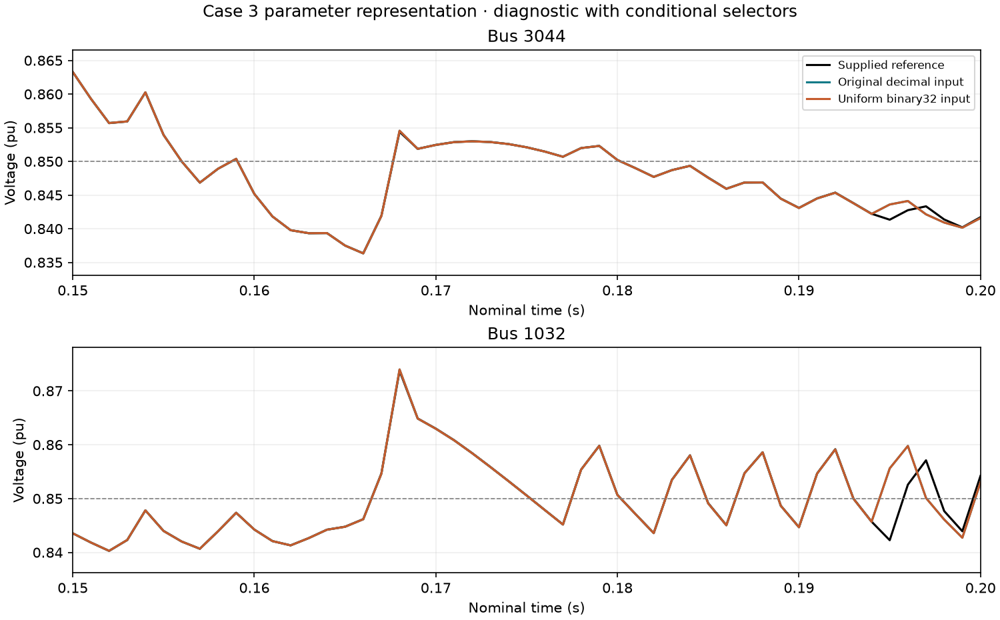

# Case 3 parameter representation control

Uniform binary32 representation of the dynamic-model parameters does not
resolve the early coupled-network divergence. It removes the first inferred
dip-decision disagreement at bus 3044/2, but the later disagreement at bus
1032/1 remains. At 0.195 seconds the voltage error there is still 0.0133414 pu
and reactive-power error is 41.3855 Mvar.

This is a diagnostic using the supplied full-system Case 3 results. It does
not change production parsing, equations, thresholds or acceptance limits.

## Paired inputs and scope

The control retains the corrected hydro gate-limit and electrical recovery
models, locally computed converted terminal point, current-P/impedance-Q
loads, 1 ms stepping, two cold-history rows, and 1e-4 network tolerance.
It also retains the previously declared 55 reference-derived recovery
selectors. Those selectors still lack an accepted autonomous initialization
rule, so neither trajectory is a system-acceptance run.

All 30,672 real literals in the original dynamic data are processed using
the same nearest-even binary32 rule. Of those, 29,160 change their decimal
representation; every binary32 bit pattern remains identical to that of its
original literal. Integer fields, quoted identifiers, RAW and IDV files are
unchanged. No parameter is selected by comparison error.

The models derive their own states from the represented parameters. Across
623 cold device records, 21,132 numeric leaves change, with a largest change
of 2.82e-7. These records include derived electrical quantities as well as
states; this count is not a count of independent dynamic states.

The resulting network matrix changes in 286 complex entries, with maximum
absolute difference 3.59e-6. Eleven entries differ after conversion to
complex64. The control therefore factors its actual matrix once and reuses
that factorization for 2,928 solves. It does not reuse a factorization of the
preceding control's different matrix.

## Comparison against supplied measurements

Each trajectory contributes 203 retained rows and 6,578 matched channels.
Scores below use the 201 nonnegative samples through 0.2 seconds. Voltage
NRMAE is mean absolute error divided by the full ten-second reference range.

| Quantity through 0.2 seconds | Original decimal input | Uniform binary32 input |
|---|---:|---:|
| Worst voltage NRMAE | 0.000528827 | 0.000531715 |
| Maximum voltage error, pu | 0.0133437 | 0.0133414 |
| Maximum rotor-angle error, degrees | 0.00111257 | 0.00111248 |
| Bus 1032/1 maximum reactive-power error, Mvar | 41.3849 | 41.3855 |
| Voltage channels below 0.001 NRMAE | 2,000 / 2,000 | 2,000 / 2,000 |
| Rotor channels below 0.02 degrees maximum error | 333 / 333 | 333 / 333 |

These short-prefix mean-error passes do not establish complete prefault
acceptance. The large voltage discrepancy already appears near the end of
the prefix; the preceding full-prefault diagnostic fails.

At 0.156 seconds, supplied bus 3044 voltage is 0.849991024 pu. The original
control gives 0.850000628 pu, while the represented control gives
0.849999682 pu. Thus the represented input places both trajectories below
their respective entered lower dip thresholds at that sample. Its first
inferred decision disagreement instead occurs at bus 1055/1 at 0.163 seconds.

At 0.193 seconds, supplied bus 1032 voltage is 0.850002289 pu. The two local
values are 0.849982931 and 0.849980350 pu. Both local trajectories remain
below the lower threshold while the supplied voltage is above it. Two
milliseconds later, both show essentially the same large reactive-power
discrepancy. Decisions are inferred from physical terminal voltage; internal
reference flags are unavailable.

The uniform representation rule changes a sensitive boundary decision but
does not explain the larger divergence. The evidence does not justify a
production rounding change or moving a dip threshold.

## Verification and retention

The independent check verifies 432 frozen-runtime/input hashes, all 6,578
normalization ranges directly from both supplied Parquet parts, and 36
selected extremum-channel metrics using separate scalar arithmetic. All
10,005 supplied rows are read; the two negative-time rows are retained and
excluded from the ten-second normalization range. No timing offset is fitted.

The inherited plan contains the original DYR hash. The run's provenance and
parameter-storage mapping contain the actual represented-input hash, and
`verification-v3/effective-inputs.json` explicitly records this distinction.
The supplied input and original plan are not silently rewritten.

The first comparator was stopped by the free-space guard. Its partial outputs
and failure status are retained; the completed comparator writes compressed
tables. Two rejected independent checks are also retained: one used an
incorrect selected-channel suffix, and one compared differently computed
floating-point timestamps with exact equality. The final check uses the
supplied channel identifier and the same nominal millisecond ordinal, while
retaining exact equality for maximum error values.

Private evidence is retained under
`ipss.test.plugin.core/testData/private/verification-artifacts/2026-10-20-case3-parameter-representation/`.
Large compressed trajectories and immutable dependencies remain referenced
by hash. Identical generated inputs from completed runs share storage while
preserving their paths and contents. Supplied references remain unchanged.

No production code changed, so no new model regression result is claimed.
Full prefault and ten-second acceptance, all six cases and 36 original events,
direct bus-frequency validation, and the 20-second runtime target remain open.
