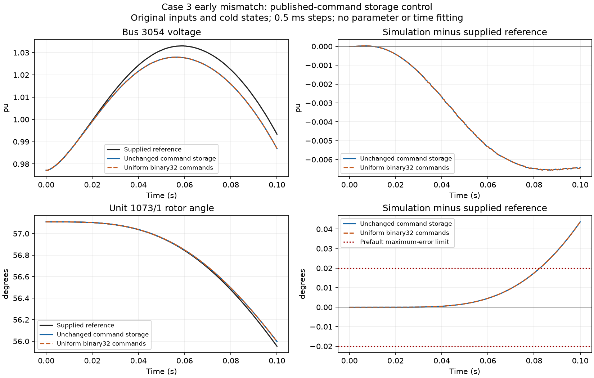

# Case 3 preprocessing and published-command storage controls

The one-pass generator preprocessing preserves Case 3's early trajectory
exactly. Uniform binary32 storage of the electrical controller's published
current commands also leaves the leading voltage and rotor discrepancies
essentially unchanged. Neither result resolves the prefault failure.

## Preprocessing control

Only the committed core inventory and preprocessing classes are refreshed
against the retained numerical runtime. The original inputs, computed converted
operating point, I-P/Z-Q load profile, 0.5 ms integration step, two cold-history
rows and 1e-4 dynamic network tolerance are retained. Initial network convergence
remains 1e-8. No reference state or fitted correction initializes the run.

All 203 rows through 0.1 seconds match the earlier complete prefault run
exactly across 6,578 physical channels. All 623 device records also match
exactly at each of the three cold/history checkpoints. The inventory build
count is one after checking and remains one after dynamic initialization.
This establishes reuse of the data-check inventory in the full case while
preserving the confirmed negative-load preparation.

The first launch stopped before dynamic initialization because a concurrently
modified output guard required a resource absent from the frozen classpath.
That failed attempt is retained. The completed control uses the committed
self-contained guard and bounded command capture.

## Published-command discriminator

The retained converter integration stores its continuous history in binary32,
while its published active and reactive current commands use double storage.
The diagnostic changes only those two command registers, at initialization
and each publication, using uniform nearest-even binary32 rounding for every
active converter. It does not change parameters, select individual devices,
or prescribe reference signals.

The same source overlay with rounding disabled reproduces every physical
value of the preprocessing control exactly. Both paired runs contain 203 rows
and 6,578 physical channels. Cold continuous states are identical; the largest
change in the two cold command registers is 2.97702e-8 pu.

Maximum absolute errors against the supplied observations from zero through
0.1 seconds are:

| Quantity | Unchanged storage | Binary32 commands | Worst location |
| --- | ---: | ---: | --- |
| Bus voltage, pu | 0.00656738986 | 0.00656738986 | Bus 3054 |
| Machine terminal voltage, pu | 0.00470310025 | 0.00470310300 | Unit 1072/1 |
| Rotor angle, degrees | 0.04369778491 | 0.04369675426 | Unit 1073/1 |
| Generator-speed deviation, pu | 0.00007776811 | 0.00007776739 | Unit 1073/1 |

Each group covers 30 supplied channels from the common prefault histories of
the six original Case 3 events. These are short-prefix absolute errors, not
full-window normalized acceptance scores. Generator speed remains a proxy for
frequency. Both rotor maxima exceed the unchanged 0.02-degree prefault limit.

The result rules out this specific published-command storage change as a
material remedy for the observed early mismatch. It does not prove equivalence
of all intermediate arithmetic or identify the remaining faulty boundary.
The diagnostic is not promoted into the production model.

## Evidence and remaining work

Private evidence set `2026-10-19-case3-preprocessing-command-storage` retains
the producers, scoped runtime overlays, original inputs, dependency hashes,
completed physical traces, cold records, failed first launch, per-channel
comparisons, plot data and PNG/PDF figure. Shared evidence objects are referenced
by hash instead of copying whole earlier evidence trees. All runs use bounded
console capture and preserve the disk-space reserve.

The largest retained full-prefault rotor mismatch remains 17.208856 degrees at
1073/1 in the earlier one-second run. This slice verifies the unchanged onset
through 0.1 seconds; it does not claim a newly completed one-second or ten-second
trajectory. The early converter/network feedback remains the localization
priority established by the [supplied-voltage replays](case3-prefault-localization-2026-10-19.md).

All six cases, 36 original events, direct bus-frequency agreement and the
quarter-cycle runtime target remain open. The
[current acceptance contract](texas2k-current-acceptance.json) is unchanged.
