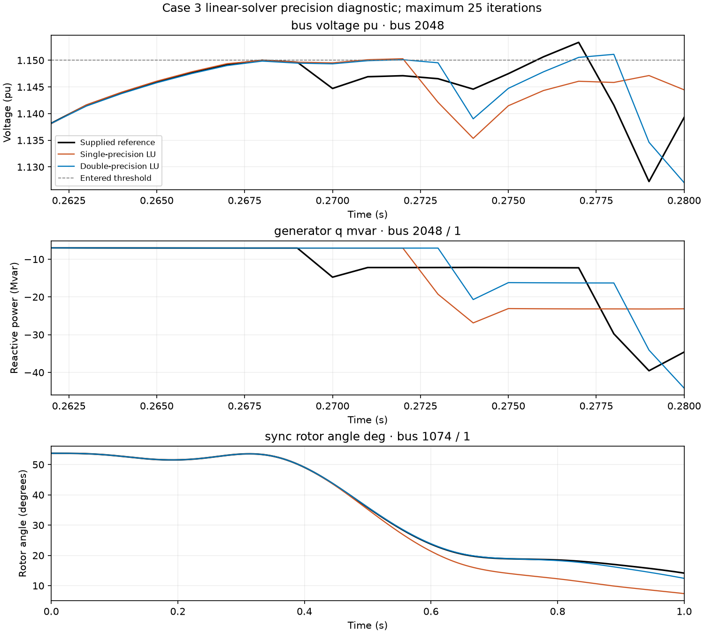

# Case 3 machine-source and network-precision controls

With the supplied terminal voltages, all 333 synchronous machines reproduce
prefault rotor angles within 0.001497 degrees through one second using the
field-stage candidate. Their current errors have little effect on the
conditional bus-2048 voltage. Changing linear-solver precision improves
that isolated voltage check, but fails to fix the coupled simulation and
reintroduces an earlier threshold disagreement at bus 1032.

These controls follow the
[network-iteration boundary diagnostic](case3-network-iteration-limit-2026-10-20.md).
They retain the original computed cold operating point and entered model
parameters. No production source, control threshold, initial state or
acceptance limit changes in this slice.

## Complete prefault machine replay

The prior machine replay is extended from 0.2 to 1.0 seconds. It prescribes
only supplied terminal-voltage magnitude and phase. All machine and controller
states evolve locally. The existing field-stage candidate uses current
regulator command with the preceding physical bridge voltage for electrical
derivatives; reported field voltage remains evaluated with current inputs.
Its scope still excludes nonzero bridge feedback and lifecycle events.

The extended replay reproduces the complete previous 203-sample prefix byte
for byte. It retains 1,003 samples for each of 333 machines, with two
negative-time history rows preserved and excluded from scoring. Every
machine's P, Q, rotor angle, speed deviation, field voltage and mechanical
power is compared against supplied measurements.

| Largest absolute error through 1.0 s | Previous field timing | Field-stage candidate |
|---|---:|---:|
| Active power, MW | 0.120248 | 0.0130013 |
| Reactive power, Mvar | 0.366117 | 0.0190321 |
| Rotor angle, degrees | 0.0194583 | 0.00149684 |
| Speed deviation, pu | 5.20095e-6 | 5.78218e-7 |
| Field voltage, pu | 0.0106745 | 0.000662610 |
| Mechanical power, MW | 0.00925423 | 0.00925423 |
| Rotor channels below 0.02 degrees maximum error | 333 / 333 | 333 / 333 |

Through 0.268 s, immediately before the bus-2048 divergence, the candidate's
largest P/Q errors are 0.00428813 MW and 0.00928598 Mvar. Its largest rotor
error is 0.00107042 degrees. These are prescribed-voltage replay results,
not coupled-system acceptance.

## Conditional machine-current contribution

Nine independent endpoint solves from 0.150 to 0.269 s compare two sets of
synchronous-machine Norton currents: currents inferred from supplied P/Q/V,
and currents from the locally evolved field-stage replay. The latter use
the exact voltage values serialized to that replay when reconstructing
their Norton sources.

Both controls use the supplied preceding network voltage and converter
regulator states from the supplied-voltage replay. Network equations,
current-P/impedance-Q load coefficients, 1e-4 voltage-change tolerance and
maximum 25 iterations remain fixed. Reference internal converter states
were not supplied, and the iteration-limit setting remains unconfirmed.

Replacing measured machine currents with replayed currents changes the
conditional bus-2048 voltage by at most 5.05e-7 pu across these endpoints.
At 0.268 s, the difference is only 2.30e-8 pu with single-precision LU.
This makes the remaining machine-current errors a small contributor at
this declared boundary.

| Conditional bus-2048 voltage at 0.268 s | Value, pu |
|---|---:|
| Supplied measurement | 1.1500021219 |
| Single-precision LU, measured machine sources | 1.1499987299 |
| Single-precision LU, replayed machine sources | 1.1499987529 |
| Double-precision LU, measured machine sources | 1.1500009547 |
| Double-precision LU, replayed machine sources | 1.1500008393 |
| Entered upper dip threshold | 1.1500000000 |

The double-precision linear solves have residuals below 1.64e-12. Both
precisions stop at 25 iterations at this endpoint without meeting the
voltage-change tolerance. The isolated threshold agreement motivates a
coupled control; it does not establish the reference simulator's precision.

## Coupled precision control

Only dynamic LU factorization and triangular-solve precision changes.
All 623 computed cold-device records are unchanged. The original network
matrix is factored once and reused for 19,303 solves in the double-precision
run. The 1 ms step, field-stage candidate, 55 reference-derived recovery
selectors and inferred maximum-25 iteration continuation policy are retained.

| Prefault comparison through 1.0 s | Single-precision LU | Double-precision LU |
|---|---:|---:|
| Largest voltage error, pu | 0.118538 | 0.122767 |
| Worst voltage NRMAE | 0.0319795 | 0.0710040 |
| Voltage channels passing NRMAE < 0.001 | 0 / 2,000 | 32 / 2,000 |
| Largest rotor-angle error, degrees | 7.16313 | 3.05261 |
| Rotor channels passing maximum error < 0.02 degrees | 0 / 333 | 0 / 333 |
| Unconverged iteration-limit stops | 478 | 473 |
| Recorded runtime, seconds | 170.35 | 225.85 |

All 6,578 matched channels are scored, with each voltage channel's full
ten-second reference range used for NRMAE. Runtime includes full diagnostic
recording and is not a controlled performance benchmark.

Double precision first exceeds 0.001 pu voltage error at bus 1032 at
0.195 s, where the error is 0.0133607 pu. The single-precision run first
exceeds it at bus 2048 at 0.270 s. Thus the isolated improvement does not
survive feedback from the preceding coupled trajectory. Neither precision
passes the declared limits.

## Convergence-norm discriminator

A wider conditional check reconstructs 269 independent endpoints from
0.001 through 0.269 s and retains all 25 iterates for each precision.
It compares two fixed 1e-4 stopping norms, both capped at 25: the largest
complex voltage-change magnitude and the largest real or imaginary
component. The closest iterate to the supplied complex voltages is retained
only as diagnostic evidence; it is never selected as a simulation rule.

| Conditional comparison | Single precision | Double precision |
|---|---:|---:|
| Complex-magnitude rule selects closest iterate | 265 / 269 | 269 / 269 |
| Component-wise rule selects closest iterate | 224 / 269 | 225 / 269 |
| Mean endpoint complex-voltage RMSE, complex rule, pu | 2.42139e-6 | 5.25404e-7 |
| Mean endpoint complex-voltage RMSE, component rule, pu | 5.47258e-6 | 3.92310e-6 |

With double precision, the norms choose different counts at 44 endpoints;
the complex-magnitude rule is closer at every one. This supports retaining
the existing norm. It does not confirm the reference configuration or
remove the need to resolve the coupled discrepancy.

The coupled double-precision run follows those independently predicted
counts through 0.194 s. Its first count disagreement occurs at 0.195 s,
after the bus-1032 threshold decisions have separated. The single-precision
run has five count disagreements through 0.269 s, beginning at 0.022 s.
These are comparisons with reconstructed counts, not supplied iteration
logs. The next localization should examine the cold point and accumulated
device inputs before the threshold transition rather than force per-step
iteration counts.

## Verification and retained evidence

Independent scalar checks verify 15,984 machine-channel metric records
and 95,904 associated fields, plus 13,156 coupled-channel metric records
and 105,248 fields. They verify the unchanged cold records, byte-identical
replay prefix, one-factorization reuse and explicit nonconvergence of all
473 iteration-limit stops.
An additional independent check reselects the fixed stopping rules from
13,450 recorded iterations and verifies all 1,076 norm summaries and
538 coupled-history records.

The first coupled setup stopped before launching the simulation because
the sandbox denied creation of input hard links. A separate retry used a
small ordinary copy of only the required inputs. Both attempts are retained.
Full trajectories and logs remain compressed, and the 2 GiB free-space guard
remains enabled.

Private evidence is under
`ipss.test.plugin.core/testData/private/verification-artifacts/2026-10-20-case3-prethreshold-source-controls/`.
These diagnostics do not establish autonomous initialization, accepted
reference solver settings or complete model support. Production integration,
all six cases and 36 original events, full ten-second voltage/rotor acceptance,
direct bus-frequency validation and the 20-second runtime target remain open.
