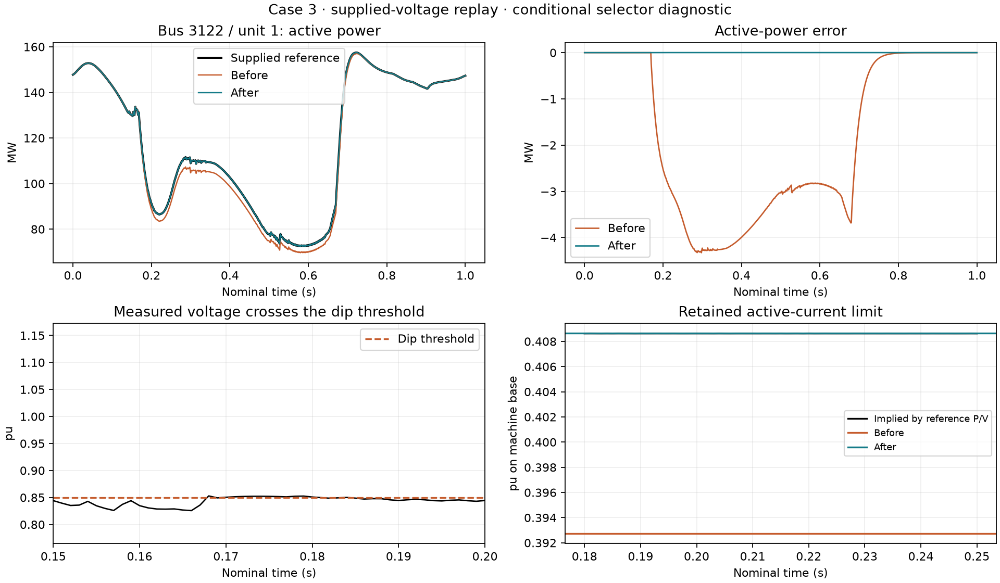
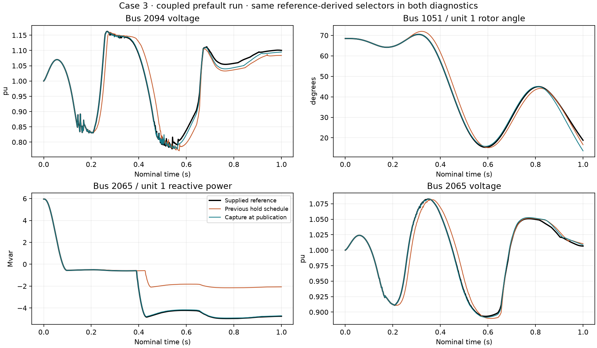

# Case 3 recovery-current memory

The supplied full-system results expose a REECA1 recovery-memory scheduling
error at bus 3122, unit 1. Capturing the active-current headroom when the
two-step controller publishes its command reduces this unit's prescribed-voltage
active-power error from 4.32696 MW to 0.00164684 MW over the prefault second.
The coupled network comparison still fails the acceptance limits.

## Scope and retained inputs

The downloaded collection contains all six cases, each with 10,005 rows,
including two negative-history samples and duplicate event times. Original
compressed parts and supplied metadata remain unchanged. The verified Case 2
file is reused without another copy. The import manifest is retained under
`ipss.test.plugin.core/testData/private/reference-imports/texas2k-full-system-bus6307-1ms-20261020/`.
Direct bus-frequency channels are absent.

This experiment continues the
[recovery-direction diagnostic](case3-conversion-recovery-signs-2026-10-20.md).
Both compared models use the same 55 reference-derived selector changes in
the declared 117-unit cohort. Those directions are diagnostic inputs; they are
not an accepted initialization rule. All 623 initial device state records,
the converted operating point, model constants and terminal-voltage inputs
are unchanged.

Converter replay covers all 290 converters and 580 P/Q channels, retaining
1,003 samples each. Scoring covers the 1,001 samples from nominal zero through
one second, before fault application. The negative-history rows remain in
the evidence. No fitted parameter, time shift, rotor offset or inferred
internal command is applied.

## Localized mechanism

Bus 3122's supplied terminal voltage crosses the 0.85 pu dip threshold
several times around 0.168 seconds. The electrical model's active-current
hold lasts 0.5 seconds. With reactive-current priority, the retained
headroom follows `sqrt(Imax² - Iqcmd²)`, subject to the active-current table.

Previously, an endpoint algebraic refresh could replace the headroom after
the two-step command had already been published. At the recovery transition,
the old model retained 0.3927317964 pu. The headroom associated with the
published reactive-current command is 0.4086359820 pu.

The correction captures that value once at command publication. Endpoint
refreshes leave it unchanged. It preserves the default staged path, current
limit equations, recovery timer, model parameters and state coordinates.
An already active hold is not restarted by a second dip.

An independent check derives the approximately constant converter command
from the supplied P and V over nominal 0.180–0.250 seconds. With the active
current lag's two-step equation, `x = P/(V·MBASE)` gives:

```text
u[k] = (Tg / dt) · (x[k+1] - x[k]) + 1.5·x[k] - 0.5·x[k-1]
```

Using binary32 Tg, dt and machine base gives 0.4086285091–0.4086315802 pu
across 71 samples, with mean 0.4086300229 pu. This is an equation-derived
diagnostic from exported measurements, not a recorded internal-state
channel. Export rounding and initial-point differences remain.

| Bus 3122/1, full prefault second | Previous schedule | Capture at publication |
|---|---:|---:|
| Active-power maximum error, MW | 4.326961 | 0.001646843 |
| Active-power RMSE, MW | 2.485325 | 0.000938859 |
| Reactive-power maximum error, Mvar | 0.000102210 | 0.000102210 |



## Fleet replay and coupled-network limits

The unchanged-model endpoint replay reproduces all 580 physical P/Q
channels through 0.25 seconds within 3.41e-13 MW/Mvar. This check reconstructs
saved/decelerated converter voltage; an instantaneous-voltage-only replay
does not close the same trajectory.
At bus 3122/1 specifically, endpoint replay closes the complete prefault
second within 5.69e-14 MW and 7.11e-15 Mvar.

With supplied voltage, the corrected fleet's largest P/Q error through
0.25 seconds is 0.00668871 MW at bus 2109/1, compared with 3.61442 MW at
bus 3122/1 before the correction. Later fleet replay requires additional
qualification: endpoint replay omits intermediate network iterations and
their high-voltage correction accumulation. Baseline local closure first
fails at 0.267 seconds. Late errors alone cannot identify a controller bug,
even when no high-voltage activity is visible at saved endpoints.

The paired coupled runs use the same operating point, 1 ms step, solver
settings and diagnostic selectors. Only the isolated REECA1 class changes.
All 6,578 matched channels are scored; voltage NRMAE uses each channel's full
ten-second reference range.

| Full prefault second, fleet measure | Previous schedule | Capture at publication |
|---|---:|---:|
| Maximum bus-voltage error, pu | 0.115477 | 0.121544 |
| Worst voltage NRMAE | 0.0657062 | 0.0688420 |
| Voltage channels below 0.001 NRMAE | 0 / 2,000 | 27 / 2,000 |
| Maximum rotor-angle error, degrees | 4.81898 | 5.17473 |
| Rotor channels below 0.02 degrees maximum error | 0 / 333 | 0 / 333 |

These are fleet extrema, not errors at one fixed device. The largest rotor
error moves from 1050/1 to 1051/1; the largest voltage error moves from bus
2094 to bus 1046. The full-system mismatch is unresolved. This slice does
not establish ten-second, all-six-case or runtime acceptance.



## Regression evidence

The new endpoint-refresh and repeated-dip guards fail against the preceding
implementation. With the correction, all 30 focused controller, history,
event and hold tests pass. All 26 retained independent electrical profiles
still meet their six-state history bounds, with identical before/after
errors. Their recovery-memory maxima remain 1.59e-7 pu at the coarse step
and 2.36e-8 pu at the fine step. Those fixtures do not exercise the ordinary
endpoint-refresh overwrite, so they establish non-regression rather than
independently proving this scheduling correction.

Independent verification recomputes the selected replay and coupled metrics,
checks 491 source/evidence hashes, verifies the 623 unchanged initial state
records and confirms byte-identical uncompressed physical output across two
baseline replay executions.

The frozen registered suite plus the 30 focused tests discovers 2,361 tests:
2,341 pass, nine are skipped, six are aborted and five fail. The five failure
methods match the preceding frozen suite: the six-case initialization smoke,
the large PEGASE power-flow test, two fixed-shunt import checks and the CGMES
voltage-match check. This is not a passing system gate. All 2,362 staged input
files retain their hashes. Only the missing output-budget configuration
section was added to the frozen harness.

An initial coupled attempt stopped before time advanced because a replay
recorder shadowed the production recorder. The successful run isolates only
the candidate model class. Two initial broad-suite attempts failed before
test execution because the frozen harness lacked the storage-guard class and
then its configuration section. These setup failures are retained separately.

The compact archive and manifest are retained under
`ipss.test.plugin.core/testData/private/verification-artifacts/2026-10-20-case3-recovery-hold/`.
The manifest protects the compressed full-system traces and supplied inputs
as hashed dependencies instead of duplicating them. No model support status
is promoted. The strict six-case flat/fault gates, complete current-reactor
suite, ten-second accuracy target and 20-second runtime target remain open.
