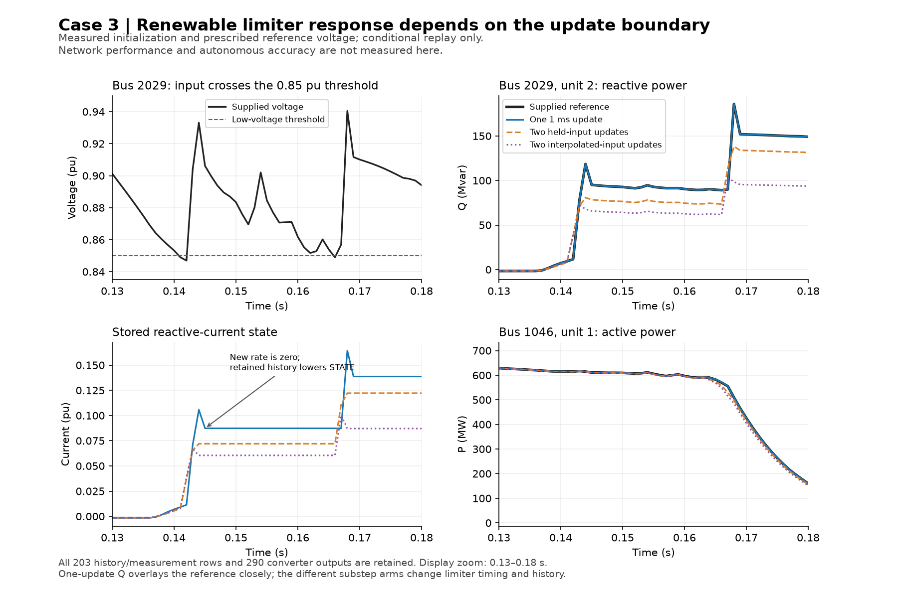

# Case 3 local-update boundary and limiter-history audit

The larger errors from local substeps are partly due to interpolating an additional voltage input, but persist when voltage is held at the recorded left endpoint. Stored-stage observations show a low-voltage current-command pulse followed by a directional zero-rate clamp. Changing the local interval changes command publication/consumption and the retained two-step history around that pulse. This identifies timestep-sensitive limiter behavior; it does not establish a wrong model equation or a production correction. The eight-second complete-run goal remains open.

## Controlled replay

The [preceding boundary replay](case3-renewable-boundary-replay-2026-10-22.md) is reused with measured initial terminal P/Q/V, explicitly as a conditional diagnostic. Four new runs include the original 1 ms update, two held-input updates, four held-input updates and four interpolated-input updates. The existing two-interpolated-input result is reused. Every run retains all 290 converter bundles and all 203 supplied history/measurement rows through 0.2 s. Only nonnegative rows are scored. No network solve or warmed complete-case timing is performed.

Held-input variants keep the recorded left voltage fixed for every local update. Interpolated variants linearly sample intermediate voltage between the recorded endpoints. Both continue to update internal controller/current feedback at each local step. The external plant/electrical input guards and constant 1 pu frequency from the preceding replay remain. Original physical parameters and binary32 state storage are unchanged. These are refinements of the 1 ms replay, not tests of the requested quarter-cycle network performance.

| Replay variant | Worst P maximum error, MW | Worst Q maximum error, Mvar |
| --- | ---: | ---: |
| One 1 ms update | 1.756995 | 0.000101 |
| Two 0.5 ms updates, held voltage | 26.214393 | 47.689557 |
| Two 0.5 ms updates, interpolated voltage | 39.558966 | 87.391795 |
| Four 0.25 ms updates, held voltage | 32.932979 | 54.598084 |
| Four 0.25 ms updates, interpolated voltage | 52.225820 | 115.519457 |

The worst active-power channel is bus 1046 unit 1 in every arm. For the original 1 ms update the largest Q error is at bus 2087 unit 2; all substepped arms have their largest Q error at bus 2029 unit 2. Holding voltage reduces the two-update Q maximum from 87.391795 to 47.689557 Mvar. That isolates an input-boundary contribution but does not make the substepped trajectory agree with the supplied 1 ms result.

## Stored-stage mechanism

Two devices are observed before and after every local advance: bus 2029 unit 2 and bus 1046 unit 1. Their complete stored converter/electrical states, last derivative evaluations, published commands and controller memory are recorded. The instrumented one-update control reproduces every physical/state CSV value from the preceding uninstrumented run exactly. All 290 ordinary outputs remain recorded; the two-device stage detail is additional diagnostic coverage.

For bus 2029 unit 2, the initial reactive power is negative and the upper/lower recovery-rate settings are zero. The active directional rule therefore limits the reactive-current derivative from below at zero. The current regulator time constant is 0.01 s. In all four observed variants, the stored derivative exactly matches the rate computed from the preceding published command, current state and this directional rule; the analogous upper-bound rule at bus 1046 also matches exactly.

In the original 1 ms replay, the sensed voltage crosses below 0.85 pu near 0.141 s. The electrical controller publishes a dip command of approximately -0.415274. The converter consumes that command on its next advance, giving a stored derivative of +40.390663 per second. After voltage recovers, the last dip command is still consumed once before the new ordinary command takes effect. The current state reaches 0.1056473 pu; on the following step the new derivative is zero and the state falls to 0.0873060 pu.

That decrease is consistent with the retained two-step recurrence: when the new rate becomes zero, the preceding +36.682442/s rate contributes approximately -0.5 × 0.001 × 36.682442 = -0.0183412 pu. A zero instantaneous derivative does not imply that the displayed two-step state remains unchanged. In binary32 storage this is the retained integration-base update already established by independent lag evidence; this audit does not replace it with clipping or a different recurrence.

With two held-input updates, the dip command is consumed within the same recorded millisecond and the controller republishes it using the intermediate state. At the recovery transition the current reaches approximately 0.0784864 pu and then drops to 0.0720031 pu. Additional interpolated input sampling changes the crossing and pulse further. These observations explain why changing only a local-step count is not semantically neutral around the limiter, without proving which discretization best approximates the continuous system or the complete coupled network.

## Implications and retained evidence

Do not promote additional substeps solely because they prevent divergence, and do not change physical gains, recovery signs or state clamps to fit this transient. A quarter-cycle reference run would help distinguish model defects from reference-step differences; its availability has been requested. Work can continue using the supplied data, but these conditional 1 ms results cannot qualify the requested quarter-cycle autonomous accuracy or performance.

Four new processes are terminal with one logical CPU verified before and after. The complete observations, all-channel errors, stage analyses, runnable producers, class/runtime identities and input/reference dependencies are retained. There are no failed rate-equation checks. Initial plotting attempts found no plotting library in the default/bundled interpreter; the existing workspace plotting dependencies produced the final figure, which was visually checked. No production model, supplied reference, acceptance threshold or numerical solver changed.
