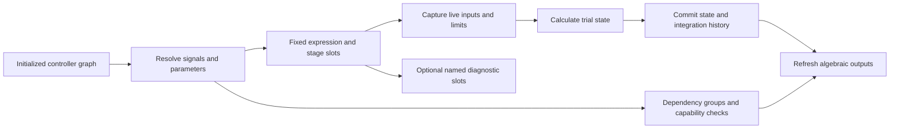

# Compiled controller runtime

The controller runtime now has an explicit compilation boundary. ST1 and PSS2A
can opt into fixed signal bindings while retaining their existing block equations,
limiter integration and network coupling. The compatible live-binding runtime
remains the default.

## Architecture

### Fixed bindings

`AbstractAnnotateController.compileRuntimePlan()` resolves block references and
expression operators once. ST1 and PSS2A bind standard public double parameters
through method handles. Parameter values, setpoints and external measurements
remain live; voltage-dependent measurements are not cached across network solves.
Custom parameter providers keep their accessors. High/low selector functions reuse
argument buffers while calling their existing implementations. Unknown functions
retain their original argument ownership and evaluation protocol.

The stage plan reuses input, state, derivative and limiter buffers. Physical block
storage remains authoritative, so the existing solver can still restore states.
This is not a second copy of the model equations or a new global integrator.

### Integration lifecycle

The observable phases are input capture, state advancement and algebraic refresh,
followed by idle. Compatible first-order kernels additionally expose separate
`calculateStage()` and `commitStage()` operations. Trial calculation does not
modify the block or its stored predictor derivative. Non-windup and custom kernels
retain their atomic integration methods because those methods own additional
history and projection behavior.

Positive-time input ordering and both established post-advance passes remain
unchanged. The compatible path retains support for nested controller integration.
The compiled path rejects nested integration and graph mutation during a stage.

### Dependency scheduling

Compilation identifies strongly connected signal groups and their dependency
order. A signal cycle can include a dynamic state; it is not automatically a
physical algebraic loop.

Output scheduling requires an explicit controller purity capability and supported
blocks. Acyclic groups evaluate once. Cyclic groups iterate locally, checking all
member outputs with the existing relative threshold of `1e-14` and a 64-iteration
cap. Failure produces a nonfinite output rather than accepting an unsettled loop.
This local criterion is stricter than checking only the final controller output.
Unknown functions, custom history or unproven block semantics retain the original
whole-controller refresh. ST1's custom feedback path retains that protocol.
Recognized PSS2A child graphs declare their pure output-refresh capability.

### Numerical kernels and diagnostics

The compiled graph selects the existing exact-class numerical kernels. It does
not introduce handwritten ST1 or PSS2A equation copies. Custom subclasses retain
their virtual integration methods and can explicitly declare safe output refresh.

`CmlRuntimeDiagnostics` binds physical state names to reusable numeric slots.
It exposes states, stored derivatives, current equation residuals and available
limiter boundary information. Second-order blocks expose both physical states;
compound filters expose their internal integration states. PSS2A custom lead-lag
and optional washout blocks supply their own diagnostic bindings.

Sample immediately after initialization to inspect initialization residuals.
A stored predictor derivative is not an initialization residual. Unsupported
residuals are `NaN`, unsupported blocks are listed, and unknown limiter status is
explicit. A state at a bound is distinguished from an active anti-windup clamp.
No diagnostic sampling occurs unless requested.

## Use and mutation contract

For the staggered solver, call `setCompiledControllerGraphsEnabled(true)` before
initialization. This currently enrolls the exact ST1 and PSS2A model classes. The
existing runtime-optimization switch must also be enabled. Other models keep
their existing runtime.

Standalone initialized controllers can call `compileRuntimePlan()`. Before
replacing a block, changing an expression, changing graph structure or changing a
mode that affects the declared history/purity capability, call
`invalidateRuntimePlan()` at an idle solver boundary, make the change, then
recompile. Invalidating returns the graph to compatible live bindings. A failed
compile also returns the tree to compatible bindings. Recreate diagnostic plans
after invalidation; old diagnostic plans reject sampling after their generation
changes. Raw public-field edits cannot be intercepted by the runtime, so callers
must honor this contract.

## Validation and limits

Core regression checks cover fixed arithmetic, live parameter changes, both
integration stages and stored history, trial/commit separation, graph invalidation,
mutation rejection during capture, acyclic refresh, local feedback convergence,
divergence reporting and diagnostic noninterference. Existing nested-call and
live-binding compatibility tests remain enabled.

The coupled small-system test compares every recorded voltage, machine quantity,
named state, stored derivative and available equation residual through fault
application and clearing. Compiled and live bindings match bit for bit. Existing
ST1 local-integration and PSS2A block regressions also pass.

The focused gates pass **32 core tests and 8 plugin tests**. In the full Case 2
pair, all **2,405 samples across 4,810 channels** are finite and identical, including
the pre/post rows at both event boundaries. The compressed trace, channel metadata,
selected-channel export and initial compensation export all have matching hashes.
This covers **11,568,050 measurements** without reducing sampling or channels.

| Full-export diagnostic run | Integration time | Network time | Network iterations |
| --- | ---: | ---: | ---: |
| Compatible live bindings | 32.310 s | 13.035 s | 38,819 |
| Compiled controller graphs | 29.492 s | 13.106 s | 38,819 |

Both runs simulate ten seconds at a quarter-cycle step with network tolerance
`1e-5`, one process-affinity CPU, Serial GC and a fresh JVM. They execute 2,400
integration steps and 4,800 network calls. Integration timing excludes export and
initialization; the complete runner takes 54.302 s and 51.844 s respectively.
The observed reduction is **8.7% in one diagnostic pair**, not a repeated timing
qualification. These use the production runtime and must not be compared directly
with the separate twelve-source experimental overlay. The ten-second runtime goal
remains open.

Identical trajectories have identical errors against any unchanged supplied
reference and comparison rule. This is numerical nonregression, not a new
independent-reference acceptance result. Existing accuracy gaps, model support
labels and independent thresholds are unchanged.

The full trace SHA-256 is
`9dc7b457d18bfcbe46e370409814107b6e882f4bbad8e41462a1cb1c9cdbd2cd`.
The two trace paths share immutable storage after byte-identity verification,
avoiding a second 92,939,945-byte file. Supplied references are unchanged.
Sources, commands, test reports, hashes and comparison evidence are retained by
`ipss.test.plugin.core/testData/private/verification-artifacts/2026-10-20-compiled-controller-runtime/manifest.json`.

The next migration boundary is explicit custom-kernel capabilities, especially
projected derivatives and limiter status. Global flattening of every model's state
storage and generation of whole-model Java source are not implemented by this
change. The architecture supports incremental adoption without duplicating model
equations.
