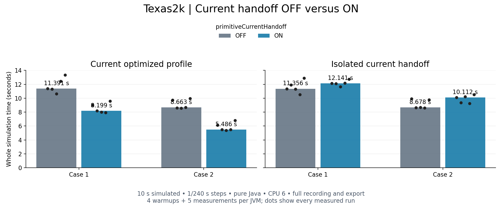

# Primitive current handoff: controlled comparison

`ipss.experiment.primitiveCurrentHandoff` selects reusable primitive current
buffers and the direct pure-Java sparse-solver handoff. In the current core,
it also qualifies packed network iteration, converter-compensation removal
and accepted-endpoint reuse. Its full-profile effect therefore includes
those dependent optimizations.

The measured full-profile median improves by 28.0% in Case 1 and 36.7% in
Case 2. The isolated handoff shows no speed benefit: its medians are 6.9%
and 16.5% slower, with overlapping ranges. Retain selection in the qualified
optimized profile; these results do not justify enabling the isolated
handoff as a universal default.

Two experiments separate these effects. Each OFF/ON pair differs in exactly
one JVM property; numerical settings, inputs, classpath and recording agree.

| Experiment | Other optimization settings |
| --- | --- |
| Current optimized profile | The maintained profile requests packed iteration, converter-compensation removal and endpoint reuse; switching handoff OFF also gates these paths off |
| Isolated current handoff | `packedNetworkIteration`, `fusedPackedConvergence`, `removeConverterCompensation` and `acceptedEndpointReuse` are OFF in both arms |

## Whole-run timing

| Experiment | Case | OFF median / range (s) | ON median / range (s) | Median reduction |
| --- | ---: | ---: | ---: | ---: |
| Optimized profile | 1 | 11.391 / 10.615–13.335 | 8.199 / 7.925–9.592 | 28.0% |
| Optimized profile | 2 | 8.663 / 8.581–9.939 | 5.486 / 5.392–6.800 | 36.7% |
| Isolated handoff | 1 | 11.356 / 10.516–12.900 | 12.141 / 11.659–12.745 | -6.9% |
| Isolated handoff | 2 | 8.678 / 8.608–9.931 | 10.112 / 9.252–10.519 | -16.5% |

A negative reduction means the ON median is slower. Small effects with
overlapping timing ranges are not established performance improvements.

Each arm uses a separate JVM because selection is static at class loading.
There are four complete warmups followed by five fresh-network measurements
per JVM. Case 1 runs OFF then ON for the profile and ON then OFF for isolation;
Case 2 reverses both orders. These are separate cohorts, not paired or
interleaved samples. Overlapping ranges limit claims about small effects.

The timer includes import, power flow, initialization, controller preparation,
the complete ten-second simulation, all recording, CSV export and writer
closure. Integrity hashing and verified duplicate-file sharing run afterward.
Residual compilation remains timed and is recorded for each invocation.

Both cases use ordinary modified Euler, a 1/240 s network step, 1e-5 pu
complex-magnitude voltage-correction tolerance, at least two fresh iterations
and a maximum of 50. Both network mixers are OFF. CPU affinity is verified
before and after every JVM at logical CPU 6 (mask 64), with one active Java
processor, Serial GC, a 2 GiB heap, synchronous compilation and identical
inlining options. No native sparse solver is used.

An integration-method audit confirms that both OFF and ON use the same ordinary
predictor/corrector implementation. The retained runner constructs `TimedSolver`,
which extends `DefaultDynamicSimulationSolver` and delegates integration to its
superclass. It explicitly rejects a staggered plan. All 72 warmed-batch
invocations record ordinary modified Euler for both the solver and renewables;
the audited runner bytecode matches the frozen archive. These figures therefore
measure profile changes within one integration method. The `MODIFIED_EULER` enum
alone would not establish this distinction: `StaggeredEulerSolver` also uses
that underlying derivative API, while implementing a separate STORE recurrence
and derivative history. A comparison between those two solvers is a separate
experiment and can legitimately produce different trajectories.

Case 1 retains 6,190 channels; Case 2 retains 4,810. Both retain all 2,000 bus
voltage magnitudes and angles, machine/converter terminal P/Q, available
synchronous rotor angles and all 2,405 samples, including startup history and
both event sides. Required frequency coverage remains 485 buses.

## Work performed

| Experiment | Case | Network iterations OFF / ON | Packed calls OFF / ON | Endpoint reuses OFF / ON | Auxiliary sources OFF / ON |
| --- | ---: | ---: | ---: | ---: | ---: |
| profile | 1 | 45,405 / 20,559 | 0 / 4,807 | 0 / 2,399 | 0 / 96 |
| profile | 2 | 52,766 / 22,732 | 0 / 4,807 | 0 / 2,399 | 0 / 96 |
| isolated | 1 | 45,405 / 45,405 | 0 / 0 | 0 / 0 | 0 / 0 |
| isolated | 2 | 52,766 / 52,766 | 0 / 0 | 0 / 0 | 0 / 0 |

| Experiment | Case | Network median OFF / ON (s) | Device integration median OFF / ON (s) |
| --- | ---: | ---: | ---: |
| profile | 1 | 6.033 / 2.991 | 3.965 / 3.805 |
| profile | 2 | 5.999 / 2.817 | 1.510 / 1.508 |
| isolated | 1 | 6.025 / 6.438 | 3.909 / 3.977 |
| isolated | 2 | 6.022 / 6.690 | 1.495 / 1.549 |

Regional medians are calculated independently and need not sum to the whole-run median.

The isolated experiment measures reusable interleaved real/imaginary storage,
qualified direct static-current writers and direct in-place triangular solves.
Voltage-dependent injections are refreshed on every required iteration.
The full profile additionally avoids repeated object publication during packed
iteration, changes the qualified converter fixed-point formulation and reuses
certified accepted endpoints. Those gains must not be assigned solely to
copying current data. Both paths reuse matrix factors until the matrix changes.

## Numerical differences

Within every arm, all warmup and measured recordings are byte-identical.
Both profile-ON recordings also match the prior frozen optimized recordings
byte for byte. The comparisons below use OFF as the control, without fitted
offsets, filtering or time shifts. Timestamp and event-side sequences agree;
every recorded value is finite.

| Experiment | Case | Recordings identical | Worst bus-voltage RMSE / peak (pu) | Worst rotor-angle RMSE / peak (degrees) |
| --- | ---: | --- | ---: | ---: |
| profile | 1 | No | 0.0010418328 / 0.008881582 | 0.80043413 / 2.6232458 |
| profile | 2 | No | 0.0027889291 / 0.023384899 | 0.32026907 / 0.91202226 |
| isolated | 1 | Yes | 0 / 0 | 0 / 0 |
| isolated | 2 | Yes | 0 / 0 | 0 / 0 |

These are maxima across channels for the complete 0–10 s interval; the worst
RMSE and peak can belong to different channels. The checkpoint contains every
quantity family, worst channel, prefault and fault/postfault errors, and
range-normalized errors using the full ten-second OFF-channel range.
The full-profile differences are material: worst rotor-angle RMSE is 0.8004°
in Case 1 and 0.3203° in Case 2, with peak bus-voltage differences of 0.00888
and 0.02338 pu. This combined switch is not a trajectory-equivalent change.
Do not infer which arm is more accurate from this internal comparison.
Finite-tolerance trajectory differences from dependent optimizations must be
distinguished from exact current-handoff equivalence. This experiment does
not establish independent reference acceptance; previously documented absolute
reference-accuracy limitations remain unresolved.

## Selection and implementation

The property defaults to false outside an explicitly selected profile. Set
`-Dipss.experiment.primitiveCurrentHandoff=true` or `false` before launching
the JVM. Changing a system property after the owning class has initialized
does not switch an existing process. Unknown/custom structures retain guarded
compatible execution; enabling the property alone does not guarantee coverage.

Relevant implementation points:

- Core `BaseDStabNetworkImpl`: `PRIMITIVE_CURRENT_EXPERIMENT`, `primitiveCurrentAssemblyEligible`, `solveNetEqn_impl`, `beginPackedIteration`, and `acceptedEndpointSourcesSafe`.
- Core `DStabCurrentBuffer`: deferred-publication and device qualification.
- Core `JKLUSquareMatrixEqnComplexSolver.solveInterleavedInPlace`: pure-Java primitive RHS solve using retained factors.
- Core `DStabSolverImpl`: packed selection and accepted-endpoint certificates.
- [Maintained optimization profile](../../tools/benchmarks/texas7k_single_cpu.json).
- [Imported-case default solver and lifecycle](../dynamic-solver-selection.md).

## Retained evidence

No engine source or production runtime was changed for this study. All 75
complete runs (72 in warmed cohorts and three pilots) succeeded. This is a
measurement study; no new full-suite execution is claimed.

The [machine-readable checkpoint](checkpoints/texas2k-current-handoff-2026-10-25.json)
contains all samples, timing regions, counters, flags and comparison metrics.
The private manifest retains exact commands, CPU affinity, source identities,
loaded runtime jars, classpath resources, harness sources, logs and full traces.
Verified identical generated traces share storage; supplied references remain
unchanged.

Private manifest: `ipss.test.plugin.core/testData/private/verification-artifacts/2026-10-25-texas2k-current-handoff/manifest.json`.

SHA-256: `782687b16757321b1b7475c0f4da61f65cff44e24cbc7738dbd70cc90b2a0caf`.
