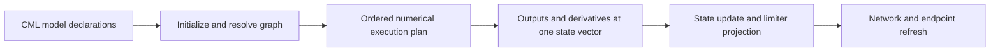

# Texas2k supplied-reference comparison: work in progress

## Acceptance contract

The supplied corpus contains 36 ten-second disturbances across six cases. The
updated user contract covers all matched bus-voltage magnitudes, machine
terminal P/Q, and generator rotor angles. The original selected-channel
references omit bus-voltage angles; the additional full-system Case 2
bus-6307 reference includes them. The user confirmed the following limits and
conventions:

- Voltage and P/Q: NRMSE below `0.001` before the event and `0.005` from event
  application, including the fault, through the end of the run.
- Both periods use the **full ten-second reference range** as the denominator.
- Rotor angle: maximum absolute error below `0.002` degrees before the event;
  **RMSE below `0.01` degrees** across the full ten seconds.
- Load conversion: constant-current P and constant-impedance Q.

The prefault side at the application timestamp is a prefault observation; the
duplicate event-post sample belongs to the fault/postfault period. The earlier
single `0.001` full-window gate is retained only as historical evidence.
The updated target has **not** been achieved. Partial or failed trajectories
cannot pass.

Commercial-tool documentation and reproducible commercial-tool outputs are the
primary verification references for the exact model and version. ANDES is a
secondary consistency check; agreement with it does not establish correctness
or satisfy commercial-reference acceptance. Resolve discrepancies against the
commercial references and documented equations. Do not change model behavior
or relax tolerances solely to match ANDES. Missing commercial verification
remains an open verification gap.

The supplied commercial-simulator outputs are the final accuracy reference for
this benchmark and for selecting a network convergence tolerance. A tighter
InterPSS run is an internal numerical-sensitivity control. Agreement between
InterPSS runs cannot establish correctness or replace the supplied-reference
voltage, terminal P/Q and rotor-angle acceptance checks.

The local comparison producer retains input and reference SHA-256 hashes,
freezes compiled runtime jars, preserves event-pre/event-post samples, and
validates the native float32 clock before mapping samples by integration-step
count. It does not fit parameters, initial angles, offsets, or trajectories.
Simulator-driving programs and full numerical evidence remain in the ignored
private verification archive, following repository policy.

## First validation case

Case 2 is the first testing and benchmarking case, as requested by the user.
The earlier largest initial voltage difference of `2.14042e-6` pu applies to
60 original observations covering only 51 unique buses. Bus 1033 was absent
from that set. It does not establish agreement at all 2,000 buses. The later
full-system reference exposes a `0.01119813` pu mismatch at bus 1033 that was
already present in the earlier local solution. Initial power-flow agreement
must now be checked across the complete supplied bus set before drawing
conclusions about dynamic initialization.

The first disturbance is `case2_bus_fault_01` at bus 6307. A 1.2-second
diagnostic covers the prefault interval, fault application, clearing, and early
recovery. It uses the confirmed constant-current P / constant-impedance Q
profile, a fully settled power flow, and a frozen runtime. The full ten-second
reference range remains the normalization denominator for this short check.
After the prefault mismatch is resolved, Case 2's remaining faults and
generator trips follow before expanding to the other five cases. Short
diagnostics cannot establish ten-second acceptance.

The first frozen run completes 1.2 seconds in 92.009 seconds of wall time,
including loading and initialization. Power flow reaches zero unsettled
controls; the largest initial Norton residual is `1.025e-12` pu. Fault
application and clearing both converge. The prefault comparison nevertheless
fails 18 of the 20 channel criteria:

| Quantity | Worst prefault error | Required limit | Channels passing |
| --- | ---: | ---: | ---: |
| Bus voltage, NRMSE | 0.00148441 | < 0.001 | 2 / 5 |
| Terminal P, NRMSE | 0.00305938 | < 0.001 | 0 / 5 |
| Terminal Q, NRMSE | 0.00388275 | < 0.001 | 0 / 5 |
| Rotor angle, maximum degrees | 0.325219 | < 0.002 | 0 / 5 |

Using only observed prefault squared errors and the full ten-second reference
sample count gives rotor-angle RMSE lower bounds of `0.01845`–`0.02994` degrees
for these five machines. Even zero subsequent error cannot make this runtime
pass the ten-second angle criterion. The unobserved remainder is incomplete;
no full-window NRMSE result is claimed.

Recorded-boundary controller diagnostics retain the original Case 2 data.
Replaying reference speed and electrical power through the five PSS2A
stabilizers gives maximum output errors below `1.8e-5` pu. Replaying terminal
voltage, field current, and stabilizer output through their exciters gives
maximum EFD errors below `7.6e-5` pu for four ESST4B machines and `0.001224` pu
for the EXST1 machine. These diagnostics use 0.5-, 0.25-, and 0.125-ms
integration steps and narrow the remaining investigation; they do not prove
full-system agreement or complete model conformance. Fourteen comparison
contract tests pass, including event sides, full-window normalization,
degree-based angle limits, and rejection of incomplete trajectories.

A separate 0.25-ms full-network diagnostic covers the complete prefault
interval while retaining the 0.5-ms reference observation grid. All five
voltage channels pass, with worst NRMSE `0.000587661`. Worst P/Q NRMSE falls to
`0.00148466` / `0.00167444`, and maximum rotor-angle error falls to `0.218461`
degrees. P, Q, and angle acceptance remains unmet. This step-size sensitivity
requires further integration/coupling investigation. The observation option
also reproduces all 50 numerical columns exactly at all 41 samples of a
separate ordinary-step, 20-ms regression check.

## Integration and operating-point follow-up

An independent cold replay exactly reproduces the commercial two-bus wind
trajectory. Three unconstrained lag states follow
`x[n+1] = x[n] + h*(1.5*f[n] - 0.5*f[n-1])`, with zero previous derivative
at startup and `h=0.0005` seconds. Here `f=(u-x)/T`, using the recorded inputs
and unchanged time constants:

| State | Maximum recurrence error (pu) | Steps checked |
| --- | ---: | ---: |
| REGCA1 active current | 7.09e-8 | 2,002 |
| REECA1 active-power order | 7.38e-8 | 2,002 |
| WTTQA1 measured power | 7.25e-8 | 2,002 |

Each float32-rounded prediction differs by at most one rounding unit. This
identifies the observed two-step update for these branches, rather than a
Heun update. Limiter transitions, event histories, and coordination of all
model derivatives still need verification before a production integration
change. Adding two Heun startup steps alone does not solve Case 2: worst
prefault voltage/P/Q NRMSE remains `0.00141946` / `0.00295138` / `0.00385832`,
and maximum rotor-angle error is `0.333880` degrees.

An explicit `TWO_STEP` renewable integration option now captures the converter,
electrical, plant, and wind inputs at a common old endpoint. It advances states
once and refreshes algebraic commands at the second solver stage. The ordinary
integration option remains the default while full-system coordination and
limiter/event histories are unresolved. Seven new tests cover the first two
commercial startup steps, common-endpoint coupling, bypasses, dip freezes,
algebraic refreshes, and reinitialization. All **114 focused Java tests** and
**14 comparison-contract tests** pass. A default-option Case 2 check reproduces
every exported field exactly across 41 samples and 50 signal channels.

On the unchanged one-second two-bus wind profile, the new option reduces the
maximum active-power-order error from `0.000648616` to `0.00000345644` pu and
the active-current-state error from `0.000284216` to `0.0000131210` pu. Terminal
active-power error falls from `0.000228824` to `0.00000285113` pu on system base.
The reactive-path discrepancy remains; these results do not establish complete
model conformance.

Changing only the 107 renewable devices does **not** resolve the full network.
The Case 2 first-fault diagnostic completes 1.2 seconds, including clearing,
in 88.068 seconds. Worst prefault voltage/P/Q NRMSE is `0.00198368` /
`0.00573435` / `0.00652358`; maximum rotor-angle error is `0.441953` degrees.
Eighteen of the twenty prefault criteria fail, and the ten-second trajectory is
incomplete. This candidate is retained as a failed mixed-integration diagnostic.

An independent audit of the supplied first-fault outputs covers 30 GENROU
machines across all six cases. Using recorded speed to predict the next
rotor-angle state, the two-step recurrence is within one float32 rounding unit
for **600,021 of 600,060** intervals, compared with 596,146 for the trapezoidal
identity. In the first three milliseconds after Case 2 fault application,
generator 6244's maximum identity error is `7.74e-10` radians for the two-step
update and `1.03e-6` radians for the trapezoidal update. This localizes the next
integration investigation to a consistent machine/controller/network update;
it does not verify the remaining machine equations or full-system accuracy.

The commercial application guide's equation 15.2 confirms
`2H*dn/dt = (Pm - D*n)/(1+n) - Telec` for the native Flux0 convention. The
frozen GENROU adapter already implements this equation. The GENSAL adapter
was missing the corresponding override and now uses the same calculation.
Four public two-bus response profiles cover speed deviations of both signs,
with zero and nonzero damping. Each repeats with an identical CSV hash from
a second cold process. Independent Java initialization plus the corrected
derivative predicts the first native speed increment within `5.38e-10` pu;
the old equation differs by `9.67e-7` to `1.18e-6` pu. The pulse initializes
both STATE and STORE consistently, with zero previous derivative.

All 35 focused machine checks pass, including four new checks that fail before
the correction. The six-case fault/trip smokes, all-six machine attachment
check, and four reference-integrity checks also pass. Case 2 has all 25 GENSAL
units offline, so the corrected first-fault run reproduces every exported
field exactly in all 2,403 samples. Its worst prefault angle error remains
`0.325219` degrees. This correction does not resolve Case 2 or establish
ten-second acceptance. The existing shared staggered-Euler solver supports a
smaller controller set; extending it to the actual Texas2k stack remains open.

A separate two-bus probe retains Case 2 generator 6245's GENROU parameters
and operating P/Q. Its initial rotor-angle error is `5.86e-5` degrees, and all
four electrical-state errors are below `5.5e-7` pu. The commercial reference
repeats with an identical raw CSV hash. Stator-equation reconstruction from
30 supplied Case 2 observations, covering 26 generators, instead locates
initial network-angle differences up to `0.004342` degrees. The reconstructed
internal-voltage magnitudes agree within `1.20e-7` pu. These inferred angles
are diagnostic observations only; they are not injected into simulations or
substituted for the supplied rotor-angle acceptance channels.

Enabling the tap, shunt, phase-shift, and interchange controls recorded in the
RAW file changes the solved Case 2 voltages by at most `5.33e-15` pu and angles
by `1.86e-12` degrees. Explicit augmented zero-impedance power flow also gives
the same solution; this case has no eligible branches at its saved `0.0002`-pu
threshold. Neither variant resolves the initial network-angle gap. The
reference generation's remaining preparation settings are still unconfirmed.

## Rotor-angle reference

The reference simulator's `SET_RELANG` supports absolute synchronous-frame angles with
`SWITCH=0`, or angles relative to a selected machine (`SWITCH=1`, positive
`IBUSEX`). System-average and weighted-average references are additional modes.
This is an output-reference choice; a generator rotor angle need not equal its
terminal-bus voltage angle or be zero at the slack bus.

Thirty supplied ANGLE channels were checked against their GENROU/GENSAL
rotor-angle STATE channels over 2,005 samples per case, through the first fault
boundary. The maximum difference between ANGLE and STATE converted to degrees
is `3.55834e-5` degrees, consistent with native float/export rounding. There is
no observed additional reference-machine subtraction in these supplied channels.
The comparison therefore retains the synchronous-frame convention.

The archived installed API page for `SET_RELANG` has SHA-256
`a45a5476b0c324fd0c287b4cdb019bb2a7c53ed2f894ea081d44b9f1597ce1ce`.

## Shared engine corrections

- Core `3681e4e50` removes repeated CML expression parsing, symbol-array
  allocation, unused observation collections, and repeated parameter-field
  lookup. Live signal and parameter values are still read on every evaluation.
  A paired 1.2-second fault benchmark uses identical physical classes, heap
  limits and unprofiled execution. Runtime falls from 325.201 to 223.536 seconds
  (31.26%); all numerical columns in all 2,403 samples are identical.
- Core `f7b082ed0` removes additional switched-shunt/SVC additions where the
  aggregate capacitor adapter already includes those banks. Sequence-network,
  dynamic-network and initial-load paths now count active banks once, including
  control-locked banks. In the Case 1 RAW initialization diagnostic, the largest
  fixed Norton correction falls from 4.93246 to 0.000799 pu.
- Core `124bca40f` makes the existing unmodeled-generator negative-load
  conversion active and constant-power, preserves other modeled generators at
  the same bus, and avoids duplicate equivalents on repeated initialization.
- Core `9893d5bae` clamps a violating machine at its reactive limit and
  redistributes the residual among machines with headroom. It preserves machine
  active power and the solved bus reactive total; infeasible totals return false.
  The correction is independently reproduced by the reference simulator on a public
  two-machine fixture, including both limit directions. Zero-power sharing also
  counts active machines only. The full core regression passes **2,945 tests**,
  with no failures, errors or skips.
- Core `1208a94c2` preserves solved slack-machine P/Q when reactive limits
  cannot supply the bus total. A sole slack machine retains the required Q;
  with several machines, the first active machine absorbs unavoidable excess
  after the other machines reach their limits. The allocation still reports
  the limit violation. Eight reference-simulator scenarios cover both directions and
  reproduce exactly from a second cold process. All **2,947 core tests** pass.
- Core `2576b7950` restores Q-limit enforcement after a bound is released,
  solves the changed network before another limit is selected, and includes
  colocated loads in generator power-flow results before dynamic initialization.
  Both defects fail focused regressions before correction. The complete core
  gate then passes **2,949 tests**, with no failures, errors, or skips.

## Power-flow voltage check requested by the user

The six cases were solved independently before any dynamic-state initialization,
using fixed input taps/shunts/phase shifts/interchange, active generator Q-limit
control, Java KLU, and a `1e-10`-pu mismatch tolerance. All six final runs converge
with zero unsettled controls and zero PV-generator Q-limit violations. All
2,000 active buses per case are compared with the solved RAW voltage values:

| Case | Bus-voltage RMSE vs RAW (pu) | Maximum difference vs RAW (pu) | Maximum difference vs first dynamic reference (pu) |
| --- | ---: | ---: | ---: |
| 1 | 7.016e-7 | 9.795e-6 | 3.141e-5 |
| 2 | 1.565e-6 | 2.288e-5 | 2.140e-6 |
| 3 | 5.003e-7 | 7.283e-6 | 3.400e-4 |
| 4 | 1.939e-6 | 9.797e-6 | 5.640e-4 |
| 5 | 6.889e-7 | 9.405e-6 | 2.596e-4 |
| 6 | 5.981e-7 | 6.017e-6 | 1.698e-4 |

The last column uses all 360 supplied initial bus-voltage/ETERM observations,
covering 304 unique case/bus pairs. These samples occur after reference-simulator dynamic
initialization, at `-2*dt`; they are distinct from a saved power-flow bus-voltage
export. The corrected power-flow solution agrees closely with the supplied
solved RAW values. The remaining initial dynamic-reference differences are
retained for investigation; neither data set is used to fit voltage offsets.
Before correction, Case 3 and 4 initial-reference differences reached `0.02270`
and `0.02020` pu respectively. Intermediate incomplete control variants are
preserved as failed diagnostics, not accepted power-flow solutions.

An explicit historical audit confirms that the larger Case 2 initial mismatch
is newly observed, rather than a regression in the local power-flow solution.
The earlier power-flow export and the initial values in the full ten-second
local run differ by at most `8.43769e-15` pu across all 2,000 active buses.
Both runs use byte-identical RAW inputs. At bus 1033, the earlier local voltage
is `1.026325785498238` pu and the later value is `1.026325785498240` pu; the
newly supplied full-system reference is `1.015127658843994` pu. On the original
51-bus set, the current local maximum error against the original references
remains `2.14042e-6` pu. Against the new full reference on that same bus set,
it is `2.14084e-6` pu. The earlier narrow observation set therefore missed
the operating-point discrepancy. Detailed rows and input hashes are retained
privately in `2026-10-18-case2-initial-voltage-coverage-audit`.

## Native wind-speed discrepancy

A reference-simulator two-bus discriminator uses the unchanged Case 4 Bus 2089
REGCA1/REECA1/REPCA1/WTTQA1 parameter stack. PFLAG=1 retains the generator-speed
multiplier even though WTTQA1 already forms `Pref = torque * speed`.
For `P0=0.625`, `speed0=0.8775`, and `Tpord=0.03`, the reference simulator reports
`dPord/dt = -2.5521`, matching `(0.625 * 0.8775 - 0.625) / 0.03`.
Adding WTDTA1 retains this startup derivative; changing only PFLAG to zero
removes it. This is a genuine non-equilibrium initial condition in the supplied
profile, not a signal to fit a gain or suppress the derivative.

The DYR importer explicitly selects the speed convention demonstrated by the
commercial reference. Existing typed-client behavior is retained for API
compatibility. The ANDES fixture explicitly selects its different convention
as a secondary regression check; that convention does not define the
commercial model's behavior or acceptance criteria. No comparison tolerance
is relaxed. Focused REECA1, wind-control and cross-tool tests pass.
The installed model-library REECA1/WTTQA1 diagrams and reference outputs support
this distinction; it is not a claim of complete wind-model conformance.

In first-20-ms diagnostics, maximum bus-voltage error falls from 0.01655 to
0.000947 pu in Case 4 and from 0.006732 to 0.0000953 pu in Case 5. These short
errors are diagnostics, not full-window NRMSE acceptance.

A second native discriminator separates shaft speed from WTTQA1's filtered
speed reference. With no drive train, native SPEED stays exactly at
`-0.1224999428` deviation over one second while the torque speed-reference state
changes. Adding WTDTA1 produces changing shaft speed. The native convention now
retains initialized shaft speed only when the mechanical model is absent;
the connected drive train and the existing typed-client convention continue
to supply changing speed. Focused controller and cross-tool tests pass.

On the identical native two-bus inputs, the corrected active-power order ends
at `0.603619608` versus native `0.603622019` at one second. The largest order
error is `0.000632356` at time zero, which still exposes a startup-history
difference. This diagnostic does not establish full-system accuracy.

## Open validation

The previous full-run epoch was stopped after isolating the missing native
speed multiplier; its interrupted traces are preserved and marked aborted.
Case 4's first fault also fails at application: the network reaches its
500-iteration ceiling near the adjacent REGCA1 terminal. That convergence
failure remains open.

RAW initialization, solved power flow, removal of fixed Norton corrections,
and two explicit startup-history steps have been compared separately. Neither
the history experiment nor the fixed-control load-flow experiment establishes
the correct native startup algorithm or reproduces every operating-point
quantity. They remain diagnostic variants. The initial runs assumed constant
impedance for both P and Q; each later diagnostic declares its own load
assumption. The user has now confirmed constant-current P and impedance Q.

The retained-speed follow-up compares two explicitly declared load assumptions
with identical frozen code. Case 1 fault 2 through 1.2 seconds gives maximum
voltage/rotor-angle errors of `0.0197555` pu / `2.43263` degrees with impedance
P/Q, versus `0.00236607` pu / `0.0608879` degrees with constant-current P and
impedance Q. This load profile has since been confirmed by the user. The runner
now selects the load-current network
path for mixed load profiles instead of silently leaving them in a fixed Y.

The slack fix also exposes the need to finish all enabled power-flow controls:
the old 50-iteration diagnostic ends with 42 controls unsettled. A 300-iteration
allowance reaches `CONVERGED`, zero unsettled controls, and a maximum initial
Norton residual of `9.62e-13` pu. The first-20-ms voltage/rotor errors then fall
to `2.48108e-5` pu / `0.00132629` degrees. The runner now refuses an unsettled
power-flow result. A fresh ten-second current-P/impedance-Q diagnostic using
that operating point was stopped after its prefault rotor-angle error reached
`0.00829852` degrees, exceeding the updated `0.002`-degree maximum. The trace is
preserved and marked aborted. Full-window acceptance is still required.

Machine electrical output now uses instantaneous terminal `V * conjugate(I)`
on system base. The old `getPe()` field contains air-gap power, including stator
loss and possible event averaging, so it cannot substitute for terminal P/Q at
event boundaries. Historical traces retain their original column definitions.

The native frequency discriminator uses a finite-inertia grid. Giving both
simulators the same explicit 0.05-second bus-frequency filter reduces maximum
frequency differences to `3.62e-6` pu at the renewable bus and `3.53e-6` pu at
the grid bus. The installed application guide documents the reference simulator's default
filter as 0.04 seconds. All 107 Case 1/2 and all 306 Case 3–6 REPCA1 records
have FreqFlag=0, so this plant-controller frequency branch is inactive in the
supplied profiles. No global filter setting was fitted or changed.

A subsequent frozen Case 1 fault-2 prefix completes 1.2 seconds, including the
fault, in 154.55 seconds. This epoch includes the native speed multiplier but
precedes the retained-shaft-speed follow-up. Its maximum voltage error is
`0.0197468` pu and maximum rotor-angle error is `2.4254` degrees. Using only the
observed squared error and the full ten-second reference sample count/range
already gives NRMSE lower bounds of `0.00301678`, `0.00236012`, and `0.00430510`
for buses 6219, 6289, and 6024. Even zero future error cannot make this epoch
pass those channels. It remains an incomplete diagnostic, with all dependency
jars frozen and hashed in classpath order. The reference operating point,
startup history, and remaining fleet response still require verification.

The registered plugin regression was executed with a bounded 3-GB test heap.
It exposes failures in the old Texas2k no-event stationarity assertion and
SVSMO1T2 comparison. The stationarity premise conflicts with the independently
observed native wind startup. Both failures are retained and must be addressed;
the full registered gate is not reported as passing. An earlier smaller-heap
attempt exhausted the test heap and is not an accuracy result.

The installed reference-simulator license accepts only 50 buses. Its Texas2k load probe
reports just 50 loaded buses despite a zero read error, so it cannot regenerate
the complete 2,000-bus references. Small native discriminators are supported;
full-case comparisons use the supplied immutable outputs.

## Shared integration and state-storage diagnostics

The opt-in staggered solver now binds the active Case 2 machine/controller and
renewable stack: 103 synchronous machines, 96 renewable bundles, and 3,478 shared
machine/controller states. The last count excludes states integrated within
renewable bundles. GGOV1 and HYGOV expose evaluation separately from state
advancement and history commitment. Compound controller filters expose their
physical first-order states rather than a synthetic aggregate state.

A separate opt-in renewable storage experiment retains single-precision STATE
and STORE coordinates. REPCA1 reactive-reference states retain their absolute
physical coordinate while the public controller API continues to expose
increments. The commercial model-library state layout and immutable commercial
two-bus outputs define this check. Parameters, operating points, load assumptions,
and comparison limits are unchanged. The original solver remains the default.

On the two-bus one-second probe, maximum reactive PI integral error falls from
`0.0000728680` to zero, voltage PI integral error from `0.000829404` to
`0.00000709295` pu, and terminal reactive-power error from `0.000122375` to
`0.00000540610` pu. This is limited evidence for storage behavior; it does not
establish fleet or event conformance.

Case 2's first prefault second still fails the required limits. The shared
double-precision variant has worst voltage/P/Q NRMSE of `0.00198924`,
`0.00573879`, and `0.00652494`, with maximum rotor-angle error `0.441010` degrees.
Using single-precision renewable storage gives `0.00198830`, `0.00573411`,
`0.00652135`, and `0.441264` degrees. Each variant passes only two of the twenty
prefault channel criteria and is worse than the retained original baseline.
The denominator remains each full ten-second reference range. These are
completed prefault diagnostics, not completed ten-second disturbance runs.

Core regression passes 2,949 tests; focused plugin regression passes 89 tests.
With both new options disabled, all 41 samples and 50 signals in the first
20 ms of Case 2 reproduce the original baseline exactly. Renewable event-history
averaging, remaining limiter behavior, and full-fleet accuracy remain open.
No full ten-second event is accepted by this follow-up.

Frozen inputs, sources, classpaths, raw traces, comparison reports, and validation
logs are retained under the private verification-artifact directory
`2026-10-17-shared-integration`. An earlier precision run failed because its
frozen runtime mixed incompatible versions of a shared wind-controller class;
that assembly failure is retained separately and is not numerical evidence.

## Absolute plant reactive-reference limits, October 18 follow-up

REPCA1's QMAX/QMIN limits apply to its absolute reactive reference. REECA1
consumes an incremental plant command in this implementation. The limiter and
anti-windup thresholds now subtract the initialized reference to use that same
incremental coordinate. Source parameters and the existing equilibrium guard
are retained. This correction applies to all three integration paths when
REECA1 initializes its plant controller.

A crafted two-bus commercial discriminator sets PFLAG to zero and plant
QMAX/QMIN to `0.12/-0.12`, then applies a moderate voltage disturbance at
`0.01` seconds. These deliberate probe settings are separate from the unchanged
Texas2k cases. Two fresh commercial processes produce byte-identical raw CSV.
Across 223 matched samples, maximum plant reactive-command error falls from
`0.0105335020` to `0.000000153265` pu. The new upper/lower limit tests fail
against the frozen old model and pass with the correction. A focused reactor
run passes 56 tests; 13 selected coupling/limit tests also pass when independently
compiled against the frozen corrected runtime. A later reactor attempt cannot
compile a concurrently edited drive-train reference; it is not a passing full
registered-suite result.

Matched Case 2 runs both complete through `1.2` seconds, including fault
application and clearing. Their physical inputs and references are byte-identical;
only REPCA1 runtime entries change. The first observed difference above
`1e-10` occurs at `0.2195` seconds. Worst prefault voltage/P/Q NRMSE changes
from `0.00198830/0.00573411/0.00652135` to
`0.00168580/0.00483185/0.00531888`. Maximum prefault rotor-angle error changes
from `0.441264` to `0.302794` degrees. Both variants still fail 18 of 20 prefault
channel criteria. No ten-second event is accepted.

Independent PSS2A diagram playback for the two observed ESST4B machines uses
the supplied reference speed and electrical power without feedback or fitted
offsets. Regulator-integral error remains below `0.00000168` pu. Replaying the
same diagram with the actual simulation inputs reproduces the solver's
stabilizer output within `0.000000000741` pu. This supports the checked equations
and dispatch, rather than complete stabilizer conformance. An isolated
machine-only storage-precision experiment leaves the failed Case 2 prefault
metrics almost unchanged and is retained as a diagnostic, not enabled in code.

The complete frozen evidence for this follow-up is retained in the private
verification-artifact directory `2026-10-18-plant-reference-limits`.

## Fleet localization and coupled-source check, October 18 follow-up

A completed one-second Case 2 diagnostic observes all 26 unique generators
monitored across its six supplied events. All original 50 signals remain
exactly unchanged in 2,003 samples; repeated prefault reference channels across
events also agree exactly. The broader observation finds maximum rotor-angle
error of `1.84454` degrees at bus 1078. Initial errors at buses 5038 and 6245
already exceed `0.002` degrees. Mechanical-power discrepancies occur in both
governor families; this check does not isolate a governor defect.

Independent PSS2A diagram playback, driven by the unchanged commercial speed
and power samples, covers all 16 monitored ESST4B units. Their outer regulator
integrals agree within `0.000002082` pu through one second. This extends the
previous limited stabilizer check, but does not verify the remaining exciters
or explain the full-network drift.

Bus 1084 has the largest observed renewable reactive-power excursion. An
isolated commercial playback uses its unchanged model parameters, initial P/Q,
and recorded terminal-voltage boundary. The prescribed waveform is sampled on
the commercial integration clock; whole-case acceptance sampling is unchanged.
Two fresh processes produce byte-identical raw CSV. Across 2,003 samples,
terminal-voltage discrepancy is below `0.000000203` pu. Checked converter and
controller states differ by at most `0.000000924` pu, including the plant
reactive integral. This supports the checked component equations and storage
under that prescribed boundary. It is not a whole-network comparison.

The coupled three-bus discriminator exposes an initialization crash in the
extended staggered solver: its classical source was incorrectly cast to a
machine with electrical states. Classical sources now evaluate their mechanical
states without that cast. The new regression fails against the frozen previous
solver and passes with the correction. Six frozen-runtime solver tests and
13 focused reactor tests pass. The latter count includes those same six tests;
these are overlapping checks, not 19 distinct tests.

With this correction, the coupled synchronous-machine/renewable diagnostic
completes one second. It retains the source model parameters in an explicitly
synthetic network, with an independently solved operating point. Maximum rotor
angle error is `0.000348398` degrees; maximum bus-voltage error is
`0.000020884` pu. Terminal P/Q maximum errors are `0.000095765` and
`0.000081869` pu on the system base. Two fresh commercial runs are byte-identical.
Case 2 has no active classical machines, so this correction does not resolve
its full-network discrepancy.

Separate native netting probes establish that operation order matters:
netting before I/Z load conversion makes the negative load follow I/Z;
netting afterward retains constant P/Q. Each profile repeats in two fresh
processes. The user confirms that the supplied runs net bus 1090 before load
conversion, so its negative load follows the confirmed I/Z profile. A Case 2
after-conversion experiment preserves initial injected power, but worsens
maximum prefault angle error from `0.302794` to `0.361175` degrees. The existing
load-conversion order remains unchanged and agrees with that confirmation.

The remaining 17 active renewable units use PFLAG zero and have zero initial
reactive power in the solved InterPSS case. Bus 1011's controlled playback
exposes an initialization-sensitive recovery selector: the commercial two-bus
initialization reports a tiny positive Q (`3.85e-11` Mvar), while the full-case
model starts at exactly zero. With zero directional recovery-rate limits,
those signs select different subsequent current behavior. Its current and
electrical-controller discrepancies are consequently much larger than bus
1084's. This is unresolved evidence for the zero-Q branch; it is not accepted
as proof of a PFLAG-zero equation defect or a justified change to the case's
initial Q. No initial-Q offsets are fitted to the supplied references.

Uncontrolled initial P/Q and inactive-model playback attempts are retained as
rejected diagnostics. They are excluded from the numerical claims above.
Frozen inputs, runtimes, producers, raw traces, comparison reports, and test
logs are retained under the private verification-artifact directory
`2026-10-18-fleet-localization`. No full ten-second event is accepted.

## Retained converter commands, October 18 follow-up

The zero-Q probe now retains bus 1011's original zero reactive-power limits.
The tiny positive Q still arises in the commercial linear startup solve.
Explicitly restoring the declared zero Q after that solve isolates the
component's exact-zero branch; two fresh processes reproduce its raw output
exactly. This restoration is confined to the component test. No such Q offset
or reset is applied to the Texas2k cases.

An independent recurrence audit identifies a command-staging difference.
The converter consumes a command formed from the advanced electrical-control
states and the preceding step's proportional Q inputs. Refreshing those
inputs before the converter derivative is evaluated changes the trajectory.
Across 2,001 intervals, the retained-input recurrence agrees within
`0.00000000542` pu, compared with `0.000006134` pu for simultaneous input
refresh. The opt-in two-step path now retains the completed control command
through zero-duration network refreshes. Its model parameters and initial
physical operating point are unchanged.

Prescribed-voltage component comparisons retain each commercial probe's
initial P/Q. For exact-zero Q, maximum converter reactive-current error falls
from `0.000119838` to `0.00000004843` pu. The reactive and voltage PI state
errors fall from `0.000016928/0.000014742` to
`0.0000001193/0.00000000559` pu. The tiny-positive-Q profile also agrees within
`0.00000001491` pu at the reactive-current state. The checked wind profile and
the complete coupled wind/synchronous-machine trace remain unchanged.
Fifteen focused reactor tests pass, including the new command-retention check.
An earlier test attempt failed to compile because its test constructor omitted
an argument; that setup error is retained separately.

The unchanged Case 2 run completes through `1.2` seconds with the correction,
including fault application and clearing. All 218 initial diagnostic fields
are exactly unchanged. Worst prefault voltage/P/Q NRMSE is now
`0.00197972/0.00596826/0.00714784`; maximum rotor-angle error is `0.416129`
degrees. These are worse than the previous full-network metrics, despite
the independently improved component agreement. The full-network discrepancy
remains unresolved; the component correction is not an acceptance result.

Separately forcing positive or negative recovery selection for the 17 zero-Q
units also fails the prefault requirements. Those are sensitivity experiments,
not verified reference preparation rules. Solving power flow before netting the
two unmodeled generators changes maximum initial rotor-angle error only from
`0.00320180` to `0.00318654` degrees and does not close the initialization gap.
Neither experiment changes the default case preparation.

Frozen evidence for this follow-up is retained under the private
verification-artifact directory `2026-10-18-converter-command-staging`.
No full ten-second event is accepted.

## Initialization discriminators, October 18 follow-up

Independent GENROU initialization at all 26 monitored machines uses only each
commercial reference's terminal P/Q and voltage magnitude. Maximum errors in
the four electrical states are below `0.000000445` pu; maximum relative rotor
orientation error is `0.000033920` degrees. No reference rotor states or bus
angles are injected. This supports initialization at a given physical
operating point; it does not establish the full network's operating point.

A two-bus converted-network startup prototype agrees with the commercial
startup solve within `0.000000127` pu in voltage and `0.000000762` degrees in
bus angle. Two fresh commercial processes reproduce the captured operating
points exactly. Applying that procedure to the original Case 2 RAW increases
maximum initial rotor-angle error across the 26 monitors from `0.00320180` to
`0.00327459` degrees. Using the RAW's recorded Newton tolerance instead gives
`0.00318620` degrees and leaves a larger discarded network-current residual.
Neither preparation discriminator meets the initialization requirement. The
strict power-flow preparation remains in use.

## Current-limit staging and dip history, October 18 follow-up

The frozen one-second fleet observation identifies 11 units crossing the high
voltage threshold and 15 reaching the circular current limit. All 96 active
plant controllers use the same selector combination. Two additional commercial
component replays retain the original Case 2 parameters and initial operating
points at buses 1026 and 1033. Each prescribed voltage profile is constructed
from the frozen fleet observation; each commercial replay repeats exactly in
two fresh processes. These are component discriminators, not independent
full-network acceptance runs.

The checks isolate three defects in the opt-in two-step path. The converter's
active command must combine the newly advanced power order and voltage filter
with the current limit computed before those states advance. The linked Q
integrator must remain frozen when the downstream voltage PI wants to move
farther into saturation, including when its limited derivative is already zero.
Finally, zero-duration network refreshes must not consume a dip transition or
start its post-dip hold timer. Exposed commercial timer variables confirm the
transition timing; observing them leaves every original output sample unchanged.

With these corrections, maximum active-current error falls from `0.303491` to
`0.00000146` pu in the current-limit replay, and from `0.0189640` to
`0.000000387` pu in the high-voltage replay. The checked Q-integral traces agree
exactly. Previous wind and solar component traces and the complete coupled
wind/synchronous-machine trace remain byte-identical. All three new regression
checks fail against the previous frozen runtime and pass with the corrections.
The focused reactor checks pass 18 tests; a separate compatibility run passes
59 additional tests. This is not a full registered-suite pass. The first focused
attempt encountered a floating-point boundary in the test's nominally zero
current limit; the corrected test drives the limit decisively into saturation.

The unchanged Case 2 run completes through `1.2` seconds, with all 218 initial
diagnostic fields exactly unchanged. Worst prefault voltage/P/Q NRMSE improves
to `0.00118173/0.00224012/0.00331266`; maximum rotor-angle error falls to
`0.211550` degrees. Four of 20 prefault criteria pass. The remaining requirements
still fail, and the run does not cover the ten-second acceptance window.

Frozen evidence for these follow-ups is retained under the private
verification-artifact directory `2026-10-18-current-limit-staging`.
No full ten-second event is accepted.

## First complete ten-second window and exciter localization

The frozen corrected runtime completes Case 2's first bus fault through ten
seconds. All 2,405 samples and 218 diagnostic fields through `1.2` seconds
reproduce the preceding run exactly. Every required comparison channel is
present and every period is complete. This event passes 6 of 40 channel
criteria and fails acceptance.

| Quantity | Worst prefault result | Worst fault/postfault or full-window result |
| --- | ---: | ---: |
| Voltage NRMSE | 0.00118173 | 0.00861415 |
| Terminal P NRMSE | 0.00224012 | 0.0201838 |
| Terminal Q NRMSE | 0.00331266 | 0.0985075 |
| Rotor angle | 0.211550 degrees maximum error | 19.0749 degrees ten-second RMSE |

The two voltage/power periods retain the full ten-second reference range as
their denominator. Fault application, including the fault, begins the relaxed
period. Rotor angle uses the confirmed absolute maximum-error and RMSE limits
in degrees. No offset or tolerance is changed. The complete project scope
remains six cases and 36 disturbances; no event has passed the full contract.

An independent prefault exciter replay now covers all 26 monitored generators.
It supplies recorded terminal voltage, field current, speed, current, and
stabilizer output, and uses the frozen solver's actual controller-state
bindings. Reference exciter states are not injected. Sixteen ESST4B units and
one IEEET1 unit agree within `0.0000123` pu in field voltage. The nine units
using the shared ST1 implementation differ by up to `0.00642330` pu. This
localizes a controller discrepancy without establishing its cause.

A separate two-bus commercial voltage playback retains bus 1078's GENROU and
EXST1 parameters and omits the stabilizer. Replaying its recorded physical
inputs through the same controller integration gives maximum field-voltage
error `0.00817420` pu. A second fresh commercial process adds observations of
the constants, compensated voltage, and voltage reference; all original
channels remain exactly unchanged. The constants retain the declared values
to native storage precision, compensated voltage equals terminal voltage,
and the voltage reference is constant. Simple input-lag alternatives do not
establish a correction. No ST1 production change is made by this follow-up.

The first replay helper failed compilation because its evaluation method used
a narrower controller type than the loader returns. A first equation audit
also keyed parameters by bus alone and encountered another unit at a
multiple-generator bus; its corrected version uses bus and unit ID. Both
incomplete attempts are retained separately from the completed evidence.

Frozen evidence is retained under the private verification-artifact directory
`2026-10-18-first-full-window-and-st1-localization`.

## Disconnected-machine reporting

All three supplied Case 2 generator-trip references set seven machine channels
to exactly zero for all 18,001 disconnected samples: angle, speed, field voltage,
mechanical power, terminal voltage, terminal P, and terminal Q. Internal rotor
states remain nonzero and can continue changing. The comparison runner now
reports zero for disconnected-machine channels while preserving the engine's
retained states. Connected-machine and bus observations are unchanged. Optional
diagnostic-generator observations also fall back to the original scoring subset
when that extra observation list is absent.

The new regression fails against the previous frozen runner and passes with
the correction. A focused reactor run passes its one reporting test. Its first
attempt stopped because an upstream module contained no matching specified test;
the corrected command permits that upstream condition and confirms the test
actually runs in the integration module. No new full-suite result is claimed.

An independent ten-second angle/speed audit supports the supplied angle
convention. The largest one-step angle residual is `0.000217` degrees; nearly all
increments agree within two native float32 units. Pairwise angle discrepancies
also remain, so an angle offset is not an accepted remedy. Absolute-angle
acceptance and all thresholds are unchanged.

The first expanded event batch stopped at initialization because five plans
lacked the extra observation list. The corrected second batch was deliberately
stopped after identifying the disconnected-channel reporting issue. Failed and
interrupted outputs are retained as diagnostics, not completed event results.
The next batch uses a fresh frozen runner and the original model parameters.

Frozen evidence is retained under the private verification-artifact directory
`2026-10-18-disconnected-machine-reporting`.

## Six complete Case 2 disturbances and EXST1 lower limits

The frozen runtime with corrected disconnected-machine reporting completes all
six original Case 2 disturbances through ten seconds. Every required channel
and comparison period is complete. Eighteen of 240 channel criteria pass; none
of the six events passes the full contract. The first bus-fault trace reproduces
the preceding complete ten-second trace exactly.

| Case 2 disturbance | Criteria passed | Fault/postfault voltage NRMSE | Terminal P NRMSE | Terminal Q NRMSE | Full-window rotor-angle RMSE, degrees |
| --- | ---: | ---: | ---: | ---: | ---: |
| Bus fault 1 | 6/40 | 0.00861415 | 0.0201838 | 0.0985075 | 19.0749 |
| Generator trip 1 | 3/40 | 0.0383526 | 0.0348342 | 0.0691809 | 21.5406 |
| Bus fault 2 | 2/40 | 0.0199602 | 0.0367603 | 0.0235084 | 13.7107 |
| Generator trip 2 | 4/40 | 0.0374497 | 0.0250785 | 0.0378127 | 18.8921 |
| Bus fault 3 | 1/40 | 0.00904878 | 0.0234430 | 0.0256851 | 13.1331 |
| Generator trip 3 | 2/40 | 0.0356466 | 0.0417326 | 0.0394875 | 19.2217 |

Each table entry is the worst channel in its quantity and period. Voltage and
terminal P/Q retain the full ten-second reference range as denominator.
Prefault rotor-angle maximum errors range from `0.204012` to `1.04970` degrees,
exceeding the `0.002`-degree limit in every event. No acceptance threshold,
initial state, reference signal, time alignment, or angle offset is fitted.
These six runs precede the separate lower-limit correction below. The project
scope remains all six cases and 36 disturbances.

The commercial controller model library distinguishes the lower field-voltage
bound of EXST1, `Vt * Vrmin - Kc * Ifd`, from ESST1A, `Vt * Vrmin`. The shared
implementation previously used the latter for both source models. Importing an
EXST1 record now retains its limit convention in the controller data; both
positive and negative field currents keep their signs. The existing ESST1A
convention is unchanged.

A sustained two-bus voltage playback activates the lower bound using the
original Case 2 generator and EXST1 parameters. Two fresh commercial processes
produce exactly identical raw traces. In 580 saturated samples, the corrected
output equation reduces maximum field-voltage error from `0.883235` to
`0.000000525` pu. This check uses the recorded physical inputs at the controller's
publication stage and independently evolved controller states. It is a lower-bound
check, not a claim that the complete EXST1 trajectory agrees. No reference
controller state is injected.

The new source-model regression fails with the previous bound and passes with
the correction. Twenty-eight focused tests pass in both an isolated frozen
JUnit run and the reactor. The initial reactor command stopped during argument
parsing; the next attempt encountered an unfinished unrelated wind-model test
source. Both failed attempts are retained. The later reactor run completes and
executes all 28 tests. The corrected frozen Case 2 prefix reproduces all 2,405
samples and 218 diagnostic quantities through `1.2` seconds exactly, confirming
that this bound correction does not change the unresolved startup discrepancy.
An additional compatibility reactor run passes 27 tests covering the parser,
staggered solver, and independent and secondary ST1 comparisons. These are 55
distinct focused/compatibility tests, not a full registered-suite pass. The new
regression is included in the registered core plugin suite.

Other ST1 findings remain diagnostic. The two ESST1A regulator-state channels
can differ from the machine field-voltage channel by `0.00641584` and
`0.000827789` pu, so controller states and published machine signals must be
checked separately. A declared unity-leadlag EXST1 experiment and an IEEET1
control with the same regulator gain and pole show different numerical update
behavior. The existing two-step rule matches the IEEET1 control within
`0.000000075` pu; none of the canonical EXST1 update alternatives tested so far
establishes a replacement. Both control experiments repeat exactly in fresh
commercial processes. No ST1 integration or field-publication correction is
adopted from these alternatives.

Frozen runs, failed attempts, source snapshots, and numerical checks are retained
under the private verification-artifact directory
`2026-10-18-case2-six-events-and-exst1-limits`. No ten-second event is accepted.

## ST1 local integration and field publication

Read-only observations of the commercial model-writing interface expose the
state, derivative, and retained integration-history values. Every state read is
cross-checked against the normal state API. All original channel samples remain
exactly unchanged when these observations are added. A second fresh process
reproduces the controlled EXST1 history observations exactly.

The observations distinguish ST1's ten internal steps per network step from the
common network-step rule used by the IEEET1 control. With the existing
discontinuity-history averaging rule, ten local steps reproduce the independent
EXST1 reference-step endpoint within `0.000000167` pu. The original Case 2
voltage playback, with all controller parameters unchanged, reduces maximum
field-voltage error from `0.00817420` to `0.0000125` pu. Replaying all nine
observed ST1 units through the production solver's actual local path gives a
maximum error of `0.0000539` pu. Only physical boundary signals and initial
field voltage are supplied; reference controller states are not injected.

The opt-in staggered solver now advances ST1 states on those local steps while
holding machine, network, and stabilizer inputs at the preceding network
endpoint. It publishes field voltage before refreshing the last local
algebraic input. This preserves the observed distinction between a zero-Ta
regulator's internal value and the field voltage supplied to the machine.
Machine states and other controller families retain their common network-step
rule. The default simulation method is unchanged.

The completed Case 2 prefix retains exactly the same 218 startup quantities and
covers `1.2` seconds. Thirteen of its 20 prefault criteria pass, compared with
four previously. All five voltage channels and all five terminal P channels
pass. Two Q channels and all five rotor-angle channels still fail.

| First-event acceptance quantity | Previous worst prefault result | Corrected worst prefault result | Limit |
| --- | ---: | ---: | ---: |
| Voltage NRMSE | 0.00118173 | 0.000546972 | 0.001 |
| Terminal P NRMSE | 0.00224012 | 0.000829732 | 0.001 |
| Terminal Q NRMSE | 0.00331266 | 0.00148035 | 0.001 |
| Rotor-angle maximum error, degrees | 0.211550 | 0.115433 | 0.002 |

The table uses the original first event's acceptance channels and unchanged
full-ten-second reference ranges. Across all 26 diagnostic machines, maximum
prefault angle error remains `0.356432` degrees. This prefix does not establish
ten-second acceptance or acceptance of the other disturbances.

Twenty focused tests pass, including three new integration/publication and
lifecycle regressions. All three fail their intended assertions against the
previous solver and pass with the correction. A separate negative control
confirms upper-bound priority when a severe voltage dip causes output bounds
to cross. The new regression class is registered in the core plugin suite;
no full registered-suite pass is claimed. The extended IEEE39 exporter remains
excluded by the normal test configuration and is not counted as validation.

An early prefix completed but its strict startup check detected two field
observations differing by at most `0.000000000000014` pu. Restoring the original
initial field refresh preserves every startup observation exactly. A first
ten-second attempt was deliberately interrupted while correcting the new
output path's crossed-bound priority; its partial output is retained and is
not scored as a completed event. A fresh ten-second run uses the corrected,
frozen runtime. No parameter, reference, angle offset, or tolerance is fitted.

Frozen evidence and rejected attempts are retained under the private
verification-artifact directory `2026-10-18-st1-local-integration`. The required
scope remains six cases and 36 ten-second disturbances; no event is accepted.

## Corrected ten-second window and coupled stabilizer check

The corrected first Case 2 bus-fault run completes all ten seconds. Its first
2,405 observations reproduce the final ST1 prefix exactly, including all 218
diagnostic quantities. All required acceptance samples and channels are present.
Fifteen of 40 criteria pass, compared with six before the ST1 correction. The
run still fails acceptance.

| First-event quantity | Corrected worst result | Limit | Passing channels |
| --- | ---: | ---: | ---: |
| Prefault voltage NRMSE | 0.000546972 | 0.001 | 5/5 |
| Prefault terminal P NRMSE | 0.000829732 | 0.001 | 5/5 |
| Prefault terminal Q NRMSE | 0.00148035 | 0.001 | 3/5 |
| Prefault rotor-angle maximum error, degrees | 0.115433 | 0.002 | 0/5 |
| Fault and postfault voltage NRMSE | 0.00798972 | 0.005 | 2/5 |
| Fault and postfault terminal P NRMSE | 0.0181861 | 0.005 | 0/5 |
| Fault and postfault terminal Q NRMSE | 0.0998041 | 0.005 | 0/5 |
| Full-window rotor-angle RMSE, degrees | 24.4420 | 0.01 | 0/5 |

The worst full-window rotor-angle RMSE increases from `19.0749` to `24.4420`
degrees. The correction's component evidence and improved prefault results
therefore leave a substantial unresolved full-system discrepancy. All six
Case 2 disturbances have now completed with this exact ST1-only frozen runtime,
before the subsequent load-curve correction. Thirty-five of 240 criteria pass;
none of the six events passes acceptance.

| Completed ST1-only Case 2 event | Passing criteria | Worst full-window rotor-angle RMSE, degrees |
| --- | ---: | ---: |
| Bus fault 1 | 15/40 | 24.4420 |
| Generator trip 1 | 4/40 | 22.6786 |
| Bus fault 2 | 3/40 | 14.2745 |
| Generator trip 2 | 5/40 | 18.0273 |
| Bus fault 3 | 5/40 | 14.2209 |
| Generator trip 3 | 3/40 | 20.2925 |

A new independent two-bus experiment retains bus 1078's original GENROU, EXST1,
and PSS2A parameters and applies a declared external voltage waveform. Two
fresh commercial processes reproduce all 2,003 output rows exactly. Replaying
the recorded physical speed and electrical-power inputs through the production
stabilizer gives maximum output error `0.0000000640` pu with the existing common
network-step recurrence. Ten stabilizer substeps increase that error to
`0.0000779` pu; the stabilizer's integration rule is unchanged.

The production solver also runs the complete machine, exciter, and stabilizer
together against the external voltage source. Over this one-second experiment,
maximum rotor-angle error is `0.000297` degrees, stabilizer-output error is
`0.000000719` pu, and field-voltage error is `0.000114` pu. Maximum terminal
voltage difference is `0.00000670` pu. A companion run without the stabilizer
has maximum rotor-angle error `0.000325` degrees. The source waveform uses the
declared physical time points; no reference machine or controller states are
injected. These coupled checks cover one original unit and narrow the next
investigation toward the other fleet components and network interactions.

Completed trajectories, the failed first compilation of the diagnostic helper,
frozen binaries, source snapshots, and exact comparison results are retained
under the private verification-artifact directory
`2026-10-18-st1-full-window-and-coupled-pss`. The original six-case, 36-event
contract, I/Z load assumption, normalization ranges, and angle limits remain
unchanged. No event is accepted.

## Low-voltage constant-current load discrepancy

A separate two-bus experiment isolates the static I/Z load characteristic using
a declared source-voltage sweep. A 50 MW, 20 Mvar load is converted to
constant-current P and constant-impedance Q. The current implementation applies
a sine reduction to the constant-current term below its shared `0.65` pu switch
voltage. The commercial reference instead retains constant current down to
`0.5` pu and follows an elliptic characteristic below that point.

The primary manual describes that transition graphically without printing its
equation. A scalar candidate recovered from separate native observations is
`I/I0 = sqrt(1 + 12*V*(1 - V)) - 1` below `0.5` pu, and unity above it. Independent
dense voltage sweeps with positive and negative active loads each contain
2,003 samples, including 941 below `0.5` pu. Each sweep repeats exactly in a
second fresh commercial process. Maximum active-power difference for this
candidate is `0.0000000341` pu on the 100 MVA system base. The existing sine
characteristic differs by up to `0.0323068` pu, or `3.231` MW for this load.
Constant-impedance Q agrees within `0.0000000207` pu.

These experiments isolate a network-load discrepancy while preserving the
confirmed I/Z assumption. The production correction and fleet check follow
below. Frozen producers, raw outputs,
manual-page provenance, cold-repeat checks, and comparison programs are retained
under the private verification-artifact directory
`2026-10-18-static-current-voltage-characteristic`. Full-system acceptance
remains unproven.

## Elliptic current-load implementation and fleet check

Core now exposes a typed, per-network constant-current voltage curve. Its
general default remains the existing sine characteristic. The reference
simulation adapter selects the verified elliptic characteristic before dynamic
load initialization, including reinitialization and runs with externally
supplied current injections. Constant-power and constant-impedance terms keep
their existing characteristics. The elliptic expression is evaluated in
rationalized form to preserve accuracy near zero voltage.

The production power and Norton-current paths agree with all 12,018 recorded
observations from the six cold-process sweeps within `0.0000000341` pu for P
and `0.0000000207` pu for Q. A public regression fixture contains 204 points
selected at fixed sample indices independently of their errors. All 2,953 core
tests and 21 focused plugin tests pass. Frozen negative controls confirm that
the preceding load calculation fails the native power assertion and the
preceding reference adapter fails the curve-selection assertion; all five
new tests pass with the correction. The adapter regression is registered in
the core plugin suite; no full registered-plugin-suite pass is claimed.

The completed first Case 2 prefix covers `1.2` seconds. Every one of its first
2,003 observations, including startup history and all prefault diagnostic
quantities, is exactly unchanged. Thirteen of 20 prefault criteria still pass.
For the 402 matched fault-and-clearing samples from fault application through
`1.2` seconds, the diagnostic errors are:

| Worst channel quantity over the short fault segment | Before | Elliptic current curve |
| --- | ---: | ---: |
| Voltage NRMSE | 0.00277852 | 0.00286267 |
| Terminal P NRMSE | 0.0180521 | 0.0191282 |
| Terminal Q NRMSE | 0.0156181 | 0.0153606 |
| Rotor-angle RMSE, degrees | 0.133198 | 0.148022 |

The NRMSE denominators remain the full ten-second reference ranges. Q improves
slightly in this segment; voltage, P, and angle errors increase slightly. The
completed ten-second run reproduces all 2,405 prefix observations exactly.
Fifteen of 40 criteria pass; the event fails acceptance. Prefault results are
unchanged. The complete fault-and-postfault voltage, P, and Q NRMSE values are
`0.00803266`, `0.0184665`, and `0.0996412`, respectively. Worst full-window
rotor-angle RMSE is `24.5252` degrees. The isolated load-equation correction
therefore leaves the principal full-system discrepancy unresolved.

The preceding ST1-only six-event batch completed the first generator trip
before its driver stopped on an overly broad startup assertion: different
events monitor different bus sets. All 208 shared machine quantities and
their first-second times match exactly. The corrected audit reports differing
bus-monitor columns explicitly, and the resumed batch reuses both completed
events. Acceptance scoring still requires each event's complete original
channel set.

Frozen code, raw component observations, negative controls, complete test
reports, the corrected prefix, and the batch-audit failure are retained under
the private verification-artifact directory
`2026-10-18-elliptic-current-load-correction`. The required scope remains all
six cases and 36 ten-second events. No event is accepted.

## Renewable startup audit and network-convergence diagnosis

A read-only observer captures all 96 active Case 2 renewable units through
`0.006` seconds. Every original whole-case observation remains exactly
unchanged. The original dynamic parameter stacks are then run in 32 groups of
three independent two-bus cells, preserving their solved physical P/Q/V points,
machine bases, constants, and selectors. Each commercial run is repeated in a
fresh process. All model states and physical output channels repeat exactly.
In eight groups, diagnostic variables in the disabled plant frequency path
differ between processes; the raw differences are retained, and whole-file
byte identity is not claimed for those groups. Twenty-five groups retain
native initialization warnings, so these tests do not establish clean
equilibrium or full model verification.

The largest startup voltage error with the production solver is
`0.0000308429` pu. A documented read-only scalar getter reports a default
network tolerance of approximately `0.0001`; a separate declared control uses
`0.00000001`. The native convergence monitor and a fixed 45-degree rotation of
the isolated network distinguish the magnitude of the complex voltage change
from componentwise voltage and current-residual stopping rules. The rotated
three-unit experiment has maximum voltage error `0.000000196` pu with the
complex norm, versus `0.0000198` pu with the componentwise rule. Both native
rotated runs repeat exactly; enabling the monitor leaves every channel
unchanged.

An independent diagnostic loop uses that complex norm and reuses the preceding
network endpoint before ordinary derivative evaluation. Across all 96 isolated
units, maximum voltage error falls to `0.000000224` pu. This runs in separate
diagnostic helpers; production solver behavior is unchanged. The
largest machine-base reactive-current discrepancy is already present at
initialization: the reference cell for bus 6085 has approximately `-0.000121`
Mvar rather than exact zero after its native power flow. Initial Q and
controller states are not adjusted to remove this difference.

The same diagnostic loop is also tested on the original full Case 2. Strict
initialization is preserved exactly. At `0.001` seconds the largest observed
machine-terminal voltage error falls from `0.0000591` to `0.00000190` pu.
However, this early improvement does not persist through the completed
`1.2`-second first-fault run:

| Diagnostic quantity | Production baseline | Network-loop hypothesis |
| --- | ---: | ---: |
| Passing prefault criteria | 13/20 | 2/20 |
| Worst prefault voltage NRMSE | 0.000546972 | 0.00145425 |
| Worst prefault terminal P NRMSE | 0.000829732 | 0.00309312 |
| Worst prefault terminal Q NRMSE | 0.00148035 | 0.00413582 |
| Worst prefault rotor-angle maximum error, degrees | 0.115433 | 0.286794 |
| Fault-segment voltage NRMSE, through 1.2 seconds | 0.00286267 | 0.00444208 |
| Fault-segment terminal P NRMSE | 0.0191282 | 0.0201844 |
| Fault-segment terminal Q NRMSE | 0.0153606 | 0.0149480 |
| Fault-segment rotor-angle RMSE, degrees | 0.148022 | 0.403352 |

All denominators, channels, event sides, and acceptance limits remain unchanged.
The loop is retained as diagnostic evidence; production settings are unchanged.
The initial rotor-angle error also remains above its limit.

Four prespecified groups, containing twelve original renewable stacks, are
subsequently extended to one second. All 2,003 native samples repeat exactly in
fresh processes for each group. The independent complex-voltage-loop helper
has maximum voltage difference `0.000000323` pu and active-current difference
`0.00000181` pu; the latter is already present at initialization. Maximum
terminal P and Q differences are `0.00000510` and `0.00000173` pu on system
base. The original initialization warnings and Q residuals are retained.
These twelve isolated stacks do not reproduce the larger full-system drift,
which leaves the synchronous-machine/controller fleet and coupled network
behavior as the next localization targets. These tests do not establish
full-fleet disturbance or system acceptance.

A further read-only snapshot captures all 103 active synchronous machines;
every original startup output remains byte-identical. Three complete original
GENROU/exciter/GGOV1/PSS2A stacks, at buses 1072, 5038, and 1078, are then tested
against declared positive and negative five-percent source-voltage ramps for
one second. All three commercial initializations are clean, and all 2,003
samples per unit repeat exactly in fresh processes. Maximum rotor-angle errors
are `0.00109`, `0.0000711`, and `0.0000709` degrees, respectively. Source
interpolation and scalar precision contribute to these bounded errors; the
native float clock is validated before alignment by integration-step count.
These three units do not establish complete synchronous-fleet coverage.

Another frozen diagnostic moves the existing constant-impedance load term from
the current-injection loop into the diagonal admittance matrix. The physical
I/Z load curve is unchanged. Both physical power and total Norton power,
including the matrix contribution, pass all 12,018 independent load
observations. Full-case initialization changes by at most `0.000000000000129`
in the exported quantities. Combined with the independent network-loop
hypothesis, the completed 1.2-second prefix still passes only 2/20 prefault
criteria. Worst voltage/P/Q NRMSE is `0.00141991` / `0.00283579` / `0.00384489`,
and rotor-angle maximum error is `0.270712` degrees. This equivalent matrix
split also leaves the system discrepancy unresolved; production code remains
unchanged.

An additional operating-point diagnostic infers terminal voltage angles from
the exported GENROU states and physical terminal P/Q/V. The phasor identity is
first checked against 6,009 directly recorded commercial bus-angle samples in
the three independent cells; maximum inference error is `0.0000118` degrees.
Applied to the 26 observed full-case machines, the inferred initial terminal
angles differ from the solved network by up to `0.004342` degrees. The supplied
RAW angles also differ from those inferred observations, so simply retaining
the RAW angle values cannot remove this discrepancy. This is an inference,
not a direct full-case bus-angle measurement or an acceptance result. No
inferred angle, state, initial Q, or fitted offset is injected into a run.

Completed native observations, frozen runtimes, failed channel-cap attempts,
primary-source provenance, cold-repeat checks, the corrected-load ten-second
event, and the completed additional ST1 baseline events are retained in the
private verification-artifact directory
`2026-10-18-startup-network-convergence`. The completed diagnostic prefix is
retained separately in `2026-10-18-network-loop-prefix`. All six cases and
36 events remain required; no event is accepted. The one-second independent
renewable observations are retained in `2026-10-18-renewable-one-second-controls`.
The complete synchronous-stack checks and clock validation are retained in
`2026-10-18-synchronous-coupled-controls`; the matrix-split diagnostic and final
ST1 baseline event are retained in `2026-10-18-static-z-matrix-and-case2-complete`.
The independently checked angle inference is retained in
`2026-10-18-initial-bus-angle-inference`.

## Operating-point preparation controls

Three fixed input-serialization controls, three switching-network preparation
controls, and three rectangular-voltage/PV-Q controls leave the initial
rotor-angle discrepancy unresolved. The original maximum is `0.00320180`
degrees across the 26 observed machines; the alternatives range from
`0.00320180` to `0.00333925` degrees. Initial terminal Q also remains discrepant
by approximately `0.000257` pu on the system base. All six reference first
rows agree exactly on shared channels. These checks preserve the original
dynamic model parameters and confirmed I/Z load allocation.

The serialization choices are first checked independently: all 2,003 native
samples remain byte-identical in four import profiles, each repeated in a
fresh process. A separate, finite-source two-bus network verifies fixed
generator Norton sources and the original I/Z coefficients through switching
preparation. Maximum voltage, angle, and P/Q differences are `0.0000000934`
pu, `0.00000102` degrees, and `0.000000241` pu. Applying that operator after
strict full-case power flow changes the point only at roundoff; applying it
to the supplied RAW point does not remove the initial discrepancy.

Five original passive-network rows are also exported independently. Their
differences are at floating precision. Native diagonals aggregate primitive
terms, so rounding each completed matrix entry to binary32 does not
consistently reproduce them. Simple float current-accumulation variants also
fail to explain all five passive-power observations. Public voltage getters
return binary32 components; this does not establish the precision of internal
factorization or arithmetic. Neither final-voltage rounding nor the associated
PV-Q recalculation resolves initialization. Production code and solver settings
remain unchanged.

The first passive export omits an unconverted swing row; its apparent large
error is an invalid comparison and is retained as such. Two helper compilation
failures and stiff-source cancellation controls are retained with the corrected
finite-source checks. The self-contained private artifact
`2026-10-18-operating-point-preparation-controls` preserves 1,872 file paths as
445 verified content objects, avoiding repeated copies of identical runtimes
and inputs. All six cases and 36 ten-second disturbances remain required;
no full-system event is accepted.

## Ten-second synchronous source-boundary controls

The three previously checked synchronous stacks are extended to ten seconds
with the original five-percent voltage ramps during the first second and a
held source afterward. Six additional representatives cover every actual
machine/exciter/governor/stabilizer combination in the 103-unit Case 2 inventory.
Each completed comparison contains 20,003 samples; all commercial trajectories
repeat exactly in separate processes and explicitly report clean initial
conditions. These are independent component checks, not connected-system gates.

The first paired-source commercial fixture does not preserve each requested
source file, so its apparent model discrepancies are invalid. One playback
source per process restores the declared boundary. A further check finds that
the playback magnitude specifies internal EMF, whereas the original file uses
terminal voltage. At bus 5262 the declared source impedance accounts for a
`0.00000937`-pu difference. Computing EMF from the original physical P/Q/V and
source impedance reduces ten-second rotor-angle RMSE from `0.0405205` to
`0.00750667` degrees. No reference machine/controller state or fitted offset is
introduced. Complete coverage of all 103 units remains open.

For six units, the production trajectories are exactly unchanged when the
independent cells are simulated together or separately, across every exported
quantity. This isolates grouping from the invalid paired commercial source
fixture; it does not establish behavior in the connected full network.

An unchanged full-case trajectory also shows that the discrepancy develops
beyond initialization. Across its five monitored machines, mean angle error
is `-0.103361` degrees at one second and `78.2314` degrees at ten seconds.
The corresponding spread about the mean at ten seconds is `0.710237` degrees.
These quantities describe the error only; no mean is removed from any scored
angle. Direct angle acceptance remains unchanged.

The completed controls, invalid paired fixture, subsequent disk-full failure,
source derivation, frozen runtime, and grouping audit are preserved in the
self-contained private artifact `2026-10-18-synchronous-ten-second-controls`.
Every content object is hash-verified. The running fleet extension is excluded
from this completed-evidence archive.

## Independent ESST4B integral-state limits

The source-boundary extension now covers all 103 original synchronous stacks.
Each native trajectory contains 20,003 samples and repeats exactly in two
fresh processes. All 206 logs explicitly report clean initial conditions.
These component profiles expose an ESST4B limiter discrepancy that the shorter
checks do not activate.

The native outer PI keeps integrating while its total output is clipped, until
the integral state itself reaches the regulator bound. A second independent
profile drives both state limits and their inward release. The integral state
holds at `1.0` and the binary32 representation of `-0.87`, with zero outward
derivative at either bound. The source diagram retains output clipping before
the regulator lag. Moving that limiter after the lag is unsupported.

Native imports now select separate integral-state and output limits for both
ESST4B PI blocks. This changes no DYR parameter count or ordering. Existing
typed clients retain their prior output-freeze convention. The separate
commercial SMIB fixture explicitly selects its observed output-freeze
convention; its trajectory tolerances are unchanged. The secondary open-source
comparison remains a limited common-output check, not an authority for the
native limiter rule.

Physical-input replay uses terminal voltage/current, field current, stabilizer
output and, for the limiter profile, the recorded reference-voltage increments.
It injects no reference controller state. The bus 5303 EFD maximum error falls
from `0.0384961` to `0.0000765121` pu. The strong-limit replay preserves all
20,023 observations, including 20 duplicate endpoints with no time advance.
Maximum integral-state, regulator-lag and EFD errors are respectively
`0.000000352922`, `0.000000953800` and `0.0000108144` pu. Both integral-state
bounds are reached exactly in the production replay.

In coupled ten-second cells, bus 5303 rotor-angle RMSE falls from `0.0285743`
to `0.00161541` degrees; buses 6165 and 6349 also fall below `0.002` degrees.
Two unchanged ESST1A controls reproduce their previous trajectories. The
synthetic weak-source cell at bus 6147 improves substantially but still has
`11.6751` degrees RMSE. This correction does not establish full-system
acceptance. The completed extension covers all 64 original ESST4B stacks:
58 trajectories are byte-identical to the baseline, all six affected cells
improve, and 61 have rotor-angle RMSE below `0.01` degrees. Three synthetic
cells remain above that limit: buses 7356, 6147 and 8071 have RMSE `45.5251`,
`11.6751` and `0.0174876` degrees. The completed connected ten-second event is
reported separately below.

All 23 focused parser, initialization, limiter and commercial/secondary fixture
tests pass. The public block tests cover output saturation with continuing
integration, upper/lower state projection and release, a pure proportional
path, changing modified-Euler stage inputs and explicit legacy behavior.
Completed cold references, primary-source provenance, baseline and corrected
replays, six coupled cells, immutable runtimes and failed helper controls are
preserved in the private artifact `2026-10-18-esst4b-integral-state-limits`.
The corrected fleet is retained in `2026-10-18-esst4b-fleet-coupled-controls`,
whose manifest hash-links the immutable native baseline archive.
The registered suite completes 1,985 tests with three failures and 13 skips:
the no-event smoke, an 8,387-bus power-flow test and a grid-import voltage
comparison. A first attempt exhausts a 1-GB heap during a separate large import;
the completed attempt uses 3 GB. An explicit control attempts all six unchanged
no-event assertions with both PI conventions. All six fail with either
convention; Case 1's reported metrics are identical, and the largest policy
effect on a reported complex-voltage drift is `0.000000469245` pu. The existing
smoke failure therefore predates this limiter correction. No assertion or
tolerance is relaxed. These controls are retained in
`2026-10-18-esst4b-regression-controls`. The registered suite is not green, and
connected-system acceptance remains open.

## Corrected first-event result and further controls

The first original Case 2 ten-second event completes with the corrected
ESST4B runtime. Inputs, reference files, scoring code, periods, full-reference
ranges and limits are hash-checked against the preceding run and are unchanged.
The result improves from 15 to 19 passing criteria out of 40. Prefault voltage
and P/Q still pass 13 of 15 criteria; the fault-and-postfault count rises from
2 to 6 of 15. The worst fault-and-postfault NRMSE falls from `0.0996412` to
`0.0203067`. Worst full-window rotor-angle RMSE falls from `24.5252` to
`20.2929` degrees. Prefault maximum angle error remains `0.115433` degrees.
No angle criterion passes and the event is not accepted. All six cases and
36 disturbances remain required. The complete run, unchanged scorer and
before/after audit are retained in `2026-10-18-esst4b-corrected-first-event`.

A separate, prescribed nonzero-inner-integral countercase confirms the same
state-limit rule for the second PI. It retains the original machine and
physical operating point, explicitly declares its changed exciter parameters,
and drives both inner state bounds and release in two identical cold runs.
The production physical-input replay reaches `-0.3` and `0.5`; maximum inner
state and EFD errors are `0.000000449296` and `0.00000521612` pu. No reference
controller state is injected.

Three further original stacks use a fixed, symmetric `+/-0.2`-Hz source
frequency profile with unchanged dynamic parameters. All six fresh native
processes report clean initial conditions, repeat exactly, and retain 20,003
samples each. Maximum source-phase discrepancy is `0.000657` degrees. The
ten-second rotor-angle RMSE values are `0.0170980` degrees at bus 1050,
`0.000444757` at bus 4026 and `0.00648247` at bus 5262. The first stack's
remaining frequency-response discrepancy requires physical-input replay
before attribution to a particular controller. The inner-PI and frequency
controls are retained in `2026-10-18-inner-pi-and-frequency-controls`.

Angle scoring continues to use the supplied channels directly. The installed
API supports absolute angles and designated machine or system-average
references, but the exported reference files do not identify that option.
No inferred average, fitted frame or offset is removed from the scored angles.

## Quarter-cycle runtime and CML execution plan

The performance target is **20 seconds of wall time for a ten-second
simulation**, using a quarter-cycle step at 60 Hz (`1/240` second, 2,400
integration steps). The older 325.201-to-223.536-second comparison above used
a 1.2-second window at a 0.0005-second step; it is a different workload.

The new control uses the first Case 2 fault, the same physical inputs and
controller parameters, I/Z loads, two startup history steps, the same
staggered integration rules, Java KLU, a `1e-8` network voltage tolerance and
the same 500-iteration ceiling. The step and observation interval alone change
to `1/240` second. These are preliminary single-process timing observations,
with profiling disabled for the before/after timing controls.

| Runtime path | Integration wall time, seconds | Nested network time, seconds |
| --- | ---: | ---: |
| Existing interpreter | 230.1045 | 46.8975 |
| Resolved live expression bindings | 220.0948 | 50.7518 |
| Combined execution-plan prototype and fixed-input ST1/PSS observation | 113.7893 | 45.9377 |
| First production execution plan | 118.7351 | 49.2201 |

All monitored trajectory CSV bytes match the interpreter in both complete
ten-second prototype controls and the final production-source control, including
the startup history, fault and clearing
observations: 218 numerical channels across 2,405 samples. The final integration
time is 48.40% below the interpreter control. This proves equivalence of the
recorded channels at this step;
it does not establish acceptance against the supplied finer-step references.
The final control spends 120.2350 seconds in the loop including CSV observations,
and 122.7587 seconds including setup. The 20-second target remains open.
The combined control makes 4,800 network
solution calls and 72,765 linear network iterations, with a maximum of 39
iterations per call. Network work alone still exceeds the target.

The syntax cache is already effective: an instrumented 24-step prefix records
12,825,040 primary-field lookups but only 4,443 misses, including setup. Some
inlined profiler samples were attributed to the string helper; that attribution
does not mean those samples repeatedly parsed uncached names. Reducing graph
traversal and repeated evaluations has a larger effect than name caching alone.

The implementation retains CML model declarations and adds an optional runtime
execution plan. It resolves expression accessors once, stores the original
block order, uses controller-owned expression working storage with a separate
reentrant path, and avoids unused advance closures during observation sweeps.
Signal, parameter and block values remain live. Changed expression records,
symbols and types invalidate their bindings; reparsing or explicitly resetting
the option clears the whole plan. Annotation wrappers, order and feedback
configuration must remain fixed while the plan is active.

The staggered solver selects this plan after controller initialization. It also
reuses the settled PSS2A output only across ST1's local substeps, where the
existing integration contract already holds every physical input and PSS state
unchanged. A `finally` block releases this observation scope before global
states or network inputs change. A stage update inside that scope is rejected.
The interpreter can be selected before initialization for numerical controls.

All 26 focused core tests and ten plugin tests pass. New coverage checks live
symbols and parameters, controller isolation, block replacement within a
wrapper, changed expression metadata, reparsing, arithmetic order, special
floating-point values and both integration stages. A full-solver control
compares every recorded bus voltage, machine quantity and named controller
state bit for bit at each endpoint through fault application and clearing.
Independent exciter/stabilizer trajectories and the existing staggered history
tests retain their assertions and tolerances. The earlier registered-suite
failures remain separately documented above.

The subsequent implementation below retains the annotation front end and lowers
hot graphs into explicit numerical kernels with primitive working arrays.
Output, derivative, limiter projection and algebraic feedback remain separate
stage operations. The interpreter supplies the comparison path for every kernel;
output reuse requires an explicit unchanged-input/state scope. A controller-wide
output cache without such a scope would be unsafe.

Performance evidence, immutable source overlays, exact inputs, trajectories,
profiling recordings and numerical controls are retained privately in
`2026-10-18-cml-quarter-cycle-performance`. The 36-event accuracy goal remains
open and is separate from this performance improvement.

## Numerical stage kernels and measured network costs

The completed CML follow-up reduces the same ten-second Case 2 integration
from **118.7351 to 79.3730 seconds**, a further **33.15% reduction**. Nested
network time is essentially unchanged at `49.1904` seconds. The complete loop
including observations takes `80.7695` seconds. The 20-second target remains
open. These remain single fresh-process observations on the same workstation.

The runtime now prepares an ordered numerical stage tape with reusable arrays
for inputs, states, derivatives, outputs and variable-limit expression values.
All parent and child inputs and limits are captured before any state advances.
Predictor and corrector arithmetic, retained derivatives, two observation
sweeps and static feedback order follow the interpreter. Reentrant calls use
separate frames; failed preparation releases its partial frame.

Exact standard delay, lead-lag, washout and PI blocks use specialized numerical
kernels. Custom subclasses and non-windup projection retain their existing
methods. Public block states remain authoritative, including state restoration.
Every block-output getter remains live, including shared block aliases and
changing limits. The solver reuses a settled PSS2A output within each exciter
evaluation only while all its physical inputs and states are fixed, and releases
that scope before governor and machine updates.

All 218 recorded numerical channels and 2,405 samples are byte-identical to
the earlier production control, including history and event-side observations.
The focused core checks pass 36 tests and the plugin checks pass ten. These
cover complete solver endpoints, fixed-input scope handling and independent
exciter/stabilizer trajectories. A warmed two-lag component allocation control performs 200,000
predictor/corrector pairs with zero measured allocated bytes on the numerical
path, versus 147,200,368 bytes through the interpreter, with identical final
state bits. This component result does not imply zero system-wide allocation.

The registered core plugin suite completes 2,006 tests with three failures,
zero errors and 13 skips. The failures match the earlier run: Case 1 no-event
voltage drift in `Texas2kSixCaseDynamicSmokeTest`, the large static power-flow
case in `MatpowerCase8387PegaseTest`, and the voltage comparison in
`CGMESCasP4AclfSmokeStubTest`. Their assertions are unchanged; the suite is
not classified as passing.

A separate diagnostic run times network phases without changing equations or
production sources. Its trajectory is also byte-identical. During ten simulated
seconds it performs **two numeric factorizations**, at fault application and
clearing, taking **0.0670 seconds combined**, including compressed-column
assembly. The original initialization factorization is outside the timed window.
Both event factorizations reuse cached symbolic analysis. The LU factors are
reused while the network matrix remains unchanged.

| Network operation | Measured wall time, seconds |
| --- | ---: |
| Current-injection calculation and right-hand-side assembly | 15.4497 |
| Custom current injections | 0.0036 |
| Linear-solver interface, including triangular solves | 10.5621 |
| Bus-voltage update, validation and magnitude checks | 10.2200 |
| Remaining iteration control, convergence checks and network work | approximately 14.6828 |
| Complete nested network time | 50.9182 |

The `10.5621`-second linear-solver measurement includes `8.4893` seconds in
72,767 factored triangular solves; those times must not be added together.
The normal iteration diagnostics count 72,765 iterations across 4,800 network
calls, averaging 15.16 iterations per call, with a maximum of 39. The low-level
counter also observes the two event-processor solves in the timed integration
window.
Instrumentation and fresh-process variation increase total integration time
to `83.0985` seconds in this diagnostic control.

Repeated nonlinear network work is the remaining bottleneck. Profiling also
identifies EMF collection iteration, repeated voltage-angle calculations,
complex-number work and convergence-table accesses. The next optimization
should reduce per-iteration bus/device traversal and allocation, reuse numerical
right-hand-side work buffers, and investigate the high iteration count while
preserving the existing tolerance and physical equations. Reusing a factorized
matrix does not permit reusing voltage-dependent current injections.

Immutable sources, exact inputs, paired trajectories, allocation controls,
network counters, raw profiles and validation logs are retained privately in
`2026-10-18-cml-numerical-stage-kernels`. The 36-event independent accuracy goal
remains open.

## Declared governor actuator rates

Physical-input replay localizes the remaining bus 1050 frequency-control
discrepancy to GGOV1. With the recorded terminal voltage/current, speed,
electrical power, field current and stabilizer output, the exciter's maximum
EFD error is `0.0000363342` pu and the stabilizer's maximum output error is
`0.00000726965` pu. The governor's mechanical-power error reaches `0.00145188`
pu even with those recorded inputs.

The native valve trajectory opens at up to `0.149965` pu/s in the original
profile. The prior import path instead applies another reference dialect's
`0.1`-pu/s opening cap. The primary model manual defines opening and closing
rates as the declared actuator limits. A separate countercase declares
`0.04` and `-0.03` pu/s; two fresh native processes repeat exactly, retain
20,003 samples each and report clean initial conditions. They also discriminate
the prior closing-rate adjustment from the declared rate.

Native GGOV1 and GGOV1D imports now select the declared opening/closing rates.
The data builder preserves that selection. Typed data defaults retain their
existing convention. Parameter order, count, imported values, time constants,
load assumptions and integration rules are unchanged.

With the production correction, maximum mechanical-power error in the original
physical-input replay falls to `0.000172786` pu. In the coupled original cell,
ten-second rotor-angle RMSE falls from `0.0170980` to `0.00206522` degrees.
The asymmetric-rate cell has `0.00446595` degrees RMSE. Two original IEEEG1
controls remain byte-identical across every exported channel and sample.
These are component controls; the six-case connected-system goal remains open.

All 38 focused tests pass, including both actuator directions, native aliases,
typed defaults, independent coupled trajectories and trip behavior. The
registered suite completes 2,013 tests with the same three previously recorded
failures, zero errors and 13 skips. No assertion or trajectory tolerance changes.
An explicit no-event control attempts every case with both rate conventions.
All six still fail their existing voltage-drift assertion; all reported voltage
and speed metrics are identical between the two conventions.

The original first Case 2 fault also completes for ten seconds at its unchanged
`0.0005`-second step and `1e-8` network tolerance. Hash checks preserve the
physical inputs, raw references, scorer, normalization, periods and limits.
It still passes 19 of 40 criteria. Worst rotor-angle RMSE changes from `20.2929`
to `20.3843` degrees, and worst fault-and-postfault voltage/P/Q NRMSE changes
from `0.0203067` to `0.0203516`. Prefault maximum angle error remains `0.115433`
degrees. Connected-system acceptance remains open despite the independently
supported actuator correction.

## Requested network tolerance control

The earlier requested quarter-cycle control used a network voltage convergence
tolerance of `1.0E-3`. That convergence-only pair uses the same frozen CML
benchmark runtime, physical inputs, controller parameters, integration rules,
quarter-cycle step and ten-second window on both sides.

| Network tolerance | Integration wall time, seconds | Nested network time, seconds | Network iterations |
| --- | ---: | ---: | ---: |
| `1.0E-8` control | 78.9436 | 48.7274 | 72,765 |
| `1.0E-3` requested setting | 51.9121 | 17.5354 | 18,042 |

Integration time falls by 34.24% and iteration count by 75.21%. Both runs make
4,800 network calls; average iterations fall from 15.16 to 3.76, and the maximum
falls from 39 to seven. The tighter control is byte-identical to the earlier
production control. Other long-running accuracy work is temporarily suspended
and then resumed for these timings. These remain individual fresh-process
measurements, not a hardware performance guarantee. The 20-second target is open.

The requested setting materially changes the trajectory: compared directly
with the tighter numerical control, the largest monitored bus-voltage
difference is `0.0186620` pu and the largest rotor-angle difference is `59.9100`
degrees. This comparison retains 218 numerical channels and all 2,405 history,
endpoint and event-side observations. It establishes the runtime tradeoff;
independent-reference accuracy acceptance remains separate and unproven.

The controller replays, cold references, source-manual provenance, frozen
production runtime, complete original-event output and scorer, six-case
regression controls, and convergence-only pair are retained privately in
`2026-10-18-ggov1-rates-and-network-tolerance`. The complete accuracy goal remains
all six cases and 36 supplied-reference disturbances.

## Internal network tolerance sensitivity (historical)

Nine additional full ten-second controls test `1e-4`, `1e-5`, `1e-6`, `1e-7`,
`3e-8`, a fresh `1e-8` repeat, `1e-9`, `1e-10` and `1e-11`. The same frozen
Case 2 first-fault performance fixture, physical inputs, controller sources,
runtime dependencies, quarter-cycle step and integration stages are retained.
Hash checks cover the actual runtime files, dependencies, input files and eight
source overlays. A producer-source comparison permits only the tolerance
literal to change. The fixture predates the governor import correction recorded
above; this is a controlled follow-up to the earlier performance measurements.

Each run completes 2,400 timed steps and 4,800 network calls. All 218 numerical
channels and 2,405 recorded observations retain exact time and event-side
alignment. The metrics below use the 2,403 observations from zero through ten
seconds; the two negative-time history observations are retained separately.
They cover five bus voltage magnitudes and 26 generator rotor angles, as well as
all exported terminal P/Q channels. No time shift, angle offset, resampling or
physical-parameter adjustment is applied.

The fresh `1e-8` repeat reproduces every exported CSV byte and exactly 72,765
iterations from the prior control. Its integration time is `68.6559` seconds,
versus `78.9436` seconds previously. These individual fresh-process wall times
vary with execution conditions; iteration counts give the reproducible work
comparison. The timings in this table are the new measurements.

All errors in this table use the tightest tested `1e-11` numerical control.
The last row is the control's self-comparison, not an independent validation.

| Network tolerance | Integration wall time, seconds | Network iterations | Mean iterations per call | Maximum bus-voltage difference, pu | Worst rotor-angle RMSE, degrees |
| --- | ---: | ---: | ---: | ---: | ---: |
| `1e-04` | 46.3862 | 28,092 | 5.8525 | 0.0097390296 | 34.56028 |
| `1e-05` | 54.6814 | 38,705 | 8.0635 | 0.012793438 | 42.760849 |
| `1e-06` | 55.0009 | 49,917 | 10.3994 | 0.00044817284 | 0.058956216 |
| `1e-07` | 60.4940 | 61,285 | 12.7677 | 0.00023373135 | 0.12338513 |
| `3e-08` | 70.3757 | 67,310 | 14.0229 | 6.5597274e-05 | 0.022026791 |
| `1e-08` | 68.6559 | 72,765 | 15.1594 | 7.7209706e-05 | 0.040500459 |
| `1e-09` | 78.4684 | 84,150 | 17.5312 | 2.5365011e-05 | 0.0083075357 |
| `1e-10` | 83.8215 | 95,712 | 19.9400 | 2.8684188e-05 | 0.0067767952 |
| `1e-11` | 86.0299 | 107,226 | 22.3388 | 0 | 0 |

The `1e-4` and `1e-5` settings reduce iterations by 61.39% and 46.81% relative
to `1e-8`, but produce rotor-angle RMSEs of 34.5603 and 42.7608 degrees against
the tighter control. Both also fail the voltage/P/Q comparison budgets. At
`1e-6`, all five bus-voltage channels meet those budgets, but one terminal-P
channel and all 26 rotor-angle channels fail. From `1e-7` through `1e-8`,
voltage and P/Q meet the budgets while all 26 rotor-angle channels still fail.
The observed angle error is not monotonic in convergence tolerance.

The `1e-9` setting is borderline: its worst rotor-angle RMSE is `0.00830754`
degrees against `1e-11`, but `0.0126538` degrees against `1e-10`; three of the
26 angle channels exceed `0.01` degrees in the latter comparison. Selecting
only its favorable comparison would overstate the evidence.

The internal sweep provisionally selected `1e-10` as a control. This selection
is withdrawn as an accuracy recommendation by the supplied-reference review
below. Against the internal `1e-11` run, worst rotor-angle RMSE is `0.00677680` degrees,
prefault maximum angle difference is `0.000000265278` degrees, and maximum
bus-voltage difference is `0.0000286842` pu. All five voltage channels and all
26 terminal-P, terminal-Q and rotor-angle channels meet the incremental
comparison budgets. Prefault includes the step endpoint at fault application;
the duplicate post-event observation begins the fault period, which includes
fault application and clearing. Voltage/P/Q use each tighter-control channel's
full ten-second range for both periods.

This internal sensitivity control takes `83.8215` seconds and 95,712 iterations, 31.54%
more iterations than the original `1e-8` control. Relative to `1e-11`, it saves
10.74% of iterations and 2.57% of measured integration time. The sweep does not
establish a tolerance relaxation that both preserves the angle budget and
substantially reduces work from the original `1e-8` setting. Faster convergence
and lower cost per iteration remain the performance priorities. The stopping
test compares successive real and imaginary voltage components; it does not
directly bound a ten-second rotor-angle trajectory error.

These are numerical sensitivity comparisons within one frozen performance
fixture. Independent supplied-reference acceptance, equilibrium, time-step
accuracy, the 20-second runtime target, and the complete six-case/36-event goal
remain open. No production solver or acceptance assertion changes in this
study. Raw outputs, logs, producer sources, full per-channel metrics, hash audits
and the tighter cross-checks are retained privately in
`2026-10-18-network-tolerance-sweep`.

## Supplied-reference review supersedes the internal recommendation

The supplied commercial-simulator trajectories determine final accuracy.
The prior `34.54`-degree figure measures a difference between two InterPSS
trajectories, using 26 diagnostic machines. It is not an error against the
supplied reference. The same distinction applies to the `0.00677680`-degree
internal agreement at `1e-10`. Neither establishes which network tolerance
reproduces the supplied results. The prior `1e-10` accuracy recommendation is
withdrawn; no network tolerance is accepted by this review.

The first Case 2 supplied-reference event has 20 scored channels: five bus
voltage magnitudes and angle/P/Q for five nearby generators. Its unchanged
acceptance contract has 40 criteria. Additional InterPSS diagnostic channels
without supplied reference values cannot establish commercial-reference
accuracy or replace these channel checks.

The raw supplied CSV is rehashed against the original recorded digest. The
20-channel scoring snapshot retains identical values at every original sample;
its hash, the float-clock mapping and the original scorer remain unchanged.
All normalization ranges come from the complete ten-second supplied reference.

The saved quarter-cycle trajectories use `1/240`-second steps; the supplied
trajectory uses `0.0005`-second steps. Their original reference grid contains
20,003 zero-through-ten-second observations, including event sides. Only 802
observations have exact common logical timestamps and event sides. Clearing
also occurs at different step endpoints. This review applies no interpolation,
time shift, extrapolation or angle offset to bridge those differences.

At those exact common observations, every saved quarter-cycle tolerance already
fails all five full-window rotor-angle criteria. The table reports rigorous
**lower bounds**, not complete-grid RMSEs. For a full reference-grid RMSE, even
assigning zero error to every unmatched observation leaves
`sqrt(sum(common squared errors) / full reference sample count)`. Actual
unmatched errors can only increase that value. Prefault maxima in the table
are observed lower bounds on the complete prefault maximum. Incomplete
comparisons cannot pass, and criteria not certified to fail are not counted
as passing.

| Network tolerance | Network iterations | Worst full-window rotor RMSE lower bound, degrees | Largest observed prefault rotor error, degrees | Criteria already certified to fail |
| --- | ---: | ---: | ---: | ---: |
| `1e-03` | 18,042 | 21.263117 | 5.668494 | 35 / 40 |
| `1e-04` | 28,092 | 26.215015 | 2.159870 | 32 / 40 |
| `1e-05` | 38,705 | 28.258735 | 3.021863 | 35 / 40 |
| `1e-06` | 49,917 | 20.041444 | 1.704512 | 28 / 40 |
| `1e-07` | 61,285 | 20.032107 | 1.702664 | 28 / 40 |
| `3e-08` | 67,310 | 20.047587 | 1.702554 | 28 / 40 |
| `1e-08` | 72,765 | 20.050296 | 1.702491 | 28 / 40 |
| `1e-09` | 84,150 | 20.044922 | 1.702490 | 28 / 40 |
| `1e-10` | 95,712 | 20.043203 | 1.702468 | 28 / 40 |
| `1e-11` | 107,226 | 20.044301 | 1.702468 | 28 / 40 |

The original-grid comparison is also rerun for the already completed ten-second
`0.0005`-second run with declared governor actuator rates and a `1e-8` network
tolerance. The unchanged scorer reproduces every previous per-channel metric
exactly: 19 of 40 criteria pass, worst rotor-angle RMSE is `20.3843403` degrees,
prefault maximum rotor error is `0.115432881` degrees, and worst
fault-and-postfault voltage/P/Q NRMSE is `0.0203515629`. This is a complete
comparison and remains unaccepted. Its corresponding limits are `0.01`
degrees, `0.002` degrees and `0.005`.

As a method control, the exact-common-timestamp lower-bound calculation is also
checked against all five complete fine-step rotor-angle scores. Every bound
remains below its known complete-grid RMSE, confirming that the sparse
diagnostic does not masquerade as a full-window score.

Tolerance selection must now follow the supplied-reference gates. Internal
comparisons retain a role in finding numerical sensitivity and checking
performance-only changes. Model, initialization and integration discrepancies
remain to be resolved before declaring an accuracy-preserving tolerance or
extending acceptance to all six cases and 36 disturbances. The 20-second
quarter-cycle performance target remains separate and open.

Raw reference snapshots, unchanged scoring sources, exact-common-timestamp
metrics and error bounds, method controls, the complete original-grid rescore,
and the superseding decision are retained privately in
`2026-10-18-supplied-reference-tolerance-review`. Earlier evidence archives are
retained unchanged as historical numerical-sensitivity records.

## Governor selector history at staggered endpoints

Two remaining synchronous source-boundary cells motivate a read-only governor
audit. The earlier declared-rate correction reduces rotor-angle RMSE at bus
6147 from `11.6751` to `0.0361408` degrees and at bus 7356 from `45.5251` to
`0.282415` degrees. Physical-input replay still leaves mechanical-power errors
of `0.00126112` and `0.00157773` pu. Rounding governor storage coordinates to
binary32 does not remove those errors and is rejected as a production change.

Seven additional read-only governor algebraic channels are recorded in two
cold native runs. Both augmented CSVs are byte-identical, and all 55 original
channels remain exactly unchanged at every one of the 20,003 observations.
The selector recurrence uses the preceding derivative endpoint's selector.
An independent calculation with the original declared parameters reproduces
that recurrence within `0.0000000397` pu; omitting its time-step multiplier
instead produces an error up to `0.66613` pu. No reference state is injected
into a simulation.

The staggered-step completion previously recomputed the committed selector
using newly advanced filter states and the preceding network input. It now
commits the selector already evaluated at the derivative endpoint. Endpoint
refresh then evaluates the following selector from that value. The ordinary
modified-Euler path, imported constants and physical assumptions are unchanged.

Maximum physical-input mechanical-power errors fall to `0.00000237455` pu at
bus 6147 and `0.00000458847` pu at bus 7356. Coupled evidence remains mixed:
their voltage-ramp rotor RMSEs increase to `0.123497` and `0.434234` degrees.
The bus 1050 original and asymmetric-rate frequency cells improve slightly to
`0.00192768` and `0.00443605` degrees. The two frequency IEEEG1 controls, the
voltage IEEEG1 control and bus 5303 retain byte-identical complete trajectories.
Physical-equation improvement does not establish coupled trajectory acceptance.

The unchanged original first Case 2 fault completes through ten seconds at
`0.0005`-second steps and `1e-8` network tolerance. Physical inputs, reference
values, scorer, periods, normalization and limits retain their original hashes.
The tested overlay and the final production governor have identical disassembled
instructions throughout the class.

| Complete original-event metric | Before selector correction | After selector correction | Required limit |
| --- | ---: | ---: | ---: |
| Worst ten-second rotor RMSE, degrees | 20.3843403 | 19.6532265 | 0.01 |
| Worst prefault rotor maximum error, degrees | 0.115432881 | 0.099316299 | 0.002 |
| Worst fault/postfault voltage/P/Q NRMSE | 0.020351563 | 0.019953833 | 0.005 |
| Passing channel criteria | 19 / 40 | 19 / 40 | 40 / 40 |

All 42 focused checks pass. The new analytical selector recurrence test fails
against the old implementation at both tested step sizes and passes with the
correction. The registered core suite completes 2,017 tests, with zero errors,
13 skips and the same three previously recorded failures: the Case 1 flat
voltage-drift assertion, the large imported power-flow case and the CIM voltage
agreement case. Explicit old/new no-event controls attempt all six cases; all
six retain their existing drift failure and every reported metric is identical.
No assertion or acceptance tolerance is relaxed.

The shared checkout contains unrelated work under development. Its initial
focused build stops on an unrelated missing core API. The reported focused and
registered results instead use an isolated export of committed base
`b93548450` plus only the governor and its test changes; exact source hashes
are retained. This does not claim the entire current shared checkout passes.

For exploratory performance work, `1e-6` remains a provisional network tolerance
at the observed sensitivity knee. The original-grid accuracy control above
retains `1e-8` to isolate this governor correction. Neither tolerance has passed
the supplied-reference accuracy contract. The 20-second quarter-cycle runtime
target and the complete six-case/36-disturbance goal remain open.

The source snapshots, repeated native observations, rejected precision control,
coupled checks, complete original event, unchanged scorer, negative test controls
and scoped validation are retained privately in
`2026-10-18-ggov1-selector-history`.

## Largest rotor discrepancy and physical-power localization

The largest original first-event rotor discrepancy is bus 6245, unit 1:
`19.6532265` degrees RMSE, reaching `65.2861351` degrees at ten seconds. The
comparison plot retains all 20,003 original observations, both event sides,
the original step and the absolute synchronous-frame angles. No angle offset,
interpolation or time shift is applied.

Across the five original scored machines, the mean angle-error trajectory has
`19.1809921` degrees RMS. Bus 6245's deviation from that mean has `0.523368`
degrees RMS. This is a diagnostic decomposition only; no mean is removed from
an acceptance channel. It directs investigation toward the shared network
response as well as the local controller.

Physical-input replay with the original bus 6245 parameters yields maximum
governor, exciter and stabilizer output errors of `0.00000842018`, `0.000700487`
and `0.00000308930` pu, respectively. Their prefault maxima are only
`0.00000361196`, `0.00000287390` and `0.00000154295` pu. Controller states evolve
independently. A diagnostic that omits event derivative-history averaging
produces a spurious exciter spike; its earlier results are superseded by the
event-aware replay, which follows the existing production event protocol.
The generic replay is not valid evidence for the separate ST1 local-step path.

An independent integration of the published swing equation with the supplied
mechanical and electrical powers reproduces the supplied angle *change* with
`0.000662254` degrees RMSE. With InterPSS physical powers, it reproduces the
InterPSS angle change within `0.00000385890` degrees RMSE. Original inertia and
damping are retained, speed starts at its cold equilibrium, and angle change
starts at zero. These increment identities diagnose the power boundary; they
do not replace or pass the absolute-angle acceptance gate. Mixed-power
diagnostics show a larger sensitivity to the electrical-power discrepancy,
partly opposed by the mechanical-power discrepancy; those mixed inputs are
not claimed as physically coupled trajectories.

The unchanged prefault observations across all six Case 2 disturbances cover
26 synchronous machines. Shared observations are required to agree exactly
before merging. Bus 1073 has the largest observed prefault speed error,
`0.0000493772` pu, and a `0.244950`-degree peak angle discrepancy. Its
electrical-power mismatch has `0.508211` MW RMS, compared with `0.00766115` MW
RMS in the mechanical torque-equivalent term. This identifies an upstream
electrical-input investigation; it does not prove a bus 1073 controller defect.

An attempted fresh whole-fleet native observation cannot load the complete
network because the installed executable is limited to 50 buses. Its partial
network, island and ordering failures are rejected tool-capacity evidence,
not model results and not substitute reference trajectories. Supplied immutable
results remain the final accuracy oracle. These diagnostics and the plot are
retained with the selector-history evidence. Case 2 still passes only 19 of
40 original criteria; no event or model acceptance label is upgraded.

## Odessa plant boundary localization

The upstream prefault investigation uses the supplied results only. Additional
full-size native observations are unavailable. Physical-input replays at buses
1073, 1072 and 6349 cover each exciter, governor and stabilizer independently;
all nine maximum output errors remain below `0.0000061` pu over the prefault
second. These checks retain the original parameters and independently evolved
controller states.

The three online units at buses 1072, 1073 and 1078 share plant bus 1071.
Their supplied GENROU electrical states and physical terminal P/Q/V reconstruct
terminal phasors using the previously independently checked stator identity.
Applying each original unity-tap generator transformer gives three independent
estimates of the same plant voltage. Across 2,003 startup/prefault observations,
the maximum complex-voltage spread is `0.000000249682` pu. These are inferred
diagnostic boundaries; they are not newly supplied bus-angle channels.

A new read-only observer records plant voltages, machine states and the
physical injections of all 199 active dynamic generators. All original 218
numerical channels remain exactly unchanged in every one of the 2,003 prefix
observations. The three generator-transformer voltage/current equations close
within `0.0000000000000018` pu in the InterPSS trace. This checks the local
transformer boundary without attributing the upstream mismatch to a controller.

At bus 1071, the largest prefault voltage-magnitude difference from the
supplied inferred boundary is `0.00232733` pu; its RMS difference is
`0.00105812` pu. The inferred phase difference peaks at `0.282233` degrees.
The reference's float clock is validated and mapped by its original integration
index. No offset, time shift, fitted state or model parameter is applied.

The complete original machine/controller stacks are next simulated with the
inferred external plant-voltage boundary. Each simulation initializes its own
internal states from physical P/Q/V. A separate control prescribes the original
InterPSS boundary and compares every exported machine state and physical output
with the unchanged full-network trace. The latter checks the replay setup;
it is not an independent accuracy reference.

| Generator bus | Original full-network prefault peak rotor error, degrees | Supplied-boundary conditional peak error, degrees | Own-boundary control peak error, degrees |
| --- | ---: | ---: | ---: |
| 1073 | 0.244950335 | 0.000960261838 | 1.49074888e-07 |
| 1072 | 0.200658953 | 0.000981307298 | 1.77183097e-07 |
| 1078 | 0.217197719 | 0.000153003978 | 2.11958398e-07 |

These conditional replays localize the larger discrepancy to the wider network
feeding the plant. They do not establish acceptance of the original connected
system, replace its voltage boundary, or authorize changing controller gains.
The inferred boundary depends on supplied phasor identities and therefore
cannot serve as an independent replacement acceptance test.

## Original-step convergence-only controls

Three further controls retain the original `0.0005`-second step, two-step
startup history, physical inputs, runtime, model parameters, I/Z loads and
supplied-reference scoring. Only the network tolerance and its matching status
metadata change. A producer-source reversal check recovers the exact baseline
source, and hashes verify every runtime dependency, input and scoring file.
These are accuracy diagnostics without a runtime-performance claim.

All twenty prefault criteria have their complete original 2,001 observations.
The ten-second fault/postfault periods remain incomplete, so no prefix can
pass the complete-event contract. Both prefault periods and the original
full-event control use the unchanged full ten-second supplied-reference ranges.

| Network tolerance | Complete prefault criteria passed | Worst prefault rotor maximum error, degrees | Worst prefault voltage/P/Q NRMSE |
| --- | ---: | ---: | ---: |
| `1e-8` existing control | 13 / 20 | 0.0993162986 | 0.00123800076 |
| `1e-04` | 3 / 20 | 0.2475924 | 0.00352112643 |
| `1e-05` | 13 / 20 | 0.115124323 | 0.00147370734 |
| `1e-06` | 13 / 20 | 0.115427898 | 0.00148100069 |

The prefixes do not accept a new network tolerance for final accuracy. The
working performance tolerance and original-grid sensitivity control remain
separate from supplied-reference acceptance. The complete original first
Case 2 event still passes only 19 of 40 criteria. All six cases, 36 complete
ten-second disturbances and the 20-second quarter-cycle runtime target remain
open. No production equation or acceptance assertion changes in this slice.

Supplied prefixes and inference inputs, exact observer equivalence checks,
all six conditional replays, the standalone comparison plot, unchanged
producer/scorer snapshots and fine-step tolerance controls are retained
privately in `2026-10-18-plant1071-boundary-and-fine-tolerance-controls`.

## Supplied-only plant power-balance localization

The supplied Case 2 results remain the final accuracy reference. No additional
full-size reference run or new reference channels are required for the following
diagnostics. Reconstructing terminal phasors for all 26 observed generators at
201 prefault samples per unit places buses 1073, 1072 and 1078 first by peak
complex-voltage difference. Their peaks are `0.00484675`, `0.00461636` and
`0.00457273` pu. The maximum supplied stator-magnitude identity residual across
all 26 units is `0.000000235425` pu. Inferred phase remains a diagnostic quantity;
it does not become a directly supplied bus-angle acceptance channel.

Plant bus 1071 has seven external transmission connections: five lines to
buses 1001, 1019 and 1037, plus transformers to buses 1079 and 1081. Although
the generator records at the latter two buses are offline, those buses carry
transmission power. A preliminary five-line balance omitted these transformer
paths, failed its current-balance check, and is explicitly invalidated. Its
source attribution and plot are excluded from the evidence conclusions.

A corrected read-only observer retains exact equality of all original prefix
observations, machine-state outputs and fleet-power outputs. The five remaining
offline-generator leaf buses have a maximum current residual of
`1.36733e-14` pu. Including all seven external connections, the plant current
balance closes within `1.53753e-9` pu throughout the prefault second. Thus the
following decomposition accounts for the observed local network equations.

The seven series admittances define a weighted upstream voltage aggregate.
The supplied plant phasor, three supplied generator currents, original line
charging and confirmed I/Z local load infer that aggregate independently of
the InterPSS neighbour voltages. Subtracting the two plant equations separates
upstream-boundary, generator-current, load-current and line-charging terms.
An exact complex-voltage projection then gives their contributions to the
voltage-magnitude error; its maximum closure residual is `7.67631e-12` pu.

| Prefault voltage-magnitude quantity | RMS, pu | Maximum absolute value, pu |
| --- | ---: | ---: |
| Total plant error | 0.00105812 | 0.00232733 |
| Upstream-boundary contribution | 0.00109094 | 0.00239219 |
| Local generator-current contribution | 0.0000411147 | 0.000148579 |
| Local load-current contribution | 0.00000559486 | 0.0000132653 |
| Line-charging contribution | 0.0000000684340 | 0.000000135553 |

The upstream contribution dominates and is partly offset by the local terms.
Using either untouched cold conversion-voltage observation to evaluate the
supplied local load changes the inferred upstream voltage by at most
`0.0000000822900` pu. That diagnostic ambiguity is much smaller than the
observed discrepancy. The three generators' combined power delivered to the
plant differs by up to `5.06947` MW and `2.85205` Mvar over this prefault second.

This balance localizes the boundary mismatch; it does not establish which
unobserved upstream device causes it. One inferred voltage aggregate cannot
uniquely identify five individual neighbour voltages. No model gain, state,
power-flow point, network tolerance or acceptance limit is adjusted. The latest
original complete ten-second event remains at 19 of 40 criteria passed, and
the complete six-case, 36-event goal remains open. The standalone plot, staged
supplied states, corrected observers, failed-balance invalidation and runnable
producers are retained privately in
`2026-10-18-plant1071-port-balance-and-observed-phasors`.

## Full-network export preparation

The reference producer now accepts an optional `full_network_diagnostics: true`
plan field. It writes `full-network.csv.gz` and a channel manifest containing
quantities, units, bus numbers, machine IDs and angle/time conventions. The
default producer path and original scoring subset are unchanged. The extra
recording is intended for diagnosis and its elapsed time is not a simulation
performance measurement.

For the original Case 2 topology, the optional trace contains 4,810 numerical
channels: voltage magnitude and angle for all 2,000 buses; terminal P/Q for all
199 online generators; and rotor angle, speed, mechanical power and field
voltage for the 103 synchronous machines. Terminal powers use MW/Mvar. Stored
angles are exported in degrees without offsets or rotations. Startup samples
and duplicate event timestamps keep their original sample sides. Disconnected
generator channels become zero while retained machine states remain intact.

The initial recorder exposed a legacy getter side effect: querying terminal
current also refreshes the subtransient machine's cached currents and air-gap
power. The preliminary export therefore differed from the original trajectory
after fault application by up to `9.49401e-11` pu in a reactive-power channel.
Two cold controls with recording disabled reproduce the original observations
exactly, establishing that the difference requires the added observation path.
The preliminary observer is not accepted as an unchanged-trajectory producer.

The corrected recorder preserves the electrical snapshot and scalar air-gap
power around the current query. A regression changes terminal voltage before
observation so a cache refresh is observable; it fails with the preliminary
recorder and passes with the correction. A separate converter check verifies
instantaneous terminal P/Q against current with the Norton-admittance term
removed, distinguishes it from an event-averaged cached power, and checks a
machine base different from the system base. The two recorder tests and the
existing disconnected-channel reporting test all pass.

An original-grid 1.2-second Case 2 check covers startup, fault application,
clearing and early recovery. All 2,405 observations of every original 218
numerical channel are exactly unchanged with the corrected full-network export
enabled. Every exported value is finite, channel identifiers are unique, and
matched instantaneous terminal powers agree exactly after unit conversion.
Reversing only the exporter hooks recovers the exact frozen original producer
source. These are observation-integrity checks, not new reference-accuracy
results or evidence of full ten-second parity.

The matching export is ready for the expanded supplied measurements. No new
reference data have arrived in this slice. The latest complete original first
Case 2 event remains at 19 of 40 criteria passed; all six cases and 36 complete
events remain required. Frozen runtimes, source snapshots, focused tests,
rejected-prototype controls, corrected full-network trace and integrity checks
are retained privately in `2026-10-18-full-network-export-validation`.

## Independent full-network current balance

The full-network trace also permits a separate reconstruction of the Case 2
passive network directly from the untouched RAW: 2,359 lines, 861 transformers,
two active fixed shunts and 150 active switched shunts. The balance includes
all 1,350 original load records, the two generators netted at bus 1090 before
I/Z conversion, transformer magnetizing admittance, line-end shunts and the
existing elliptic low-voltage current reduction. It does not import the
engine's assembled admittance matrix or infer missing device injections.

Eleven selected startup, prefault, fault and postfault observations provide
22,000 bus balances. The maximum cold-start current residual is `1.17841e-12`
pu; the sampled prefault maximum is `2.37768e-8` pu. The audit also accounts for
the existing zero-current guard below `0.0001` pu, verified in the frozen
runtime. With that guard, the maximum across all eleven snapshots, including
the fault and clearing, is `3.67354e-8` pu. A continuous-load counterpart retains
the tiny current removed by that guard and explains its separate faulted-bus
residual; the guard is unchanged. Across the eleven snapshots, the absolute
summed active power residual stays below `0.000029` MW, and the corresponding
reactive power residual below `0.000092` Mvar. Both sides of fault application
and clearing remain distinct.

These balances show no missing or duplicated passive-network term in the
sampled Case 2 trace. They check internal physical bookkeeping; they do not
show that unobserved generator dynamics agree with the supplied reference.
The larger trajectory mismatch remains unresolved, and the original six-case,
36-event acceptance contract is unchanged. The selected physical snapshots,
all bus residuals and independent producer are retained privately in
`2026-10-18-case2-full-network-current-balance`.

## Remaining coupled-component discriminators

Existing cold-paired ten-second component references for original units 7356
and 6147 permit further checks while the expanded full-network measurements
are being prepared. These are previously generated independent reference cells,
with prescribed source waveforms, rather than the original connected-system
disturbance. No new reference simulation is generated in this slice.

Recompiled legacy controls reproduce the existing component traces exactly.
Preserving machine caches during observation and separately omitting the PSS
output query leave both rotor trajectories exactly unchanged. Thus the recorder
side effect found in the full-network export does not explain these component
errors. Reference power-sensor state transitions also support the current
physical-input endpoint: their RMS recurrence residual is about `2.73e-8` pu,
versus `4.39e-7` to `4.79e-7` pu for the two adjacent-sample hypotheses.

Reconstructing source EMF from reference phasors and physical currents reveals
a profile-clock difference. Evaluating the unchanged prescribed waveform on
the validated float32 clock reduces its peak source-voltage error from roughly
`3.7e-6`--`4.5e-6` pu to a few `1e-7` pu. It barely changes the rotor error.
The source profile is evaluated at its declared input time; reference output
samples are not shifted or fitted.

| Component control | Unit 7356 rotor RMSE, degrees | Unit 6147 rotor RMSE, degrees |
| --- | ---: | ---: |
| Original `0.0005`-second control | 0.434234 | 0.123497 |
| Profile evaluated on reference float clock | 0.433057 | 0.123783 |
| Integration step `0.00025` seconds | 0.454850 | 0.144465 |
| Integration step `0.000125` seconds | 0.468827 | 0.154263 |
| Fixed binary32 serialization of original input literals | 0.434933 | 0.123515 |
| Float32 integration store for the measured-power state only | 0.433457 | 0.123480 |

The last control follows an offline scalar discriminator: float32 arithmetic
for integration storage reproduces the observed measured-power state within one
float32 step (`5.96047e-8` pu); rounding only the published state does not.
That offline check starts from the observed scalar value and is explicitly
separate from independent model initialization. The coupled overlay initializes
its own states and changes only this storage representation. Its small
improvement does not justify a production change or establish a complete
native storage policy for other state coordinates.

All refinement runs retain the original 20,003 output/reference samples without
interpolation. No parameter is tuned to trajectory error. The fixed input and
storage representation controls are not applied to the original input files
or production code; original acceptance criteria remain unchanged. These controls eliminate
several simple explanations without resolving the coupled-component errors.
The original complete first Case 2 event remains at 19 of 40 criteria passed;
the six-case, 36-event objective remains open. Inputs, cold-reference hashes,
producers, outputs and the recovered serial refinement job are retained
privately in `2026-10-18-remaining-component-discriminators`.

## Governor temperature-input characteristic

An existing-reference state audit identifies an extra shaft-speed factor in the
GGOV1 temperature/load-limiter input. Fuel flow already includes the speed
dependence selected by `Flag`. For nonnegative `Dm`, no additional speed factor
belongs in this branch; negative `Dm` retains its separate maximum-power
characteristic. The correction follows the
[published governor diagram](https://www.powerworld.com/WebHelp/Content/TransientModels_HTML/Governor%20GGOV1%20and%20GGOV1D.htm)
and the independently recorded temperature-state transitions. Original Case 2
GGOV1 units all specify `Flag=0` and `Dm=0`.

The recurrence audit covers all 88 existing ten-second GGOV1 cells and
1,760,264 samples. The corrected measurement recurrence stays within
`5.9600e-8` pu per step across the fleet; the canonical lead-lag recurrence
stays within `2.9795e-8` pu. Measurement RMS recurrence error decreases in
87 profiles. In the remaining profile, both candidates are below `2.8e-9`
pu and do not discriminate the equation at the recorded state precision.
This audit diagnoses the equation from observed states; independent
initialization is checked separately below.

With unchanged reference valve and speed inputs, the corrected scalar
measurement recurrence has maximum one-step errors below `6e-8` pu for units
7356 and 6147. Independent controller replays initialize their own states and
retain all original physical inputs, constants and integration settings:

| Temperature measurement maximum error | Unit 7356, pu | Unit 6147, pu |
| --- | ---: | ---: |
| Extra speed factor | 0.000926286 | 0.000466392 |
| Corrected input | 0.0000041514 | 0.0000026959 |

The canonical temperature lead-lag coordinate is obtained analytically by
removing the declared direct feedthrough from its output. Its maximum error
for unit 6147 decreases from `0.000323682` to `0.0000018091` pu. Other governor
states and mechanical outputs retain their previous small errors. Both
ten-second coupled component rotor trajectories remain unchanged, at RMSE
`0.434234` and `0.123497` degrees: the load limiter is inactive in those cells.
Thus the corrected equation resolves a controller-state discrepancy without
claiming to resolve their coupled rotor errors.

Eight new equation checks cover both fuel flags, under/overspeed, zero and
positive `Dm`, and the retained negative-`Dm` characteristic. All 50 focused
governor, lifecycle and solver tests pass. The old implementation fails the
six new nonnegative-`Dm` profiles and passes both negative-`Dm` profiles.
Unchanged short flat, fault and generator-trip assertions are attempted for
all six original cases before and after the correction. All twelve fault/trip
profiles pass in both versions; all six previously failing flat profiles
remain failures, with no newly failing profile.

The frozen-runtime registered-suite rerun discovers 2,034 tests: 2,018 pass,
nine are skipped, four abort through assumptions and three fail. The failed
test identities match the prior registered gate: the existing Texas2k flat
assertion, the large Matpower load-flow assertion and the CIM voltage-match
assertion. This remains a failed registered gate. Before/after short-flat
observation values are byte-identical.

Separate float32 turbine-storage controls, including a combined measured-power
and turbine-store variant, do not resolve the remaining coupled rotor errors
and are not promoted. Neither numerical storage, original inputs, output
sampling, reference angles nor acceptance thresholds are adjusted by the
temperature-equation correction.

The original complete Case 2 bus-6307 disturbance is rerun at `0.0005` seconds
and network tolerance `1e-8`, with the original reference samples and scoring
contract. All 40 criterion records remain identical: 19 pass, worst rotor-angle
RMSE remains `19.653226` degrees, prefault angle maximum remains `0.0993163`
degrees, and worst fault/postfault voltage or power NRMSE remains `0.0199538`.
This event still fails acceptance. The correction resolves the independently
observed governor temperature-state error; it does not resolve the connected
system discrepancy or complete the six-case, 36-event objective.

Existing cold references, all 88 recurrence checks, independent controller and
coupled controls, rejected storage variants, gate results and the complete
original-event comparison are retained privately in
`2026-10-18-ggov1-temperature-characteristic`.

## Complete Case 2 reference channels and initial network discrepancy

An additional user-supplied bus-6307 reference contains 10,005 rows and 4,810
numerical channels: voltage magnitude and angle at all 2,000 buses, terminal
P/Q for 199 generators, and rotor angle, speed deviation, mechanical power and
field voltage for 103 synchronous machines. The original Parquet bytes and
download checksum are retained in the private reference-import directory.
Every numerical value is finite and no column contains nulls. A four-panel
preview shows the supplied fault-bus voltage and angle and unit 6245/1 angle
and terminal power without altering the source values.

The new timestamps exactly reproduce repeated single-precision additions of
0.001 seconds, including two negative-time history rows and duplicate rows at
fault application and clearing. These duplicates occur at recorded times
0.9999907017 and 1.0839946270 seconds. Both rows of each pair have a false
`event_active` flag, so that flag alone cannot establish the event side.
The voltage jump and row order distinguish the pre-event and post-event
samples. Alignment uses integration-step identity and event side, with no
interpolation, fitted shift or angle offset. This additional 1 ms reference
does not replace the original 0.5 ms acceptance records.

A matched 1 ms simulation through 1.2 seconds produces all 4,810 channels
and 1,205 corresponding samples. The newly observable initial conditions
expose a discrepancy outside the previously supplied voltage-monitor set:
bus 1033 starts at 1.01512766 pu in the reference and 1.02632579 pu locally.
Direct physical current balance using all supplied bus phasors and generator
powers localizes the largest initial reactive residuals to switched-shunt
buses. Expressing those residuals as an equivalent change in shunt
susceptance gives the following diagnostic values, in Mvar at 1 pu:

| Bus | Saved RAW shunt setting | Apparent setting from supplied balance |
| --- | ---: | ---: |
| 1033 | 50.000 | 0.00017 |
| 1081 | 73.290 | 108.87409 |
| 3050 | 42.880 | 51.10186 |
| 1087 | 8.300 | 10.24602 |

These are observed balance diagnostics, not authoritative exported shunt
settings. A missing reactive injection or a different channel definition
would also affect the calculation. No inferred susceptance is inserted into
the simulation. The original voltage objectives, generator reactive limits
and reference-run solution options must establish the correct initial
control state. Existing adjustment-enable and cold-control-start probes
retain the original shunt susceptances and do not resolve this discrepancy.
The supplied fault-bus voltage also does not satisfy the particular fault
admittance assumed by the existing balance diagnostic; that boundary requires
the original run setting before its residual can be interpreted.

Over the matched prefault interval, the largest voltage difference is
0.0491757 pu at bus 1012, and the largest synchronous rotor-angle difference
is 2.00340 degrees at unit 1050/1. These all-channel diagnostics are distinct
from the earlier limited-channel results. Repeating the prefault comparison
with the existing 0.5 ms simulation does not remove the discrepancy: its
largest voltage difference against this new reference is 0.0591736 pu.
Neither comparison establishes full-event acceptance.

Two additional original 0.5 ms, ten-second events complete with the unchanged
runtime and scoring contract. The first generator trip passes 4 of 40
criteria, with worst rotor-angle RMSE 21.93924 degrees. The third bus fault
passes 5 of 40, with worst rotor-angle RMSE 13.92401 degrees. Across these
events and the original first bus fault, all 208 shared machine observations
are bitwise identical at all 2,003 prefault/history samples. The differing
post-event errors therefore do not result from inconsistent initialization
between these three local runs. The six-case, 36-event accuracy objective
remains open.

Before arrival of the full-system reference, passive-network equations
uniquely extended the original 26 inferred generator-terminal phasors to
74 bus phasors. The same reconstruction recovered local simulation voltages
within 1.27e-15 pu, and 12 independent unused equations closed the supplied
inferred voltages within 3.16e-7 pu. A linear observability audit found no
additional individually determined bus voltage from those constraints.
Direct full-system measurements now supersede that missing-channel limitation.
The original selected-recorder cache-preservation control also left prefault
values unchanged, with at most 2.13e-10 difference in its postfault prefix.
These diagnostics and the new reference comparisons are retained privately
in `2026-10-18-case2-full-system-reference-intake`.

### Recovery intervals and staged current limits (2026-10-18)

The complete supplied voltage history localizes additional converter errors
without changing model parameters. All 96 online converters use their recorded
initial physical P/Q and terminal voltage; subsequent generator P/Q is never
fed back. Plant feedback is local and frequency control is disabled in these
original records. A self-replay control first recovers local P/Q with a maximum
active-power error of 0.000567 MW. These are conditional component comparisons,
not acceptance of a solved network.

At generator 1082, the first material active-power difference occurs at
0.870 seconds. A second voltage excursion was restarting an existing recovery
interval. The corrected interval keeps its original deadline, includes time
spent in later excursions, and retains the originally held fault-current limit
until expiry. The optional single-precision path also retains timer arithmetic
at that precision. Separately, two-step Q-priority headroom uses the previously
published reactive-current command; endpoint refreshes cannot bring a new
command across the integration boundary early.

The complete 10,005-row component comparison preserves both event duplicate
pairs and uses each channel's full ten-second reference range. Results are:

| Conditional component criterion | Before | Corrected |
| --- | ---: | ---: |
| Prefault P/Q channels below 0.001 NRMSE | 181 / 192 | 192 / 192 |
| Fault/postfault P/Q channels below 0.005 NRMSE | 181 / 192 | 188 / 192 |
| Generator 1082 peak P error (MW) | 107.951345 | 0.0000889264 |
| Generator 3122 peak P error (MW) | 148.119904 | 3.874594 |
| Generator 3127 peak P error (MW) | 94.808256 | 6.659089 |
| Generator 3112 peak P error (MW) | 54.449454 | 0.689812 |

Generator 3141 still has a 66.648384 MW peak active-power error and 0.192888
fault/postfault NRMSE. The other conditional failures are active power at 1084
and reactive power at 3074 and 3113. Event-boundary behavior and later timer
expiry remain under investigation; the component results do not establish
complete controller conformance.

The three new regression tests cover repeated recovery episodes, retained
fault limits, reinitialization, storage precision at expiry, and staged
current-command feedback. All 81 focused tests pass; the original implementation
fails all three new tests. Concurrent plant-port work is excluded from the
frozen runtime used for these controls.

A timer-only coupled control of the original ten-second, 0.5 ms event reduces
the worst rotor-angle RMSE from 19.653226 to 19.238490 degrees. It still passes
only 19 of 40 criteria. The final combined correction's 0.5 ms coupled run
has now completed: worst rotor-angle RMSE is 19.355058 degrees, and 19 of 40
original selected-channel criteria pass. The retained-limit correction leaves
this particular coupled trajectory unchanged from the timer-plus-staging run.
The 81 focused tests and four additional two-step integration tests pass.
The registered suite has 2,013 successful tests, nine skipped, four aborted,
and the same three baseline failures among 2,029 discovered tests. Across
all six cases, fault and generator-trip smoke controls pass; all six existing
flat-run assertions continue to fail. These checks establish no new regression,
but they do not establish full-system accuracy. Component evidence is retained
privately in `2026-10-18-case2-recovery-controller-checkpoint`.

### Complete supplied Case 2 comparison (2026-10-18)

The supplied full-system Parquet dataset is now the primary reference for
the Case 2 bus-6307 fault. A complete coupled-network run at its 1 ms interval
compares all 4,810 measurement channels and all 10,005 recorded rows:
48,124,050 paired measurements. Coverage includes 2,000 bus magnitudes,
2,000 bus angles, terminal P and Q for 199 generators, and rotor angle,
speed deviation, mechanical power and field voltage for 103 synchronous
machines. No recorded voltage or state trajectory is imposed on this network.

Alignment uses integration-step identity and the recorded side of each event.
Both rows at fault application and clearing are retained. Every supplied
timestamp matches repeated binary32 addition of 0.001 exactly; the final
recorded time is 10.0004110336 seconds for integration step 10,000. The local
clock's corresponding time is 10 seconds. No interpolation or fitted time
shift is used. Metrics retain the two startup rows separately; acceptance
uses 10,003 rows from integration time zero, including 1,001 prefault rows
and 9,002 fault/postfault rows. The application STEP_END is prefault and
its EVENT_POST is fault-side.

The local bus phases are independently unwrapped across successive 360-degree
crossings, starting from their original local phases. Supplied unwrapped
phases are unchanged; raw local phase errors are also retained. No fitted
angle offset or reference-selected turn is used. Rotor angles remain as
recorded. Absolute local speed is converted to deviation by subtracting one.
Bus-angle and additional machine-state errors are diagnostic; the agreed
rotor-angle limits remain the acceptance criteria for machine angles.

Each voltage and terminal-power gate uses the channel's full ten-second
reference range. Passing channel counts are:

| Quantity | Prefault | Fault and postfault |
| --- | ---: | ---: |
| Bus voltage | 96 / 2000 | 16 / 2000 |
| Generator P | 28 / 199 | 29 / 199 |
| Generator Q | 15 / 199 | 32 / 199 |

Rotor-angle prefault maximum-error and full-window RMSE gates pass for 0
and 0 of 103 machines, respectively. The accuracy objective is not met.

The largest full-window RMSE channel for each quantity is listed below.
The peak error is for that same channel, which need not have the largest
instantaneous error in the quantity group.

| Quantity | Bus / unit | RMSE | Peak absolute error |
| --- | --- | ---: | ---: |
| Bus voltage | 8024 | 0.015576004 pu | 0.025342609 pu |
| Bus angle | 1070 | 32.600152 deg | 97.093495 deg |
| Generator P | 1070 / 1 | 57.586797 MW | 120.42719 MW |
| Generator Q | 5263 / 1 | 13.850113 Mvar | 37.985095 Mvar |
| Rotor angle | 1050 / 1 | 28.255819 deg | 87.865968 deg |
| Speed deviation | 1051 / 1 | 0.00067444631 pu | 0.0016114266 pu |
| Mechanical power | 6078 / 1 | 6.5440603 MW | 17.835831 MW |
| Field voltage | 5263 / 1 | 0.68403497 pu | 2.9143245 pu |

The largest initial voltage-magnitude difference is 0.01119813 pu at bus
1033. Generator 1070 provides a useful distinction: its conditional
voltage-replay active-power RMSE is 0.00574665 MW, while the coupled-network
RMSE is 57.586797 MW. Its supplied active power falls to zero late in the
event, while the coupled run remains near 120 MW. This evidence directs the
next investigation toward the operating point and network voltage history;
it does not establish complete controller conformance.

All channel-level metrics, event-side records, raw angle controls, plots,
input hashes, frozen runtime provenance and completed regression outputs
are retained privately in
`2026-10-18-case2-full-reference-ten-second-comparison`.
The streaming scorer reproduces all 9,620 earlier prefix metrics within
2.85e-14 and independently verifies angle unwrapping without reference input.
The initial operating-point differences and the exact original fault
admittance remain unresolved. The next numerical diagnosis uses this complete
reference; the six-case, 36-event accuracy objective remains open.

### Common rotor motion and initial voltage controls (2026-10-18)

The complete reference separates common machine motion from individual-machine
error. Using each original online machine's MVA rating times its declared
inertia as the weight, the common angle difference has 26.887894 degrees RMSE
and reaches 84.648825 degrees at ten seconds. It accounts for 99.9754 percent
of the weighted mean-square rotor-angle error. The largest remaining relative
motion RMSE is 1.597101 degrees at unit 4026/1; unit 1050/1 has 1.524251 degrees.
This decomposition is diagnostic only: acceptance still uses the original
absolute rotor angles, with no fitted or subtracted rotation. The common final
speed difference is 0.098150 Hz. The local-minus-reference sums of terminal P
and synchronous mechanical power are +52.401847 MW and -181.402010 MW at the
last sample. These observations direct attention to system power balance and
its voltage-dependent inputs, rather than an isolated angle offset at 1050.

A paired replay of unit 1070/1 uses the same original controller parameters
with each run's own initial physical P/Q and terminal voltage history. The
supplied-history replay has maximum P/Q differences of 0.076741 MW and
0.222969 Mvar. Replaying the local history reproduces local P/Q within
0.000777352 MW and 0.000042354 Mvar. Around eight seconds the supplied-history
reactive-current command reaches the total-current limit of 1.3 pu, leaving
zero active-current capacity under Q priority. The local history does not
reach that command limit at the same time. This explains the differing active
power collapse conditionally; initial operating points also differ, so the
paired replay does not attribute the entire discrepancy to voltage alone.

Power-flow investigation identifies a separate, reproducible core defect.
An ungrouped continuous shunt becomes ineligible after its susceptance is
clipped at a limit. It then cannot move back inside that limit when another
network adjustment reverses the required direction. In the sequential Case 2
probe, bus 4196 remains at 2.0 pu susceptance and 1.067806 pu voltage despite
a 1.03 pu target and available downward adjustment.

Core commit `f0ef05989` retains adjustment eligibility after saturation for
ordinary continuous shunts. The existing directional room check prevents
further outward movement. Explicit holds and rejected trials remain blocked;
SVCs retain their separate behavior. Four new limit-release cases fail on the
baseline and pass on the correction, covering upper and lower limits, voltage
bands and reversed sensitivity. Additional checks preserve explicit holds
and disabled automatic control. All 12 focused tests and 212 existing
shunt/SVC tests pass in the isolated candidate. The production reactor build
passes all 238 selected tests without skips or failures.

The original input at bus 1033 contains conflicting colocated objectives:
the generator schedule is 1.0 pu and the continuous-shunt objective is 1.03 pu.
The reference's initial power balance is consistent with much less shunt
injection than the saved RAW setting. A diagnostic gives the generator
schedule precedence, retaining all original input files and parameters.
This precedence is an unconfirmed hypothesis, not a production policy or an
accepted benchmark correction. A separate ordering probe solves power flow
before converting the bus-1090 generators to negative loads, still before
the confirmed I/Z load conversion. It uses the solved generator P/Q, without
injecting measured voltages, inferred susceptances or reference states.

All probes below include the shunt limit-release correction, one outer shunt
adjustment per solve, and a 1e-8 voltage-control tolerance:

| Diagnostic policy | Largest initial bus-magnitude difference | Bus |
| --- | ---: | ---: |
| Original voltage objectives; netting before power flow | 0.011200597 pu | 1033 |
| Generator-schedule precedence; netting before power flow | 0.000184045 pu | 1090 |
| Generator-schedule precedence; netting after power flow | 0.0000142144 pu | 4175 |

For the last probe, the largest initial bus-angle and rotor-angle differences
are 0.000266531 and 0.000544705 degrees. Initial terminal P/Q differences are
at most 0.00889109 MW and 0.00368422 Mvar. The initial network compensation
residual is 1.04e-12 pu; no residual injection is retained during dynamics.
These close initial values do not establish correct dynamic behavior.

The completed 1.2-second probe compares all 4,810 channels at 1,205 samples,
preserving startup and both sides of the fault and clearing. Its prefault
maximum voltage error is 0.109928 pu and maximum rotor-angle error is
10.386478 degrees, worse than the original coupled result. A redundant
ten-second extension was stopped after this prefix result; its incomplete
output is explicitly excluded from scoring. Repeating the prefix with the
previously observed 1e-4 complex-voltage iteration rule and preceding-endpoint
reuse gives 0.109406 pu and 10.439524 degrees, respectively. Neither diagnostic
passes the agreed criteria or resolves the discrepancy. The improved cold
operating point must not be presented as a trajectory-accuracy improvement.

The accepted comparison method and full-reference baseline remain unchanged.
At the time of these probes, the solution sequence was unconfirmed; the
subsequent user clarification is recorded below. Fault admittance remains
unconfirmed. The core
fix, negative controls, production test reports, paired voltage replay, common
motion analysis, successful and rejected power-flow probes, and both completed
prefix comparisons are retained privately in
`2026-10-18-case2-shunt-limit-and-operating-point-diagnostics`.
The next localization uses the earliest divergence and the supplied complete
machine channels; the six-case, 36-event accuracy objective remains open.

### Independent initial power-balance audit (2026-10-18)

A separate nodal-admittance calculation checks all 2,000 supplied initial
bus phasors, all available terminal P/Q, and the original loads. It reproduces
the earlier branch-by-branch balance calculation within 5.54e-11 MVA.
This is a read-only diagnostic at the first sample, before any disturbance;
it does not depend on fault admittance or change a simulation input.

At bus 1033, the original 50 Mvar shunt setting produces a 51.524032 Mvar
reactive balance discrepancy at the supplied voltage. The apparent shunt
setting inferred from that balance is 0.000171 Mvar at 1 pu, consistent with
zero within the export-precision bound. The supplied generator Q is
-40.029671 Mvar, close to its original lower limit of -40.03 Mvar. Thus the
large voltage discrepancy is associated with an initial control-state
difference. A shunt at zero has room to increase toward its original
1.03 pu objective when the voltage is 1.015128 pu, so the observed state
does not establish that both original conflicting objectives were active.
The primary control description requires matching objectives for colocated
setpoint controllers; it does not specify automatic generator precedence
for this conflicting input. The subsequent user clarification below confirms
the enabled adjustment and solved outcome, without specifying the internal
resolution of conflicting targets.

Using only the shunt settings and netted powers independently solved in the
existing diagnostic policy, the largest initial power-balance residual falls
from 51.524032 MVA at bus 1033 to 0.030507 MVA at bus 4147. Of 2,000 buses,
1,990 fall within a conservative bound for float32 voltage, phase and power
rounding, and 1,997 fall within that bound plus 0.001 MVA. The bound excludes
solver tolerance and input uncertainty and is not an acceptance threshold.
The leading remaining excesses are at buses 4147, 4175 and 4005. These results
support the operating-point localization without proving the unconfirmed
control policy or improving the failed dynamic comparison. All 150 active
shunt records, bus-level residuals, rounding bounds and input hashes are
retained privately in `2026-10-18-case2-initial-control-balance-audit`.

### Confirmed initial preparation sequence (2026-10-18 follow-up)

The user confirms that the original case had the bus-1033 shunt energized at
its 50 Mvar setting. The initial reference power-flow solve enabled switched-
shunt adjustment and moved this shunt to zero. The generator remained at its
reactive-power minimum, so the voltage settled at 1.015128 pu rather than its
1.0 pu schedule. The subsequent generator-netting solve and generator/load
conversion did not change this bus result. No voltage-target edit was
reported.

The earlier benchmark used `fixed_powerflow_controls=true`, which explicitly
disabled switched-shunt adjustment, and applied generator netting before its
first solve. This is a preparation mismatch. The historical 51-bus comparison
did not expose bus 1033; its small error was not evidence that the complete
operating point matched. The user-confirmed sequence supersedes the previous
uncertainty about whether this shunt was adjusted. It does not validate
changing its original 1.03 pu target to 1.0 pu, nor establish that enabling
adjustment alone reproduces the colocated controller behavior.

A follow-up probe retains both original voltage targets, explicitly enables
switched-shunt adjustment, solves before generator netting, then solves again
after netting. It includes the verified continuous-shunt limit-release fix.
Both power-flow solves converge with settled controls, but the shunt remains
at 0.5 pu susceptance and the generator remains at -0.4003 pu reactive power.
Bus 1033 is 1.026328249 pu before netting and 1.026328248 pu after it; the
largest initial voltage error is 0.011200589 pu at that bus. The initial
network compensation residual is 1.07e-12 pu. The probe ends at zero seconds
and is not a dynamic acceptance run. Its inherited
`fixed_powerflow_controls` flag is overridden explicitly for switched-shunt
adjustment; the full injected runner source is retained with the evidence.

Therefore correcting the preparation order and enabling adjustment do not
resolve the colocated control mismatch. The current coordinated Newton shunt
path excludes a parent bus with an active generator; its outer control path
can leave the shunt at its upper limit while the generator is at its lower
limit. Reproducing the reference requires resolving this interaction while
preserving the original targets. The earlier generator-target substitution
remains an unvalidated diagnostic, despite its closer initial voltages.
The confirmed sequence, unchanged-input probe, source, outputs and runtime
dependencies are retained privately in
`2026-10-18-case2-confirmed-powerflow-sequence-check`.

### Colocated reactive-sharing formulation (2026-10-18)

An experimental formulation now reproduces the confirmed bus-1033 state
without overwriting either original voltage target. It explicitly assigns
the local generator's voltage equation to the group, combines generator Q
limits with the shunt's voltage-dependent reactive capability for the solve,
then allocates the solved group output in proportion to participation weights,
subject to individual bounds. Physical generator limits and the physical
shunt representation are restored before dynamic initialization. This is an
explicit group policy, not proof of a universal rule for conflicting targets.

Six independent lossless-network fixtures pass: compatible and conflicting
targets at the lower limit, unequal participation in the interior, generator
upper-limit operation starting with either zero or full shunt output, and
exhaustion of both upper limits. Their voltage and reactive-power expectations
are calculated analytically. Separate allocation checks cover conservation,
weight scaling, saturation, fixed bounds and rejection of infeasible demands.
An earlier formulation based only on redistributing existing output failed
the upper-limit checks and is retained as a negative control. A second probe
was explicitly stopped before dynamics because it unnecessarily iterated an
inactive capability bound; only the corrected completed run is scored.

In the completed Case 2 probe, bus 1033 has zero shunt susceptance,
-40.03 Mvar generator output, and 1.015128513 pu voltage after the netting
solve. The original generator and shunt targets remain 1.0 and 1.03 pu.
The largest initial voltage error across all 2,000 buses is 0.0000142113 pu
at bus 4175. The initial network compensation residual is 1.06e-12 pu,
and no residual injection is retained.

The subsequent 1.2-second coupled comparison still fails: its prefault maximum
voltage error is 0.109927 pu at bus 1046 and maximum rotor-angle error is
10.386441 degrees at unit 1051/1. The worst rotor-angle RMSE over this prefix
is 4.378404 degrees. All 4,810 channels and 1,205 samples are compared with
event-side ordering preserved and full-ten-second normalization ranges.
Thus reproducing the initial control state does not resolve the dynamic error.

The six original cases contain 1, 1, 25, 25, 25 and 25 active continuous-shunt
groups colocated with generators, respectively. All have conflicting source
voltage objectives. Each of Cases 3–6 has five such buses with multiple active
generators. The current experimental formulation supports one generator and
one local continuous shunt per group and explicitly rejects larger groups;
it is not integrated as a production policy or a six-case solution.
The analytical checks, rejected probes, completed coupled prefix, original
case inventory and primary-source extracts are retained privately in
`2026-10-18-case2-colocated-reactive-sharing-diagnostics`.

### Generator priority and initialization state audit (2026-10-18)

The user specifies generator-first control: the generator plant supplies the
required reactive power within its physical limits, and the secondary shunt
assists when that capability is exhausted. The new opt-in benchmark fixture
`GeneratorFirstShuntLoadflow` replaces participation-weighted allocation for
this policy. It retains the entering shunt susceptance while the generator
plant can meet the required Q, then moves the shunt only as needed. Original
device targets, real generation and physical reactive limits are retained.
This does not change the default production load-flow policy.

Twelve independent analytical network tests pass, covering generator headroom,
both limit directions, exhausted aggregate capability, two-generator plants,
nonzero real power, repeated solves, unsupported mixed generator targets and
failure cleanup. Support remains limited to local generators sharing one
target and one local continuous shunt; larger control configurations and all
six full cases have not been validated with this fixture.

The Case 2 startup probe retains zero shunt susceptance and -40.03 Mvar at bus
1033, with voltage 1.015128513 pu. All 4,810 physical channels at all 23 samples
from -0.002 through 0.020 seconds are numerically identical to the earlier
completed group-formulation prefix. Thus generator priority preserves the
corrected initial operating point but does not resolve the dynamic mismatch.

The benchmark runner now accepts `audit_initialization=true`. It exports the
core machine initial-condition report and read-only state snapshots before
and after each configured startup-history step. The audit uses the core's
machine integration snapshots, CML named states and retained derivatives,
including nested controllers and every internal compound-filter section.
It does not advance states or reevaluate controller equations. Retained rates
must already have been evaluated by the solver; the tested staggered solver
does this during initialization. Four focused tests verify detection of an
injected nonzero derivative, nonfinite-rate rejection, incomplete controller
initialization reporting and compound-section coverage without state mutation.

The initial snapshot covers 199 active units and 2,598 retained machine/CML
derivatives. None exceeds 1e-6 in its native state units per second. The largest
absolute rate is 1.03001e-11 in unit 4094/1's exciter delay state. This is a
diagnostic equilibrium check for the observed states, not a global acceptance
test. The derivative accessors do not cover the 88 custom GGOV1 governors or
96 renewable bundles; these gaps are explicitly recorded. Named governor
states change by at most 2.87e-11 over the first two startup steps.

The corresponding initial physical-channel comparison against the supplied
full-system measurements is:

| Quantity | Maximum absolute initial error | Location |
| --- | ---: | --- |
| Bus voltage | 0.0000142113 pu | 4175 |
| Bus phase | 0.000266501 degrees | 4177 |
| Generator active power | 0.00889059 MW | 7389/1 |
| Generator reactive power | 0.00368468 Mvar | 4192/6 |
| Rotor angle | 0.000544181 degrees | 7389/1 |
| Field voltage | 0.0000196617 pu | 4052/1 |

The first substantial observed state motion is in renewable active-power
orders. For example, unit 2059/1 changes from 0.625 to 0.619257808 pu on the
first startup step. The supplied terminal P/V measurements, interpreted using
the original converter lag and two-step recurrence, imply 0.619256078 pu for
that first command. Across 96 bundles the largest local-versus-reference
inferred command difference is 3.55e-6 pu. This inference assumes inactive
converter current/rate limits at these startup samples and is not a directly
exported reference state. Its reconstruction residual against the observed
local command is below 5.37e-7 pu. No reconstructed state is injected into the
simulation.

Consequently, the large renewable startup motion alone does not identify an
initialization defect: similar motion is present in the supplied reference.
By time zero, after two startup steps, physical-channel errors already reach
0.000226340 pu voltage at bus 3034 and 0.146118 Mvar reactive power at unit
5263/1. The first network/controller refreshes and the remaining derivative
coverage are the next localization targets. The earlier failed 1.2-second
comparison remains the applicable dynamic result; no new ten-second or
six-case acceptance is claimed.

Both focused test classes pass all 16 tests, and the tracked runner compiles
against the frozen diagnostic runtime. Sources, runtime hashes, successful
and rejected probes, startup snapshots and all-channel comparisons are
retained privately in
`2026-10-18-case2-generator-priority-initialization-audit`.

### Whole-fleet voltage replay and discrete initialization sensitivity

A paired diagnostic now replays bus voltage phasors through all 199 original
devices for 903 samples, from -0.002 through 0.900 seconds. It retains the
independently solved initial operating point and all original parameters;
subsequent powers, rotor angles, field voltages and controller states are not
imposed. This isolates device response from closed-loop network feedback.
The prescribed voltages make this a conditional component test, not a
coupled-system acceptance run.

The self-replay first uses the completed local trajectory. A rejected first
implementation omitted the stator-current cache refresh normally performed
by network current evaluation and fails this control. The corrected replay
refreshes machine Norton outputs at each imposed endpoint. It reproduces
local rotor angle within 1.74e-7 degrees, field voltage within 1.73e-6 pu,
mechanical power within 3.58e-7 MW, terminal P within 0.000897 MW and terminal
Q within 0.0000350 Mvar. Both attempts and their sources are retained.

With the supplied voltage history, the largest device discrepancies over
the same interval change as follows. The locations of maxima may differ
between the two columns.

| Quantity | Coupled run | Supplied-voltage replay |
| --- | ---: | ---: |
| Rotor angle maximum | 8.10240 degrees | 0.00363717 degrees |
| Terminal P maximum | 109.118863 MW | 0.0824185 MW |
| Terminal Q maximum | 94.615855 Mvar | 5.652801 Mvar |
| Field voltage maximum | 3.288372 pu | 0.0191549 pu |

For unit 5263/1 specifically, terminal-Q maximum error falls from 94.615855
to 0.0106834 Mvar and field-voltage maximum error falls from 3.139484 to
0.000429716 pu. The largest remaining field-voltage error is at unit 5303/1.
Using full-ten-second normalization ranges, all 199 P channels and 180 of
199 Q channels pass the prefault NRMSE threshold over this shortened replay
interval; 100 of 103 rotor-angle channels satisfy the maximum-error threshold.
These conditional counts do not cover the complete prefault period or fault.

Seventeen of the Q failures share a discrete initialization difference. Their
local initial reactive current is exactly zero, while every corresponding
supplied initial terminal-Q value is positive, between 6.98e-7 and 0.000199676
Mvar. The converter's existing recovery rule uses the sign of initial Q to
select a directional rate boundary; exact zero selects neither boundary.
With zero-valued directional limits, this small initial difference changes
later admissible current motion. Unit 8099/1 has the largest conditional Q
error, 5.652801 Mvar. The other two Q failures, 4010/1 and 4142/1, have maximum
absolute errors of only 0.002672 and 0.001120 Mvar but small reference ranges.

A separate 1.2-second coupled sensitivity probe changes only the seventeen
stored recovery selectors to the positive-Q branch indicated by the supplied
initial measurements. All original continuous states, physical initial
outputs, power-flow controls and model parameters are preserved. This is
explicitly a counterfactual diagnostic, not a validated initialization rule
or production correction. Its prefault maximum rotor-angle error decreases
from 10.386441 to 10.199512 degrees, while voltage maximum error changes from
0.109927 to 0.109988 pu. Thus the selector difference is real but does not
explain the main coupled discrepancy. No selector override is promoted.

An independent passive-network calculation also checks 18 selected samples
through the complete prefault interval, using solved shunts and the confirmed
I-P/Z-Q conversion. The local physical power-balance residual stays below
3.1e-6 MVA at every checked bus. The supplied residual is about 0.03 MVA at
the leading bus; much of this is within the exported phasors' conservative
float32 bound. Smaller residuals at converter buses exceed that rounding
bound and are consistent with the previously observed finite network stopping
rule. The reference-based subtransient internal-voltage reconstruction changes
by at most 1.76e-7 pu over the first two startup steps. Neither check reveals
a large initial synchronous-machine state imbalance or proves exact network
iteration equivalence.

The large discrepancy therefore remains associated with closed-loop network
feedback and its numerical interface, with smaller device and initialization
differences still present. The supplied-voltage agreement does not justify
replacing the required coupled simulation with replay. Full-window and
six-case acceptance remain open. Scripts, frozen sources, rejected controls,
raw traces, all-channel metrics and source hashes are retained privately in
`2026-10-18-case2-whole-fleet-voltage-and-initial-selection`.

### State and derivative access for the remaining Case 2 controllers

The initialization audit now uses read-only `IntegrationStateAccess` for GGOV1,
REGCA1, REECA1, REPCA1, WTTQA1, WTPTA1 and WTDTA1. Existing named-output keys
are preserved. `getIntegrationStates()` exposes current stored coordinates;
`getStateDerivativeSnapshot()` returns detached, immutable maps of the states
used in the last derivative evaluation and their corresponding rates. These
maps must be paired with each other, not with a later corrected state.
For example, GGOV1's stored derivative lag is distinct from its published
derivative-control output. One-mass WTDTA1 exposes only its differential speed
coordinate; its algebraic torque is not assigned a fictitious derivative.

Snapshots identify predictor, corrector, staggered or two-step evaluation.
The legacy sequential block path reports `APPLIED_STEP`: average applied
change per second, including limits, rather than an instantaneous equation
derivative. Algebraic refreshes retain the preceding actual rate observation.
Reinitialization clears all observations; `NOT_EVALUATED` and empty rate maps
mean unavailable, not zero. No getter reevaluates equations or advances a
state, selector, timer, limiter, transport buffer or integration history.
Observation buffers are reused; named maps are created when read.

The converter also exposes its stored initial reactive power and directional
recovery selection. REECA1 exposes its rate-limited power-reference memory,
dip and hold timers, held current limit and previously published commands.
These discrete memories remain separate from differential coordinates.

The corrected Case 2 startup replay contains 199 active devices. Following
the first history step, all 88 custom governors and all 96 renewable bundles
have retained rate access, including their 96 plant controllers, 48 torque
controllers and 48 pitch controllers. The audit reports 4,588 rate entries
and no coverage gaps at either history endpoint. Before the first history
step, 384 renewable component snapshots correctly report no evaluation yet.
These counts describe audit entries and are not a solver state-vector size.

The newly visible first-step active-power-order rate reaches -3.828125 pu/s
at several renewable units, while the plant, torque and pitch rates are zero
at that evaluation. This records an actual startup transient; it does not by
itself establish an erroneous initialization or agreement with the reference.
The accessor change leaves every physical output numerically identical to
the preceding startup baseline: 4,810 channels across 23 samples from -0.002
through 0.020 seconds, with maximum difference exactly zero.

Validation passed 166 focused model, solver, two-step and audit tests,
including nonzero-rate detection, held-state rates, predictor/corrector
identification, snapshot immutability, read-only access and reset semantics.
The isolated build uses the frozen diagnostic runtime and the current additive
bus API needed by unrelated controller dependencies; no engine implementation
is changed. This is access and startup non-regression evidence. It does not
close the full-window or six-case accuracy gates. Sources, binaries, commands,
test summaries, audit snapshots and output comparisons are retained privately
in `2026-10-18-case2-controller-state-access`.

### Startup-rate consistency and renewable current feedback

The new rate observations are checked against the supplied startup measurements
before interpreting nonzero derivatives as initialization failures. For all
48 wind units, the first active-power-order rate equals the declared speed
multiplier contribution, `Pfilter * (speed - 1) / Tpord`. Its largest magnitude
is 3.828125 pu/s. Inverting the first nonzero converter-current increment from
the supplied terminal P and V gives a power-order estimate consistent with
that first step for all 48 units. The largest difference is 1.35646e-6 pu,
within the conservative exported-float and state-storage rounding bounds.
The same inversion against local current and stored state differs by at most
5.36442e-7 pu. This is a bounded consistency check, not direct observation of
the reference's internal states. It does not justify suppressing the initial
power-order derivative to create a flat startup.

A separate set of conditional interventions localizes the subsequent feedback
error. Current magnitudes are reconstructed as `Ip = P / (V * MBASE)` and
`Iq = Q / (V * MBASE)` for all 96 converters over the 903 history/prefault
samples through 0.9 seconds. They rotate with each locally solved bus voltage;
no supplied voltage phase, bus magnitude, rotor angle or controller state is
imposed. The network, I-P/Z-Q loads and all synchronous machines and controls
continue to solve. Original initial states and model parameters are retained.
The converter controls continue to evaluate, but the selected injected-current
component follows its recorded boundary. The active-only and reactive-only
interventions leave the other current component fully coupled.

Replaying the local current records reproduces the original coupled trace:
maximum voltage difference is 5.55e-15 pu and maximum rotor difference is
1.85e-12 degrees. Every imposed component is independently reconstructed from
the physical output and checked against its staged boundary for all 96 units
and 903 samples; the maximum discrepancy is 2.22e-16 pu.

Errors against the supplied measurements over 0 through 0.9 seconds are:

| Conditional run | Maximum voltage error, pu | Maximum rotor error, degrees | Maximum terminal P error, MW | Maximum terminal Q error, Mvar |
| --- | ---: | ---: | ---: | ---: |
| Original coupled control | 0.109927 | 8.102401 | 109.118863 | 94.615855 |
| Both renewable current components supplied | 0.000298982 | 0.0150753 | 0.183365 | 0.407396 |
| Active component supplied; reactive component coupled | 0.00567977 | 0.0510230 | 0.474268 | 4.592817 |
| Reactive component supplied; active component coupled | 0.0126846 | 0.338512 | 34.335895 | 8.745456 |

These interventions associate the dominant coupled discrepancy with renewable
current feedback and make the active-current path the next investigation
priority. They do not establish which equation, discrete transition or network
sampling rule is responsible. Reactive-only replay still leaves the largest
active-power discrepancy at unit 1082/1, reaching 34.335895 MW at 0.9 seconds.
Active-only replay leaves the largest voltage and reactive-power errors at
unit 8099/1, consistent with the previously identified zero-Q recovery-selector
difference. The effects of the two interventions are not additive.

No replay is a coupled-system acceptance result. The 0.002-degree prefault
rotor limit is still exceeded, the complete prefault interval and fault are
not covered by these probes, and no production equation or acceptance limit
changes in this slice. Full-window and six-case acceptance remain open.
Startup-rate bounds, exact producer and analyzer sources, frozen binaries,
inputs, raw traces, component-binding checks and all-channel metrics are
retained privately in `2026-10-18-case2-current-feedback-localization`.

### First active-current limiter divergence and threshold sensitivity

A read-only endpoint observer records all 96 renewable bundles through 0.9
seconds in both the original coupled run and the supplied-voltage replay.
All 4,810 physical channels across all 903 samples remain exactly unchanged
in each run. During the first 0.1 seconds, inversion of the converter lag
recovers locally published active-current commands within 9.63e-7 pu. The
largest difference from the supplied-current inferred command is 0.000205091
pu in the coupled run and 0.0000101544 pu under supplied voltages. This
inversion is restricted to the prefix with inactive converter output/rate
limits; it is not a directly supplied controller-state channel.

The first large limiter divergence is at unit 1009/1. The coupled model's
active-current command first binds at 0.516 seconds and reaches zero at
0.537 seconds. Under supplied voltages, its active-current limit does not
bind until 0.869 seconds. Both runs retain the original constants and initial
states. The earlier distinction is a single high-voltage excursion:

| Unit 1009/1 observation | Coupled model | Supplied voltage / conditional model |
| --- | ---: | ---: |
| Maximum terminal voltage before 0.5 seconds, pu | 1.149610863 | 1.150030971 |
| Time of that maximum, seconds | 0.365 | 0.366 |
| Original high-voltage threshold, pu | 1.15 | 1.15 |
| Post-excursion active-current hold initiated | No | 0.5 seconds at 0.368 seconds |

The timer in this table is observed in the local model driven by supplied
voltages, not exported by the reference run. Its held active-current limit
is 0.964409 pu. Without that hold, increasing reactive-current demand consumes
the available current capacity and suppresses active power much earlier.
Smaller upstream voltage differences precede this event: the earliest differing
excursion flag is at unit 1070/1 at 0.334 seconds. Thus unit 1009/1 explains
an amplification mechanism rather than the source of the earlier mismatch.

A separate intervention derives only excursion booleans from the supplied
terminal voltages and original DYR thresholds. Continuous voltages, powers,
states and current injections remain locally calculated. Replaying local
booleans first reproduces every physical output exactly. Using supplied
booleans reduces maximum voltage error from 0.109927 to 0.00932786 pu and
maximum rotor error from 8.102401 to 0.384972 degrees over 0 through 0.9
seconds. Maximum P/Q errors become 34.709454 MW and 5.809051 Mvar. This
confirms the importance of discrete threshold history without accepting
measured branch decisions as a production correction.

Two further coupled controls retain the corrected operating point and impose
no measured signals. They move the existing constant-impedance load term into
the matrix, preserving the independently checked physical I-P/Z-Q equation.
The baseline bus executable instructions match the earlier validated split;
initial physical outputs change by at most 4.53e-11 in exported units. At
1e-8 network tolerance, maximum voltage/rotor errors remain 0.109927512 pu
and 8.102417 degrees. With the previously observed 1e-4 complex-voltage
stopping rule and preceding-endpoint reuse, they become 0.109372182 pu and
8.263027 degrees. Both variants still miss unit 1009's crossing. This matrix
split and stopping-rule combination therefore does not resolve the upstream
discrepancy.

The original thresholds, recovery durations, initial states and acceptance
limits are unchanged. No production correction is promoted. Complete-event
and six-case acceptance remain open; the next target is the voltage mismatch
before the first differing excursion. Full state/rate traces, observer checks,
rejected compilation log, threshold replay, matrix controls, all-channel
comparisons and a standalone explanatory plot are retained privately in
`2026-10-18-case2-threshold-and-state-localization`.
