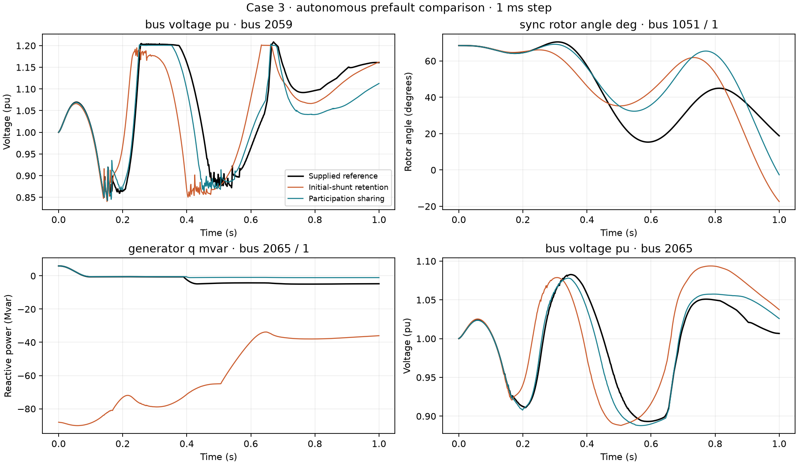

# Texas2k generator and shunt reactive sharing

The full-system references exposed a power-flow initialization discrepancy that
bus-voltage agreement had concealed. In Case 3, the largest cold voltage
difference was only 0.00000453 pu, but generator 2065/1 started at −88.0895 Mvar
instead of the supplied +5.9552 Mvar. Its continuous shunt compensated for the
difference, leaving nearly identical bus voltages.

The reference manual's AC voltage-control section specifies reactive sharing
between voltage controllers in proportion to their participation factors,
subject to each device's limits. A generating plant is one participant; its
individual machines subsequently share the plant output while respecting their
own reactive limits. Exact manual provenance is retained in private evidence.

The benchmark fixture now offers `ReactiveAllocation.PARTICIPATION_FACTORS`.
The generator still determines the group's voltage target. The allocation uses
the original participation factors and the solved total reactive requirement;
the shunt's limits are converted from susceptance to reactive power using the
solved voltage. The existing initial-shunt-retention policy remains separately
selectable.

## Independent static comparison

The prediction uses the existing locally solved network, original input
participation factors and physical limits. Supplied generator measurements are
used only to evaluate the prediction. No reference voltage, power, state or
trajectory is substituted into the calculation.

| Case | Largest initial generator-Q error before (Mvar) | After participation allocation (Mvar) |
| --- | ---: | ---: |
| 1 | 0.000789 | 0.000789 |
| 2 | 0.003578 | 0.003578 |
| 3 | 94.044834 | 0.000954 |
| 4 | 98.258003 | 0.000598 |
| 5 | 94.161525 | 0.001459 |
| 6 | 98.297740 | 0.000604 |

All 53 generator-Q discrepancies above 0.1 Mvar in Cases 3–6 disappear in
this static calculation. Bus voltages, bus angles, loads and generator active
powers are preserved, and each group's reactive balance is checked. Converted
dynamic operating points are then recalculated with the retained conversion
algorithm; this table describes the static allocation before that conversion.

The full Case 3 power-balance audit also supports retaining the confirmed
current-P/impedance-Q conversion for the two unmodeled units. During the
prefault period, the resulting maximum residual is 0.02205 MVA at bus 5045
and 0.00359 MVA at bus 7099. The constant-P/Q alternative gives 9.38618 MVA
and 0.63674 MVA respectively. This is an offline accounting check; the
alternative is not applied to a trajectory.

## Coupled Case 3 comparison

Two autonomous runs use the same original inputs, 1 ms integration, two cold
history steps, load model, controller implementation and numerical solver.
They differ only in reactive allocation and its consistently recomputed
conversion. The comparison covers every matched physical channel: 2,000 bus
voltages, 2,000 bus angles, 623 generator P/Q pairs and four quantities for each
of 333 synchronous machines. Four additional supplied P/Q channels belong to
the two netted units and are identically zero.

| One-second prefault metric | Initial-shunt retention | Participation sharing |
| --- | ---: | ---: |
| Largest voltage error (pu) | 0.301593 | 0.237116 |
| Worst voltage NRMAE | 0.276146 | 0.236324 |
| Largest rotor-angle error (degrees), unit 1051/1 | 36.168956 | 26.698147 |
| Voltage channels below 0.001 NRMAE | 0 / 2,000 | 0 / 2,000 |
| Rotor channels below 0.02 degrees | 0 / 333 | 0 / 333 |

Voltage NRMAE uses each channel's full ten-second supplied range. The
one-second comparison uses 1,001 shared nonnegative samples, with no fitted
offset, interpolation or time shift. Cold history is retained separately.
These results improve the discrepancy but do **not** meet the dynamic gates.
Neither ten-second rotor acceptance nor postfault acceptance is established.
Direct bus-frequency channels remain unavailable.

The raw supplied measurements exhibit prefault oscillations too. Their
presence alone is therefore not an initialization-failure test. Subsequent
diagnosis must compare the measured boundary signals and controller responses
after correcting the proven initial reactive allocation.

## Verification and retained evidence

- All 24 focused fixture tests pass, including unequal participation, plant
  and shunt saturation, fixed-Q machines, invalid participation and the
  existing allocation policy.
- An independent verifier checks the paired input/runtime hashes, recomputes
  the reported extreme-channel errors, and confirms that the unchanged run's
  complete cold physical row matches the retained runtime byte for byte.
- The six downloaded references contain 10,005 finite rows each. Their
  supplied file hashes and split-file continuity are verified. Duplicate
  fault-side samples are preserved; the supplied `event_active` flag does not
  correctly label two boundary rows, so comparison uses timestamp/event-side
  order.
- The private artifact set `2026-10-20-generator-shunt-reactive-sharing`
  retains source snapshots, reports, focused-test evidence, plots and hashed
  dependencies for the paired runs and original compressed references.

At the October 20 checkpoint, the new option was a benchmark fixture capability. Default integration,
the remaining dynamic discrepancy, the full original event matrix, direct
frequency acceptance and the runtime target remain open.

## Default preparation and capability tracking, October 22

The shared `Texas2kPowerflowPreparation` path now explicitly selects participation
allocation. The earlier capability was present but the default still retained the
initial shunt. This reproduced bus voltage while giving several renewable units
the wrong initial Q. The generator continues to determine the voltage target;
allocation uses the imported participation factors and physical device bounds.
The explicit initial-shunt-retention option remains available for diagnostics.
Status output now records `reactive_allocation=PARTICIPATION_FACTORS`.

All six cases were checked with the current preparation, 0.001 pu load-flow
tolerance, quarter-cycle network steps and 1e-5 dynamic voltage tolerance. The
table compares the first cold physical row with the supplied references. It is
not a ten-second trajectory comparison.

| Case | Previous maximum generator-Q error (Mvar) | Current maximum generator-Q error (Mvar) | Current maximum bus-voltage error (pu) |
| --- | ---: | ---: | ---: |
| 1 | 0.00116043 | 0.00116043 | 1.57356e-7 |
| 2 | 0.00367427 | 0.00367427 | 1.42145e-5 |
| 3 | 94.04488 | 0.00936052 | 1.13015e-5 |
| 4 | 98.25800 | 0.00351694 | 4.95852e-6 |
| 5 | Preparation failed | 0.147939 | 1.59421e-4 |
| 6 | 98.29774 | 6.42137 | 5.40583e-6 |

Cases 1 and 2 retain byte-identical short-run recordings. Case 6's remaining
largest P/Q errors are on unit-99 channels: 10 MW at bus 1016 and 6.42137 Mvar
at bus 1078. These are separate unresolved discrepancies, not evidence against
the removed generator/shunt allocation error. Case 5's initial rotor error is
0.00504456 degrees, above the prefault maximum-error target.

Case 5 also exposed a repeated-solve defect. Bus 1033 was held at an aggregate
Q limit of 1.0921 pu. After voltage changed, the physical generator-plus-shunt
maximum became 1.08375779 pu, but the fixed-Q injection stayed at 1.0921 pu.
Updating the limit alone let each previous-solution solve return to the same
zero-mismatch electrical point. Preparation repeated 50 times and failed.

The temporary aggregate injection now follows its binding voltage-dependent
limit, including the contributing-machine value used to rebuild bus injections.
Settlement also checks an expanding capability: an old bound cannot become an
accepted interior allocation while its voltage target remains unmet. A residual
within the requested load-flow tolerance may be projected onto the final physical
bound; the device limits themselves remain exact. Independent capacitor and
reactor tests verify both directions at 1e-3 and 1e-9 pu tolerances.

Case 5 now completes preparation in two solves, followed by a zero-update
post-netting solve. The existing `loadflow_before_netting_iterations` status field
reports only the last solve's two iterations; it is not a total across the two
solves. No aggregate iteration-count claim is made here.

All 40 focused preparation tests pass. The two default-allocation regressions
fail with the previous default, and both new bound-tracking regressions fail
without the capability fix. The final six-case probes retain the earlier
integration settings, including the isolated four-renewable-substep diagnostic
for Case 3. Cases 1–3 complete the 0.1-second prefix; Cases 4, 5 and 6 fail at
0.0458333, 0.0333333 and 0.05 seconds respectively. Full dynamic acceptance and
the eight-second warmed runtime goal remain open. The existing full-reactor
compilation limitations were not rechecked in this focused run.

These changes are in the shared benchmark preparation helper, not a new default
for every core load-flow caller. The
[evidence index](checkpoints/default-reactive-sharing-preparation-2026-10-22.json)
retains the source, tests, manual provenance, six-case reports and output hashes.
