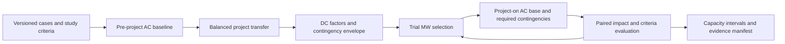

# Transmission interconnection hosting capacity: research and implementation plan

Status: design proposal, 2026-11-05. Scope: a **steady-state, incremental MW capability** at a specified point of interconnection (POI), for generation or load, without modeled network upgrades. The output is conditional on named network cases, dispatch, contingencies, ratings, voltage criteria, and controls. It is a study aid, not an interconnection approval, a queue allocation, or proof that short-circuit, protection, dynamics, or stability requirements are met.

## 1. Evidence and interpretation

| Primary source | What it establishes | Design implication |
|---|---|---|
| [NERC FAC-002-4 facility interconnection studies](https://www.nerc.com/globalassets/standards/reliability-standards/fac/fac-002-4.pdf) and [NERC standard status](https://www.nerc.com/standards/reliability-standards/fac) | Interconnection impact studies cover generation and electricity end-user facilities; they document assumptions, performance, alternatives, and coordinated recommendations. Steady-state, short-circuit, and dynamics studies are used as necessary under normal and contingency conditions. The status page lists FAC-002-4 as mandatory as of this plan. | Label this tool's result as a steady-state component. Preserve a reviewable study manifest and identify additional studies needed. Do not hard-code a generic limit as a compliance criterion. |
| [NERC TPL-001-5.1](https://www.nerc.com/globalassets/standards/reliability-standards/tpl/tpl-001-5.1.pdf) | Planning assessments distinguish normal conditions and multiple event categories, with category-specific performance requirements. | Require an explicit, jurisdiction-specific contingency set and criteria profile. `N-1` alone is not a universal complete scope. |
| [MISO generator interconnection study page](https://www.misoenergy.org/planning/resource-utilization/GI_Studies/) and [MISO public system impact study](https://cdn.misoenergy.org/GI-DPP-2021-West_Phase-1_SIS-Study-Results_FINAL_20230905%20-%20PUBLIC630260.pdf) | MISO's published example compares benchmark and study cases for summer peak and shoulder conditions, uses full AC contingency analysis to identify thermal and voltage issues, and tests proposed upgrades. Storage charging and discharging can be distinct conditions. | Pair pre-project and post-project cases for every scenario; run both directions for storage when applicable; record the limiting case rather than one system-wide number without context. |
| [Siemens advanced linear analysis module](https://assets.ctfassets.net/17si5cpawjzf/OHPcMt2BvisTNeV2H12C5/1584bb8059abb79ecd47f64e483988b7/pss-e-adv-lin-analysis-module-datasheet-EN-v1.pdf) and [Siemens transmission planning overview](https://www.siemens.com/en-us/products/pss-software/gridscale-x-pss-e/) | PSSE offers linear distribution factors and first-contingency incremental transfer capability across bus groups, batch scenarios, and AC power flow/contingency studies. This describes product capabilities, not a universal utility procedure. | Model the proposed MW change as a specified source/sink transfer; use DC factors to produce a fast candidate limit and ranking, then validate with AC. |
| [PowerGEM TARA product brief](https://www.power-gem.com/static/TARA.pdf) | TARA combines input validation, linear and nonlinear power flow, N-1/N-1-1 contingency analysis, DFAX/LODF, thermal and voltage transfer limits, preventive redispatch, and region-specific deliverability applications. Product material does not specify one mandatory capacity algorithm. | Treat thermal, voltage, dispatch, and deliverability assumptions as separately configurable. Keep scenario and contingency evidence attached to each limit. |
| [MISO benchmark of SUGAR](https://cdn.misoenergy.org/MISO%20Benchmarking%20of%20Pearl%20Street%20SUGAR697461.pdf) | MISO benchmarked SUGAR against TARA using the same study inputs, comparing ERIS thermal, NRIS flowgates, and voltage constraints. One reported worst AC loading was missed by TARA's contingency screen; another discrepancy arose when AC verification was skipped above a DC loading threshold. MISO accepted SUGAR for its Phase 1 process while retaining other tools later. | A DC screen must not silently exclude required AC cases from a reported feasible point. Benchmark constraint identities and worst-case values, not only solver convergence. |
| [Pearl Street explanation of contingency analysis](https://pearlstreet.substack.com/p/contingency-analysis) and [Pearl Street transmission-provider product page](https://pearlstreettechnologies.com/transmission-providers/) | The vendor describes pre-project and post-project AC contingency comparisons; DC analysis accelerates selection and supports relative thermal impact attribution. SUGAR automates model building, dispatch, solving, constraint identification, and upgrade work in utility-specific workflows. These are vendor descriptions. | Preserve baseline violations and project incremental impact separately. Do not equate a capacity limit with network-upgrade selection or cost allocation. |
| [MISO SUGAR benchmark methodology](https://cdn.misoenergy.org/MISO%20Benchmarking%20of%20Pearl%20Street%20SUGAR697461.pdf) | MISO's comparison used matching cases, monitoring, contingency, and subsystem inputs. Its 98% constraint-overlap target was a **specific benchmark acceptance criterion**, and the published results were above 99% in the compared categories. | Make study input equality and missed-constraint review part of validation. Do not adopt MISO's 98% as a tolerance for this implementation. |
| [DOE hosting-capacity map guidance](https://www.energy.gov/cmei/vehicles/us-atlas-electric-distribution-system-hosting-capacity-maps) and [DOE integrated distribution planning report](https://www.energy.gov/oe/articles/integrated-distribution-planning-report-august-2016) | Distribution hosting-capacity maps are preliminary siting information, not site-specific answers; distribution studies also include voltage/power quality and protection constraints. | Keep this transmission, positive-sequence steady-state capability result distinct from feeder hosting capacity. Route feeder studies to the three-phase distribution workflow. |
| [ERCOT planning guide index](https://www.ercot.com/mktrules/guides/planning/current) and [ESIG/MISO/Pearl Street webinar Q&A](https://www.esig.energy/wp-content/uploads/2025/04/Questions-Webinar_Speeding_up_Interconnection_Studies_posting.pdf) | Large-load interconnection has its own utility/region processes. The webinar describes large-load use of the same broad model-build, dispatch, load-flow, constraint, and mitigation workflow as technically possible, but says the referenced SUGAR deployment was not then a utility large-load program. | Support load electrically, but never imply that generation queue rules or the cited SUGAR deployment define a load approval process. |

**Research conclusion.** The common, defensible workflow is: validate and solve multiple study cases; define project dispatch and balancing; establish pre-project performance; use fast DC sensitivity/contingency calculations to find likely thermal limits; run AC system-intact and contingency cases for project impacts; compare against entity-specific criteria and pre-project conditions; document limiting events and unresolved studies. The exact dispatch, event set, exclusion rules, and upgrade responsibility remain study-specific. The cited vendor sources support capabilities and examples, not a single universal hosting-capacity definition.



## 2. Proposed quantity and boundary

For a fixed POI, project model, scenario set, and criteria profile, define `x` as **incremental MW at the POI** relative to the study baseline. Report generation export and load import separately. For storage or flexible load, use distinct operating modes and a joint reported envelope if requested.

The proposed result is `max tested feasible x` within `[0, requestedUpperMw]`, at a declared search resolution, with all required AC checks passed at that `x`. A continuous global maximum is not asserted from finite trials. If monotonic feasibility is demonstrated over a bracket, report a narrower threshold interval; otherwise retain each sampled feasible interval and mark the maximum as resolution-limited. A limiting constraint means the first observed criterion boundary or the most restrictive validated case, with the exact definition stored in the result.

Two policy modes should be explicit:

1. `AC_DECISIVE` (default): DC predicts and prioritizes; AC determines whether a trial passes. A DC-only limit never caps the search because DC MW flow cannot establish AC MVA or voltage feasibility and can mis-rank events.
2. `DC_AND_AC_REQUIRED`: an entity may explicitly make a DC thermal criterion a study requirement. Report its limit separately and require both DC and AC to pass. This is a named study rule, not an implicit numerical shortcut.

Neither mode automatically awards deliverability, transmission service, or an upgrade-free interconnection. The output must disclose whether upgrade options, remedial actions, emergency redispatch, and existing violations were included.

## 3. Study contract

Add a package such as `org.interpss.plugin.hosting` in `ipss.plugin.core` with immutable definitions and results. Use Java 21 records for the external contract and small service interfaces for solver stages.

```java
public interface HostingCapacityRunner {
    HostingCapacityResult run(AclfNetwork network, HostingCapacityStudyDefinition study);
}

public record HostingCapacityStudyDefinition(
    int schemaVersion,
    String studyId,
    String poiBusId,
    ProjectMode mode,                 // GENERATION_EXPORT or LOAD_IMPORT
    ProjectInjectionModel project,   // P/Q schedule, limits, voltage control
    List<StudyScenario> scenarios,   // case identity and project baseline
    BalancePolicy balance,           // explicit participating devices/weights
    List<ContingencyDefinition> contingencies,
    CriteriaProfile criteria,        // normal/emergency ratings and voltage rules
    ExistingViolationPolicy existingViolations,
    SearchOptions search,
    ValidationMode validationMode) {}

public record HostingCapacityResult(
    StudyManifest manifest,
    List<ScenarioCapacityResult> scenarioResults,
    double aggregatedTestedFeasibleMw,
    List<CapacityInterval> testedIntervals,
    List<ConstraintEvidence> bindingAndNearBinding,
    List<StudyDiagnostic> diagnostics,
    ResultStatus status) {}
```

Contract requirements:

- `StudyScenario` identifies a solved network snapshot, load and generation dispatch, topology, queue inclusion, and any seasonal or charging mode. The runner must not create a scenario from a verbal label alone. Aggregate capacity across scenarios is the minimum **only when** all scenarios passed the same study requirements; retain every scenario result.
- `ProjectInjectionModel` describes an existing or synthetic project at the POI. The first version may attach to an existing bus and model fixed power factor or a bounded `Q(P)` schedule; it must reject unsupported remote-voltage controls and unsupported topology instead of silently simplifying them. Specify gross versus net POI MW and station load/loss treatment.
- `BalancePolicy` supplies named source/sink machines, participation factors, dispatch bounds, and loss treatment. No implicit slack fallback. A load trial increases POI demand and dispatches the specified generation; a generation trial raises POI output and reduces specified generation or increases named demand. Enforce active-power balance and record actual changes.
- `BalancePolicy` must identify its dispatch basis: `PRESCRIBED_PARTICIPATION`, `UTILITY_STUDY_RULE`, or `ECONOMIC_SCENARIO`. The economic option requires an explicit cost/commitment model, fuel and availability assumptions, interchange and reserve limits, and a named optimization objective; it is never inferred from the AC solver's slack response. Multiple credible dispatch policies may be separate study scenarios, with the worst feasible capacity retained.
- `CriteriaProfile` maps each monitor and event category to a rating or voltage limit, with units, source, scope, inclusion/exclusion, and threshold tolerance. Normal and emergency ratings are separate. Missing/nonpositive ratings are `UNASSESSED`, never silently unlimited; require an explicit allowlist to omit a monitor. Include both ends of branch MVA where relevant, bus voltage, and optional interface/angle criteria.
- `ExistingViolationPolicy` chooses `STRICT_ALL_PASS` or a documented incremental-impact rule. For the latter, retain both pre- and post-project values for the same scenario/contingency/monitor and a user-provided worsening tolerance. A pre-existing violation is never silently ignored.
- Every event carries an ID, action list, category, applicable monitors, special controls, and whether it is mandatory. Unsupported actions, islands, and unserved load need a recorded disposition; no default `pass` on non-convergence or skipped analysis.
- `SearchOptions` states upper bound, coarse step, local refinement tolerance, maximum AC solves, numerical tolerances, and cancellation. Budget exhaustion returns `INCOMPLETE` with tested points; it does not claim capacity.
- `StudyManifest` includes a hash of the network and all study inputs, software/source revision, units, control settings, solver tolerances, scenario and event IDs, exclusions, run completion, and per-stage diagnostics. Store a per-trial evidence row keyed by `(scenario, x, event, monitor, criterion)`.

## 4. Calculation design

### 4.1 Preparation and pre-project baseline

1. Validate topology, POI, project P/Q capability, ratings, monitor coverage, contingencies, and balancing headroom. A candidate above dispatch headroom is a dispatch limit, not a thermal limit.
2. Snapshot the supplied network. Solve each scenario's pre-project AC base case using the configured controls. Compare a supplied solved state against a fresh solve to reveal model or setting changes. Fail the scenario on an unresolved base-case failure; do not replace it with a DC case.
3. Apply every mandatory AC contingency to the pre-project case and record thermal, voltage, unserved load, islanding, and convergence outcomes. This is needed to support incremental-impact rules. Store normal-condition and event-specific results separately.
4. Create the project-at-zero baseline on the same network assumptions. A different topology or control setting between benchmark and trial must be explicit and hashed.

### 4.1a Dispatch before sensitivity and AC checks

At each trial `x`, first construct a physically balanced **pre-contingency** dispatch. For generation export, add `+x` MW at the POI and remove the corresponding MW from named existing generators, raise named demand, or change interchange according to the study rule. For load import, add `-x` MW at the POI and raise named supply or imports. The participating generators need not be nearby: physical proximity does not determine which units change output. Check each unit's `Pmin/Pmax`, status, ramps if relevant, and reactive/voltage role. If a local generator shuts down rather than merely reducing MW, represent that as a different discrete scenario because its voltage support also changes.

Use this same dispatch in the DC transfer and AC project-on base case; the AC solve may require a small additional loss-balancing adjustment, which must be recorded. Do not let the swing bus absorb hundreds of unreported MW. After a contingency, apply only the corrective redispatch or remedial action allowed by that event's criteria; this is distinct from the pre-contingency balancing dispatch.

Economic dispatch is optional. It is appropriate when the study question concerns plausible market operations or when the utility's adopted method calls for it. A cost-minimizing redispatch can relieve a thermal overload and thus materially change the answer; it cannot be silently used to raise an upgrade-free capacity. MISO's [published model-building example](https://pearlstreettechnologies.com/wp-content/uploads/2023/08/SUGAR_MISO_Ulteig_CaseStudy.pdf) describes a prescribed regional reduction of existing generation proportional to `Pmax`, rather than a generic economic optimum. TARA [describes](https://www.power-gem.com/static/TARA.pdf) economic dispatch and minimum-change security redispatch as distinct optional analyses. An [ERCOT large-load example](https://www.ercot.com/files/docs/2025/07/28/EIR_Status_Update_Oncor_Southern_DFW_Load_Interconnection_Project_RPG_July_2025.pdf) documents its particular generation and load balancing assumptions. These examples support a configurable dispatch stage, not one universal dispatch rule.

### 4.2 DC sensitivity and contingency estimate

For a linear region with fixed participation, let `f(s,c,m,0)` be signed baseline DC MW on monitored branch `m` in scenario `s` and contingency `c`. Let `h(s,c,m)` be MW flow change per MW of project transfer. Then

`f(s,c,m,x) = f(s,c,m,0) + h(s,c,m) x`.

For an N-1 branch outage `o`, a candidate fast path is `h_post(m) = PTDF_transfer(m) + LODF(m,o) PTDF_transfer(o)`, when the outage factors are defined and the dispatch model is unchanged. Multi-action, singular, or islanding cases require the existing exact/topology replay path or an explicit `UNASSESSED_DC` status. Never apply an N-1 formula to an unsupported event. DC signed MW is a thermal **indicator**, not an AC MVA result.

For each signed limit `-L <= f(x) <= L`, intersect the resulting interval in `x >= 0` with `[0, requestedUpperMw]`. Handle `h = 0`, reverse flow, already exceeded limits, and separate normal/emergency limits. Preserve the full interval; a single `(L-|f0|)/|h|` shortcut is wrong when flow reverses or a baseline is already outside the limit. Rank contingencies and monitors by minimum margin and project impact. If dispatch reaches a machine bound, split the transfer into a new participation segment and recompute sensitivities on the changed dispatch.

For example, `f0 = 90 MW`, `h = -0.5`, and `L = 100 MW` yield `-100 <= 90 - 0.5x <= 100`, so the DC thermal interval is `0 <= x <= 380 MW` (before other criteria). A margin divided by `|h|` would incorrectly suggest `20 MW` because the initial transfer relieves the flow before reversing it.

Compare this estimate against a direct DC contingency solve at selected trial points, including the predicted boundary, a reverse-flow case, and every unusual topology route. Use full retention of the rows that establish the limit. A top-K or thresholded sensitivity export is unsuitable for proving a maximum.

### 4.3 AC validation and capacity search

At each trial MW, build a fresh project-on scenario snapshot, apply the same balancing rule with limits and loss allocation, and solve the AC system-intact case. Then solve required AC contingencies using snapshot isolation. On a **passing** trial, all mandatory events and monitors must have evaluated successfully. On a failing trial, an early stop may save work, but the last passing point and the reported boundary require complete evidence.

Begin trials at zero, the user upper bound, and DC-predicted critical levels. Add a coarse grid covering the complete requested interval; refine every pass/fail transition to the MW tolerance. Do not assume feasibility is monotone when Q limits, taps, switched shunts, redispatch bounds, or remedial controls switch. If the AC solve budget prevents full coverage, return a lower bound and `INCOMPLETE`. An optional fast bisection mode may be exposed only with an explicit monotonicity assumption and a visible qualification flag.

Evaluate AC branch loading from complex power at both terminals against the rating appropriate to that event, voltage magnitude against per-bus limits, and any configured voltage-deviation or interface rules. Keep convergence separate from criterion satisfaction: `NOT_CONVERGED` means indeterminate until reviewed or a documented policy classifies it. Record solver termination, reactive limit transitions, control actions, islanding, and unmet dispatch. A repeated solve or alternative initialization may diagnose numerical failure, but cannot silently turn it into a pass.

Bound concurrency by available memory as well as CPU. Cache read-only DC panels only while topology and participation remain identical; do not cache a changed operating point under the old fingerprint. Stream per-trial measurements and retain compact limiting evidence rather than accumulating solved full-network snapshots. Reuse a snapshot only within one isolated trial; no worker may mutate the supplied network or another worker's trial. A cancelled worker must finish cleanup before the manifest is finalized.

### 4.4 Result interpretation

The result should show: generation/load direction; POI and scenario; tested feasible MW; bracket or sampled intervals; DC estimated MW; governing AC event and monitor; pre-project and project-on measurements; applicable limits; dispatch and Q at the tested point; every exclusion; incomplete or indeterminate cases; and studies outside scope. Include a machine-readable result plus a concise report table. If the upper bound passes, report `AT_LEAST_UPPER_BOUND`, not an invented maximum.

## 5. Repository integration

| Existing component | Proposed use or gap |
|---|---|
| `org.interpss.plugin.sensitivity.DcSensitivityStudyDefinition` and `DefaultDcSensitivityRunner` | Reuse endpoint, participation, PTDF, LODF, multi-outage concepts. The runner's result retention options can omit a critical row, so the capacity solver needs direct full-factor access or a capacity-specific sink. Do not turn the sensitivity package into a study-policy package. |
| Core `DclfSensitivityAnalyzer` and `ParallelDclfContingencyAnalyzer` | Compute reusable transfer panels and actual contingency flows. The latter has definition routing and topology replay; capture statuses and exact baseline/post-project values. |
| `DclfContingencyPreScreenUtil` | Diagnose islanding and singular cases before choosing a DC route. Preserve the classification in the manifest. |
| `BranchRatingFileUtil` | Import configured ratings, but require explicit normal/emergency mapping and monitor coverage validation. |
| `ContingencyDefinitionAdapter` and `AclfContingencyDefinitionHelper` | Resolve named action lists consistently for DC and AC; flag actions one engine cannot represent. |
| Core `AclfContingencyCaseSolver` | Reuse isolated outage/dispatch/AC solves and the solved network for measurement. Verify that its dispatch semantics match the study's pre-contingency transfer and post-contingency response rules. |
| Plugin `ParallelAclfContingencyAnalyzer` | Do **not** use its current `totalCases` interface as the certification engine: it chooses the first N branches and returns only convergence. A capacity-specific evaluator must take explicit events and collect MVA/voltage evidence. |

Keep the new study in `ipss.plugin.core`. Do not add an `ipss.plugin.core` dependency on the desktop application's contingency service; reproduce only the needed measurement logic or extract a shared core measurement helper after review. Keep static network data separate from dynamic-simulation Y-matrix contributions.

## 6. Implementation sequence and review gates

1. **Contract and audit trail.** Add immutable input/result records, JSON schema/version handling, criteria validation, network/input fingerprints, and deterministic IDs. Gate: invalid/missing ratings, POI, participation, or unsupported controls produce explicit diagnostics; source network is unchanged.
2. **Balanced transfer and DC base case.** Apply signed generation/load MW, fixed power factor or supported Q schedule, generator bounds, and explicit balance. Add exact interval arithmetic for signed branch limits. Gate: synthetic reverse-flow and pre-existing-violation examples agree with hand calculations and direct DC runs.
3. **DC contingency envelope.** Resolve named event definitions, calculate full factor panels, route multi-action/islanding cases to replay, and retain every binding candidate. Gate: analytical N-1 factors agree with direct contingency re-solves; no mandatory event silently disappears.
4. **AC baseline and event evaluator.** Run paired pre-project/project-on scenarios with explicit outages; collect both-terminal MVA, voltage, convergence, islanding, and dispatch evidence. Gate: a trial is `PASS` only if all mandatory checks completed; baseline comparison is reproducible.
5. **Capacity search.** Add coarse sweep, transition refinement, nonmonotonic interval reporting, budgets, cancellation, and upper-bound status. Gate: known nonmonotonic fixture does not produce a false continuous maximum; budget exhaustion returns `INCOMPLETE`.
6. **Cross-tool and utility review.** Use legally available benchmark cases and matching criteria files, compare case-by-case AC values and constraint identities with an independent study tool, investigate every missed severe constraint, and obtain utility engineer sign-off on scenario, event, rating, and baseline policies. MISO's published benchmark demonstrates the value of this process; its acceptance percentages are not adopted here. Gate: documented comparisons, discrepancies, and approved scope before any operational study claim.

Run targeted JUnit 5 tests in `ipss.test.plugin.core`. Include IEEE small cases with hand-checkable transfers, a multi-outage/islanding case, load and generation, reverse flow, dispatch exhaustion, differing normal/emergency ratings, pre-existing violations, AC reactive-limit and control changes, a DC-safe/AC-unsafe case, and non-convergence. Include two dispatch policies for the same project, a local generator reaching `Pmin` or shutting down, and a check that a large trial cannot be hidden in the swing-bus residual. Use `python tools/run_bounded.py --log target/<run>.log -- <command> ...` for long builds and bounded Java heaps. Run `python tools/check_neutral_benchmark_language.py` before delivery of new documentation or Java files.

## 7. Decisions a utility study owner must supply

Before treating a result as a project study, obtain: jurisdiction and service type; network model vintage and queue assumptions; seasonal/load/renewable/storage scenarios; generator and load P/Q models; source/sink participation and loss balancing; monitor/event list; normal/emergency ratings and voltage rules; treatment of pre-existing violations; allowed controls, curtailment, and remedial actions; search resolution; and which additional short-circuit, protection, dynamics, voltage-stability, or facilities studies are required. Record each as a versioned input, not an undocumented code default.

## 8. Source limitations

Product briefs describe capabilities and may not document a utility's actual parameterization. MISO's published SUGAR comparison is one Phase 1 dataset and does not establish a universal error bound or a transferable approval threshold. The public sources above do not publish a complete, common algorithm for continuous hosting-capacity maximization. The numerical method in this plan is therefore an engineering proposal grounded in the documented workflow; it requires local model validation, criteria approval, and independent comparison before use in a utility decision.
